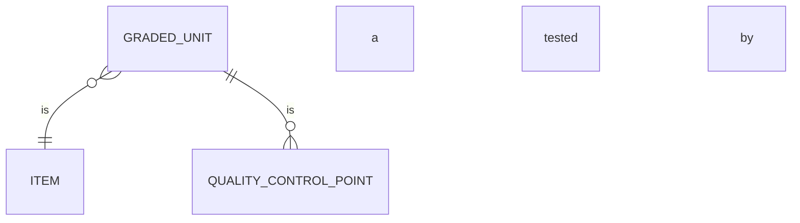
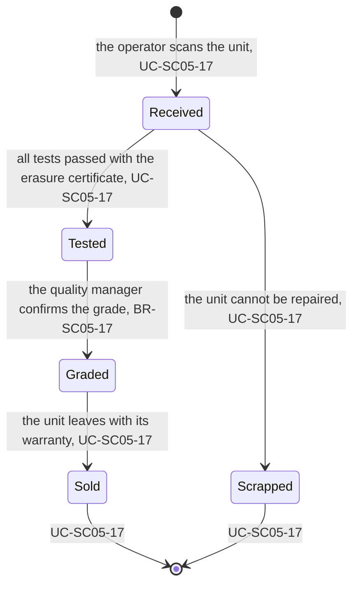

🏠 [Specs](../../../README.md) › 🏷️ [Sectors](../../README.md) › 🏭 [SC05 Manufacturing](../README.md) ›
🗃️ [Data](README.md) › 🗃️ E-SC05-16 Graded unit

# 🗃️ E-SC05-16 Graded unit

**Status:** ✅ specified

## Purpose

One used unit followed from reception to sale: its serial number, test results, parts used, erasure certificate and
confirmed grade ([D549](../../../06-decisions/sectors/d549-benchmark-gaps-sc05-manufacturing.md)). It is the serial
number of the stock ([E-F7-10](../../../02-functional/f07-purchasing-and-stock/data/e-f07-10-lot-or-serial.md)) with the
refurbishing record the grade needs.

## Fields

| Name | Type | Required | Validation | Default | Example | Personal data | Custom fields |
|---|---|---|---|---|---|---|---|
| serial number | text | yes | unique for the item | - | 358812 | no | no |
| item | item (E-F7-06) | yes | a refurbishable item | - | Phone, 128 GB | no | no |
| source | purchase, trade-in, customer return | yes | one of the three | purchase | trade-in | no | no |
| battery health | percent | no | 0 to 100 | - | 91 | no | no |
| erasure certificate | file | no | required before grading | - | erasure-358812.pdf | no | no |
| parts | list of items | no | items in stock | none | screen P-884 | no | no |
| grade | A, B, C | no | confirmed by the quality manager | - | B | no | no |
| warranty end | date | no | after the sale date | - | 2027-11-14 | no | no |
| tested by | user | no | a user of the company | - | Karim | no | no |
| state | Received, Tested, Graded, Sold, Scrapped | yes | the lifecycle below | Received | Tested | no | no |
| owner | user | yes | a user of the company | the creator | Claire P. | yes | no |

## Relations

- [E-F7-10](../../../02-functional/f07-purchasing-and-stock/data/e-f07-10-lot-or-serial.md)
- [E-F12-07](../../../02-functional/f12-manufacturing/data/e-f12-07-quality-control-point.md)
- [E-F6-27 Warranty](../../../02-functional/f06-customers-and-sales/data/e-f06-27-warranty.md)

## Lifecycle

## Indexes and search

By serial number, item, grade, state and tester.

## Retention

Kept for the warranty period plus one year, and the erasure certificate for three years.

## Audit

Every test, part, certificate and grade change, with who, when and the old and new value.

## Import and export

CSV import of the serial numbers of a received batch; export of the grades by batch.

## Used by

- [UC-SC05-17](../use-cases/06-excise-refurbishment-and-cutting/uc-sc05-17-refurbish-electronics.md)
- [UC-SC05-13](../use-cases/05-suppliers-and-customers/uc-sc05-13-qualify-staff-for-operations.md)

## Open questions

None.

---

⬅️ [E-SC05-15 Bonded stock](e-sc05-15-bonded-stock.md) · ⬆️ [Up](README.md) · ➡️ [E-SC05-17 Proof](e-sc05-17-proof.md)
