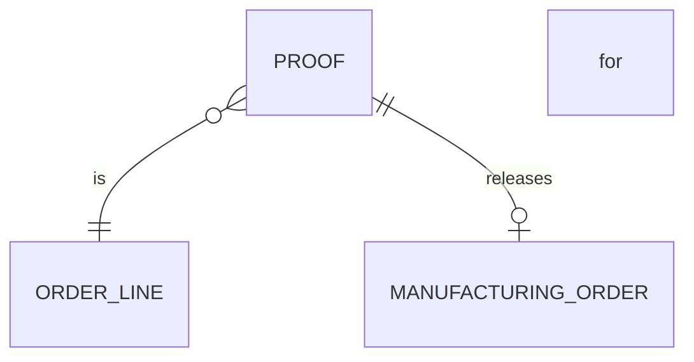
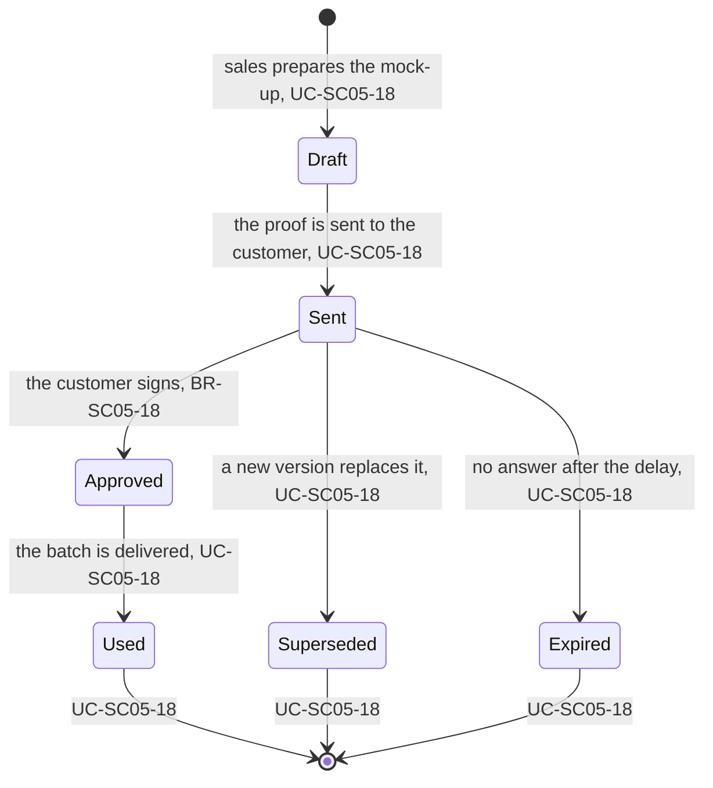

🏠 [Specs](../../../README.md) › 🏷️ [Sectors](../../README.md) › 🏭 [SC05 Manufacturing](../README.md) ›
🗃️ [Data](README.md) › 🗃️ E-SC05-17 Proof

# 🗃️ E-SC05-17 Proof

**Status:** ✅ specified

## Purpose

The proof of a personalised order line: the artwork, the zone and method, its versions and the customer's approval
([D549](../../../06-decisions/sectors/d549-benchmark-gaps-sc05-manufacturing.md)). It is the agreement to produce, not
the configured product ([E-SC05-03 Configuration rule](e-sc05-03-configuration-rule.md)) that lists the options.

## Fields

| Name | Type | Required | Validation | Default | Example | Personal data | Custom fields |
|---|---|---|---|---|---|---|---|
| order line | order line (E-F6-04) | yes | a line of an order | - | SO-2210 line 1 | no | no |
| artwork | file | yes | an accepted format above the minimum size | - | logo-roche.svg | no | no |
| zone | text | yes | a zone of the product | - | front | no | no |
| method | print, engraving, embroidery | yes | a method of the product | - | print | no | no |
| colours | number | yes | 1 to 8 | 1 | 2 | no | no |
| version | number | yes | 1 or more | 1 | 2 | no | no |
| answer | approved, changes asked | no | set by the customer | - | approved | no | no |
| approved on | date and time | no | set with the signature | - | 2026-11-05 10:12 | no | no |
| signature | e-signature | no | required to approve | - | Mia Roche | no | no |
| state | Draft, Sent, Approved, Superseded, Expired, Used | yes | the lifecycle below | Draft | Sent | no | no |
| owner | user | yes | a user of the company | the creator | Claire P. | yes | no |

## Relations

- [E-F6-04 Order](../../../02-functional/f06-customers-and-sales/data/e-f06-04-order.md)
- [E-F12-04](../../../02-functional/f12-manufacturing/data/e-f12-04-manufacturing-order.md)
- [E-SC05-03 Configuration rule](e-sc05-03-configuration-rule.md)

## Lifecycle

## Indexes and search

By order line, customer, state and approval date.

## Retention

Kept with the order for the warranty period plus five years, as the proof of the customer's acceptance.

## Audit

Every version, sending, answer, reminder and release, with who, when and the signature.

## Import and export

Export of the approved proof as a PDF for the workshop.

## Used by

- [UC-SC05-18](../use-cases/06-excise-refurbishment-and-cutting/uc-sc05-18-personalise-products-for-customers.md)
- [UC-F12-04](../../../02-functional/f12-manufacturing/use-cases/03-make-the-products/uc-f12-04-launch-and-follow-manufacturing-orders.md)

## Open questions

None.

---

⬅️ [E-SC05-16 Graded unit](e-sc05-16-graded-unit.md) · ⬆️ [Up](README.md) ·
➡️ [E-SC05-18 Remnant](e-sc05-18-remnant.md)
