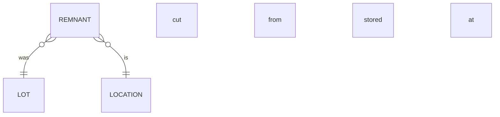
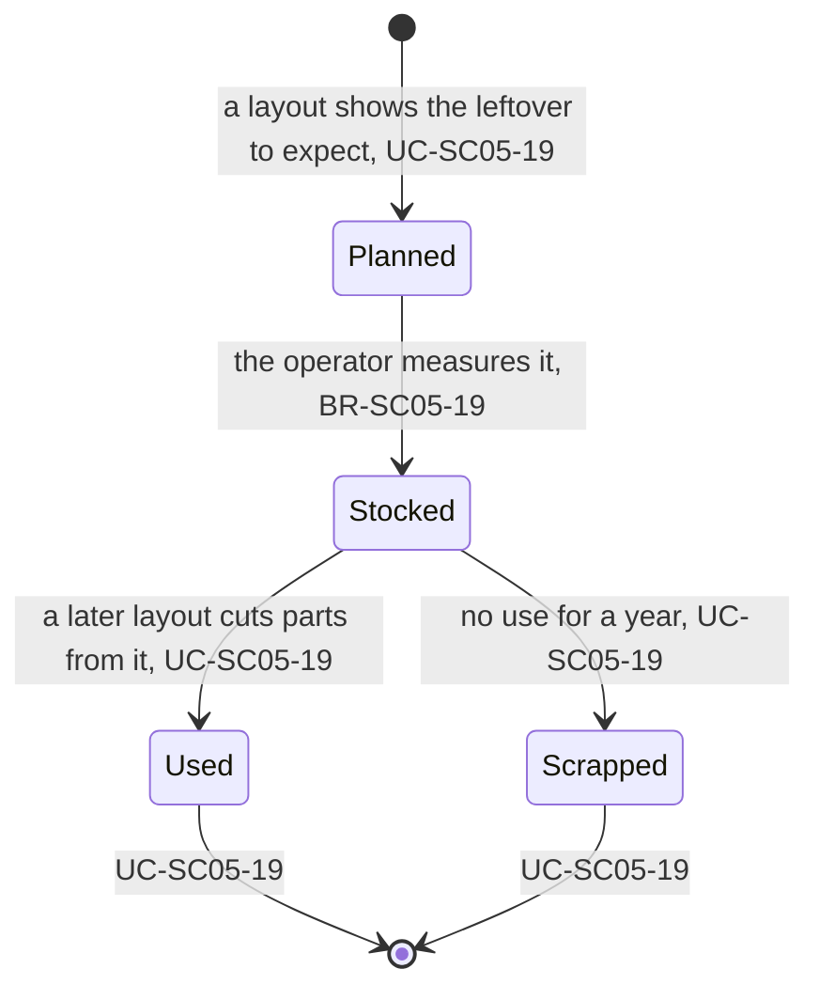

🏠 [Specs](../../../README.md) › 🏷️ [Sectors](../../README.md) › 🏭 [SC05 Manufacturing](../README.md) ›
🗃️ [Data](README.md) › 🗃️ E-SC05-18 Remnant

# 🗃️ E-SC05-18 Remnant

**Status:** ✅ specified

## Purpose

A usable leftover piece of material kept in stock after a cut, with its dimensions, cost and origin
([D549](../../../06-decisions/sectors/d549-benchmark-gaps-sc05-manufacturing.md)). It is a stock lot
([E-F7-10](../../../02-functional/f07-purchasing-and-stock/data/e-f07-10-lot-or-serial.md)) with the dimensions and the
certificate that the cutting needs.

## Fields

| Name | Type | Required | Validation | Default | Example | Personal data | Custom fields |
|---|---|---|---|---|---|---|---|
| source lot | lot (E-F7-10) | yes | the lot the piece was cut from | - | S-77 | no | no |
| item | item (E-F7-06) | yes | the material | - | Steel plate 6 mm | no | no |
| length | number in mm | yes | above the minimum size | - | 420 | no | no |
| width | number in mm | yes | above the minimum size | - | 300 | no | no |
| thickness | number in mm | yes | the source piece's thickness | from the source | 6 | no | no |
| certificate | file | no | the source piece's certificate | from the source | cert-S77.pdf | no | no |
| location | location (E-F7-07) | yes | a rack of the company | - | Rack C-4 | no | no |
| cost | amount in EUR | yes | the share of the source's cost | computed | 8.40 | no | no |
| created on | date | yes | not in the future | today | 2026-11-14 | no | no |
| state | Planned, Stocked, Used, Scrapped | yes | the lifecycle below | Planned | Stocked | no | no |
| owner | user | yes | a user of the company | the creator | Claire P. | yes | no |

## Relations

- [E-F7-10](../../../02-functional/f07-purchasing-and-stock/data/e-f07-10-lot-or-serial.md)
- [E-F7-07 Location](../../../02-functional/f07-purchasing-and-stock/data/e-f07-07-location.md)
- [E-F12-04](../../../02-functional/f12-manufacturing/data/e-f12-04-manufacturing-order.md)

## Lifecycle

## Indexes and search

By material, thickness, size, location and state.

## Retention

Kept with the stock movements of the lot for ten years, as accounting records
([CR-FR-002](../../../10-country-packs/france/accounting/cr-fr-002-accounting-records-kept-ten-years.md)).

## Audit

Every creation, use and scrap of a remnant, with the dimensions, the source and who and when.

## Import and export

Export of the remnants in stock as CSV for the purchasing team.

## Used by

- [UC-SC05-19](../use-cases/06-excise-refurbishment-and-cutting/uc-sc05-19-optimise-cutting-and-keep-remnants.md)
- [UC-SC05-05](../use-cases/02-made-to-order/uc-sc05-05-handle-customer-supplied-parts.md)

## Open questions

None.

---

⬅️ [E-SC05-17 Proof](e-sc05-17-proof.md) · ⬆️ [Up](README.md)
