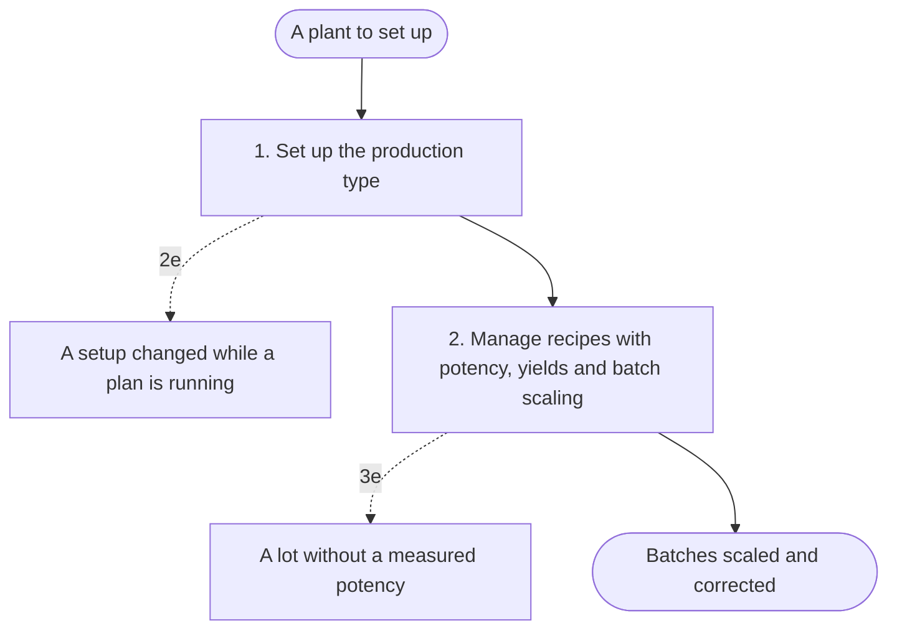

🏠 [Specs](../../../README.md) › 🏷️ [Sectors](../../README.md) › 🏭 [SC05 Manufacturing](../README.md) ›
🔀 [Flows](README.md) › 🔀 FL-SC05-01 Production setups

# 🔀 FL-SC05-01 Production setups

**Status:** ✅ specified

## Summary

How the plant produces: its production type and its recipes. It covers
[UC-SC05-01 Set up the production type](../use-cases/01-production-setups/uc-sc05-01-set-up-the-production-type.md),
[UC-SC05-02 Manage recipes with potency, yields and batch scaling](../use-cases/01-production-setups/uc-sc05-02-manage-recipes-with-potency-yields-and-batch-scaling.md).

## Personas

- [U07 Administrator](../../../01-users/personas/u07-administrator.md)
- [U20 Production operator](../../../01-users/personas/u20-production-operator.md)
- [U21 Production planner](../../../01-users/personas/u21-production-planner.md)

## Flowchart

## Sequence diagram

See each use case.

## Steps

| Step | Persona | Screen | Use case | What happens |
|---|---|---|---|---|
| 1 | U21, U07 | [S-SC05-01](../screens/01-production-setups/s-sc05-01-production-setup.md) | [UC-SC05-01](../use-cases/01-production-setups/uc-sc05-01-set-up-the-production-type.md) | The production planner and the administrator choose the plant's production type, discrete, batch or process, install its F12 setup and adjust it before planning starts |
| 2 | U21, U20 | [S-SC05-02](../screens/01-production-setups/s-sc05-02-recipes.md) | [UC-SC05-02](../use-cases/01-production-setups/uc-sc05-02-manage-recipes-with-potency-yields-and-batch-scaling.md) | The production planner writes batch recipes with the shared recipes capability and adds what the process plant needs |

### Entities and screens

| Entity | States in this flow | Shown at step and screen | Aggregated view |
|---|---|---|---|
| [E-SC05-01 Production setup](../data/e-sc05-01-production-setup.md) | Active | 1 [S-SC05-01](../screens/01-production-setups/s-sc05-01-production-setup.md) | Production setups |
| [E-F12-12 Master plan line](../../../02-functional/f12-manufacturing/data/e-f12-12-master-plan-line.md) | Recorded | Shown elsewhere: [S-F12-03 Master plan](../../../02-functional/f12-manufacturing/screens/02-plan-production/s-f12-03-master-plan.md) | Master plan lines |
| [E-F12-04 Manufacturing order](../../../02-functional/f12-manufacturing/data/e-f12-04-manufacturing-order.md) | Draft, Confirmed, Cancelled, In progress, Done | Shown elsewhere: [S-F12-04 Manufacturing order](../../../02-functional/f12-manufacturing/screens/03-make-the-products/s-f12-04-manufacturing-order.md) | Manufacturing orders |
| [E-F7-10 Lot or serial](../../../02-functional/f07-purchasing-and-stock/data/e-f07-10-lot-or-serial.md) | Active | Shown elsewhere: [S-F7-03 Receipt](../../../02-functional/f07-purchasing-and-stock/screens/02-receive-and-store/s-f07-03-receipt.md) | Lot or serials |
| [E-SC05-02 Batch recipe](../data/e-sc05-02-batch-recipe.md) | Active | 2 [S-SC05-02](../screens/01-production-setups/s-sc05-02-recipes.md) | Batch recipes |

## Errors

- [UC-SC05-01](../use-cases/01-production-setups/uc-sc05-01-set-up-the-production-type.md) 2e. A setup changed while a
  plan is running: the planner is warned and the change applies to new orders only.
- [UC-SC05-01](../use-cases/01-production-setups/uc-sc05-01-set-up-the-production-type.md) 2f. A required field missing
  in the configuration: the install stops and names it.
- [UC-SC05-02](../use-cases/01-production-setups/uc-sc05-02-manage-recipes-with-potency-yields-and-batch-scaling.md) 3e.
  A lot without a measured potency: the nominal potency is used and the batch flagged.
- [UC-SC05-02](../use-cases/01-production-setups/uc-sc05-02-manage-recipes-with-potency-yields-and-batch-scaling.md) 4e.
  A yield under the recipe's tolerance: a non-conformity is opened,
  [UC-F12-06](../../../02-functional/f12-manufacturing/use-cases/03-make-the-products/uc-f12-06-consume-components-trace-lots-and-serials.md).

## Images

Every step and error, for each persona taking part, in light and dark mode (D120). Steps are numbered as in the Steps
table; E rows are the error cases.

| Step | Persona | Device | Light | Dark |
|---|---|---|---|---|
| 1 | U07 | desktop | [light](../images/01-production-setups/u07-administrator/1-production-type-desktop-light.png) | [dark](../images/01-production-setups/u07-administrator/1-production-type-desktop-dark.png) |
| 1 | U21 | desktop | [light](../images/01-production-setups/u21-production-planner/1-production-type-desktop-light.png) | [dark](../images/01-production-setups/u21-production-planner/1-production-type-desktop-dark.png) |
| 1 | U21 | phone | [light](../images/01-production-setups/u21-production-planner/1-production-type-phone-light.png) | [dark](../images/01-production-setups/u21-production-planner/1-production-type-phone-dark.png) |
| 2 | U21 | desktop | [light](../images/01-production-setups/u21-production-planner/2-recipe-desktop-light.png) | [dark](../images/01-production-setups/u21-production-planner/2-recipe-desktop-dark.png) |
| 2 | U21 | phone | [light](../images/01-production-setups/u21-production-planner/2-recipe-phone-light.png) | [dark](../images/01-production-setups/u21-production-planner/2-recipe-phone-dark.png) |
| 2 | U20 | tablet | [light](../images/01-production-setups/u20-production-operator/2-recipe-tablet-light.png) | [dark](../images/01-production-setups/u20-production-operator/2-recipe-tablet-dark.png) |
| E1 | U21 | desktop | [light](../images/01-production-setups/u21-production-planner/e1-potency-missing-desktop-light.png) | [dark](../images/01-production-setups/u21-production-planner/e1-potency-missing-desktop-dark.png) |
| E1 | U21 | phone | [light](../images/01-production-setups/u21-production-planner/e1-potency-missing-phone-light.png) | [dark](../images/01-production-setups/u21-production-planner/e1-potency-missing-phone-dark.png) |

## Open questions

None.

---

⬆️ [Up](README.md) · ➡️ [FL-SC05-02 Made to order](fl-sc05-02-made-to-order.md)
