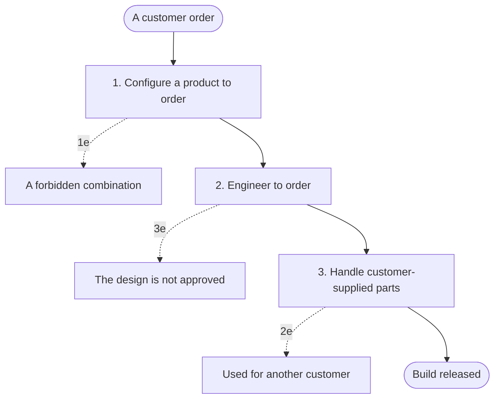

🏠 [Specs](../../../README.md) › 🏷️ [Sectors](../../README.md) › 🏭 [SC05 Manufacturing](../README.md) ›
🔀 [Flows](README.md) › 🔀 FL-SC05-02 Made to order

# 🔀 FL-SC05-02 Made to order

**Status:** ✅ specified

## Summary

Made to order: configured products, engineered designs, customer parts. It covers
[UC-SC05-03 Configure a product to order](../use-cases/02-made-to-order/uc-sc05-03-configure-a-product-to-order.md),
[UC-SC05-04 Engineer to order](../use-cases/02-made-to-order/uc-sc05-04-engineer-to-order.md),
[UC-SC05-05 Handle customer-supplied parts](../use-cases/02-made-to-order/uc-sc05-05-handle-customer-supplied-parts.md).

## Personas

- [U03 Sales](../../../01-users/personas/u03-sales.md)
- [U15 Warehouse operator](../../../01-users/personas/u15-warehouse-operator.md)
- [U21 Production planner](../../../01-users/personas/u21-production-planner.md)
- [U27 Quality manager](../../../01-users/personas/u27-quality-manager.md)

## Flowchart

## Sequence diagram

See each use case.

## Steps

| Step | Persona | Screen | Use case | What happens |
|---|---|---|---|---|
| 1 | U03, U21 | [S-SC05-03](../screens/02-made-to-order/s-sc05-03-configurator.md) | [UC-SC05-03](../use-cases/02-made-to-order/uc-sc05-03-configure-a-product-to-order.md) | Sales configures a product from its options in a quote, only valid combinations are offered, the order builds the bill of materials and routing of the chosen combination |
| 2 | U21, U27 | [S-SC05-04](../screens/02-made-to-order/s-sc05-04-engineer-to-order.md) | [UC-SC05-04](../use-cases/02-made-to-order/uc-sc05-04-engineer-to-order.md) | For a one-off project, the production planner designs its own bill of materials and routing, has them approved by quality, and releases them for production |
| 3 | U15, U21 | [S-SC05-05](../screens/02-made-to-order/s-sc05-05-customer-parts.md) | [UC-SC05-05](../use-cases/02-made-to-order/uc-sc05-05-handle-customer-supplied-parts.md) | The warehouse receives parts supplied by a customer, keeps them apart and unvalued, consumes them only for that customer's orders and returns the rest |

### Entities and screens

| Entity | States in this flow | Shown at step and screen | Aggregated view |
|---|---|---|---|
| [E-F6-04 Order](../../../02-functional/f06-customers-and-sales/data/e-f06-04-order.md) | Open, In progress, Cancelled, Done | Shown elsewhere: [S-F6-05 Order](../../../02-functional/f06-customers-and-sales/screens/02-quote-to-order/s-f06-05-order.md) | Orders |
| [E-F7-06 Item](../../../02-functional/f07-purchasing-and-stock/data/e-f07-06-item.md) | Active | Shown elsewhere: [S-F7-21 Stock levels](../../../02-functional/f07-purchasing-and-stock/screens/03-replenish/s-f07-21-stock-levels.md) | Items |
| [E-SC05-03 Configuration rule](../data/e-sc05-03-configuration-rule.md) | Active | 1 [S-SC05-03](../screens/02-made-to-order/s-sc05-03-configurator.md) | Configuration rules |
| [E-SC05-04 Engineered design](../data/e-sc05-04-engineered-design.md) | Active | 2 [S-SC05-04](../screens/02-made-to-order/s-sc05-04-engineer-to-order.md) | Engineered designs |
| [E-SC05-05 Customer-supplied part](../data/e-sc05-05-customer-supplied-part.md) | Active | 3 [S-SC05-05](../screens/02-made-to-order/s-sc05-05-customer-parts.md) | Customer-supplied parts |
| [E-F12-01 Bill of materials](../../../02-functional/f12-manufacturing/data/e-f12-01-bill-of-materials.md) | Approved | Shown elsewhere: [S-F12-01 Bill of materials](../../../02-functional/f12-manufacturing/screens/01-define-the-products/s-f12-01-bill-of-materials.md) | Bill of materials |

## Errors

- [UC-SC05-03](../use-cases/02-made-to-order/uc-sc05-03-configure-a-product-to-order.md) 1e. A forbidden combination: it
  is not offered, with the rule shown.
- [UC-SC05-03](../use-cases/02-made-to-order/uc-sc05-03-configure-a-product-to-order.md) 3e. A component out of stock:
  the build is proposed with a purchase.
- [UC-SC05-04](../use-cases/02-made-to-order/uc-sc05-04-engineer-to-order.md) 3e. The design is not approved: release is
  blocked.
- [UC-SC05-04](../use-cases/02-made-to-order/uc-sc05-04-engineer-to-order.md) 2e. A component without a cost: approval
  is refused until costed.
- [UC-SC05-05](../use-cases/02-made-to-order/uc-sc05-05-handle-customer-supplied-parts.md) 2e. Used for another
  customer: it is refused.
- [UC-SC05-05](../use-cases/02-made-to-order/uc-sc05-05-handle-customer-supplied-parts.md) 1e. More received than
  announced: the difference is recorded.

## Images

Every step and error, for each persona taking part, in light and dark mode (D120). Steps are numbered as in the Steps
table; E rows are the error cases.

| Step | Persona | Device | Light | Dark |
|---|---|---|---|---|
| 1 | U03 | desktop | [light](../images/02-made-to-order/u03-sales/1-configurator-desktop-light.png) | [dark](../images/02-made-to-order/u03-sales/1-configurator-desktop-dark.png) |
| 1 | U03 | phone | [light](../images/02-made-to-order/u03-sales/1-configurator-phone-light.png) | [dark](../images/02-made-to-order/u03-sales/1-configurator-phone-dark.png) |
| 1 | U03 | tablet | [light](../images/02-made-to-order/u03-sales/1-configurator-tablet-light.png) | [dark](../images/02-made-to-order/u03-sales/1-configurator-tablet-dark.png) |
| 1 | U21 | desktop | [light](../images/02-made-to-order/u21-production-planner/1-configurator-desktop-light.png) | [dark](../images/02-made-to-order/u21-production-planner/1-configurator-desktop-dark.png) |
| 1 | U21 | phone | [light](../images/02-made-to-order/u21-production-planner/1-configurator-phone-light.png) | [dark](../images/02-made-to-order/u21-production-planner/1-configurator-phone-dark.png) |
| 2 | U27 | desktop | [light](../images/02-made-to-order/u27-quality-manager/2-engineer-to-order-desktop-light.png) | [dark](../images/02-made-to-order/u27-quality-manager/2-engineer-to-order-desktop-dark.png) |
| 2 | U27 | tablet | [light](../images/02-made-to-order/u27-quality-manager/2-engineer-to-order-tablet-light.png) | [dark](../images/02-made-to-order/u27-quality-manager/2-engineer-to-order-tablet-dark.png) |
| 2 | U21 | desktop | [light](../images/02-made-to-order/u21-production-planner/2-engineer-to-order-desktop-light.png) | [dark](../images/02-made-to-order/u21-production-planner/2-engineer-to-order-desktop-dark.png) |
| 2 | U21 | phone | [light](../images/02-made-to-order/u21-production-planner/2-engineer-to-order-phone-light.png) | [dark](../images/02-made-to-order/u21-production-planner/2-engineer-to-order-phone-dark.png) |
| 3 | U15 | phone | [light](../images/02-made-to-order/u15-warehouse-operator/3-customer-parts-phone-light.png) | [dark](../images/02-made-to-order/u15-warehouse-operator/3-customer-parts-phone-dark.png) |
| 3 | U15 | tablet | [light](../images/02-made-to-order/u15-warehouse-operator/3-customer-parts-tablet-light.png) | [dark](../images/02-made-to-order/u15-warehouse-operator/3-customer-parts-tablet-dark.png) |
| 3 | U21 | desktop | [light](../images/02-made-to-order/u21-production-planner/3-customer-parts-desktop-light.png) | [dark](../images/02-made-to-order/u21-production-planner/3-customer-parts-desktop-dark.png) |
| 3 | U21 | phone | [light](../images/02-made-to-order/u21-production-planner/3-customer-parts-phone-light.png) | [dark](../images/02-made-to-order/u21-production-planner/3-customer-parts-phone-dark.png) |
| E1 | U21 | desktop | [light](../images/02-made-to-order/u21-production-planner/e1-design-not-approved-desktop-light.png) | [dark](../images/02-made-to-order/u21-production-planner/e1-design-not-approved-desktop-dark.png) |
| E1 | U21 | phone | [light](../images/02-made-to-order/u21-production-planner/e1-design-not-approved-phone-light.png) | [dark](../images/02-made-to-order/u21-production-planner/e1-design-not-approved-phone-dark.png) |

## Open questions

None.

---

⬅️ [FL-SC05-01 Production setups](fl-sc05-01-production-setups.md) · ⬆️ [Up](README.md) ·
➡️ [FL-SC05-03 Packaging](fl-sc05-03-packaging.md)
