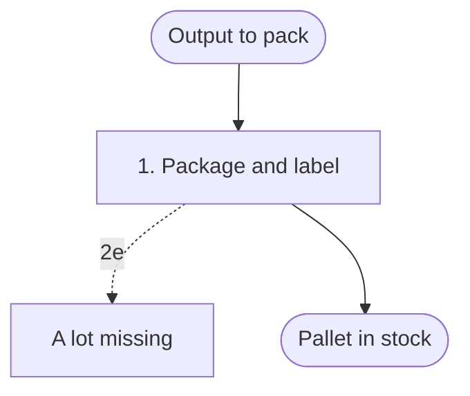

🏠 [Specs](../../../README.md) › 🏷️ [Sectors](../../README.md) › 🏭 [SC05 Manufacturing](../README.md) ›
🔀 [Flows](README.md) › 🔀 FL-SC05-03 Packaging

# 🔀 FL-SC05-03 Packaging

**Status:** ✅ specified

## Summary

Packaging with traceable labels. It covers
[UC-SC05-06 Package and label](../use-cases/03-packaging/uc-sc05-06-package-and-label.md).

## Personas

- [U15 Warehouse operator](../../../01-users/personas/u15-warehouse-operator.md)
- [U20 Production operator](../../../01-users/personas/u20-production-operator.md)

## Flowchart

## Sequence diagram

See each use case.

## Steps

| Step | Persona | Screen | Use case | What happens |
|---|---|---|---|---|
| 1 | U20, U15 | [S-SC05-06](../screens/03-packaging/s-sc05-06-labels.md) | [UC-SC05-06](../use-cases/03-packaging/uc-sc05-06-package-and-label.md) | The production operator packs the output, prints unit, case and pallet labels with barcode, lot and dates, and closes the pallet for the warehouse |

### Entities and screens

| Entity | States in this flow | Shown at step and screen | Aggregated view |
|---|---|---|---|
| [E-SC05-06 Label template](../data/e-sc05-06-label-template.md) | Active | 1 [S-SC05-06](../screens/03-packaging/s-sc05-06-labels.md) | Label templates |
| [E-F7-10 Lot or serial](../../../02-functional/f07-purchasing-and-stock/data/e-f07-10-lot-or-serial.md) | Active | Shown elsewhere: [S-F7-03 Receipt](../../../02-functional/f07-purchasing-and-stock/screens/02-receive-and-store/s-f07-03-receipt.md) | Lot or serials |
| [E-SC15-14 Pallet](../../sc15-wholesale-and-distribution/data/e-sc15-14-pallet.md) | Active | 1 [S-SC05-06](../screens/03-packaging/s-sc05-06-labels.md) | Pallets |
| [E-F7-06 Item](../../../02-functional/f07-purchasing-and-stock/data/e-f07-06-item.md) | Active | Shown elsewhere: [S-F7-21 Stock levels](../../../02-functional/f07-purchasing-and-stock/screens/03-replenish/s-f07-21-stock-levels.md) | Items |

## Errors

- [UC-SC05-06](../use-cases/03-packaging/uc-sc05-06-package-and-label.md) 2e. A lot missing: printing is refused.
- [UC-SC05-06](../use-cases/03-packaging/uc-sc05-06-package-and-label.md) 2f. The printer is offline: labels wait and
  the operator is told.

## Images

Every step and error, for each persona taking part, in light and dark mode (D120). Steps are numbered as in the Steps
table; E rows are the error cases.

| Step | Persona | Device | Light | Dark |
|---|---|---|---|---|
| 1 | U20 | tablet | [light](../images/03-packaging/u20-production-operator/1-labels-tablet-light.png) | [dark](../images/03-packaging/u20-production-operator/1-labels-tablet-dark.png) |
| 1 | U15 | phone | [light](../images/03-packaging/u15-warehouse-operator/1-labels-phone-light.png) | [dark](../images/03-packaging/u15-warehouse-operator/1-labels-phone-dark.png) |
| 1 | U15 | tablet | [light](../images/03-packaging/u15-warehouse-operator/1-labels-tablet-light.png) | [dark](../images/03-packaging/u15-warehouse-operator/1-labels-tablet-dark.png) |
| E1 | U20 | tablet | [light](../images/03-packaging/u20-production-operator/e1-no-lot-tablet-light.png) | [dark](../images/03-packaging/u20-production-operator/e1-no-lot-tablet-dark.png) |

## Open questions

None.

---

⬅️ [FL-SC05-02 Made to order](fl-sc05-02-made-to-order.md) · ⬆️ [Up](README.md) ·
➡️ [FL-SC05-04 Quality system](fl-sc05-04-quality-system.md)
