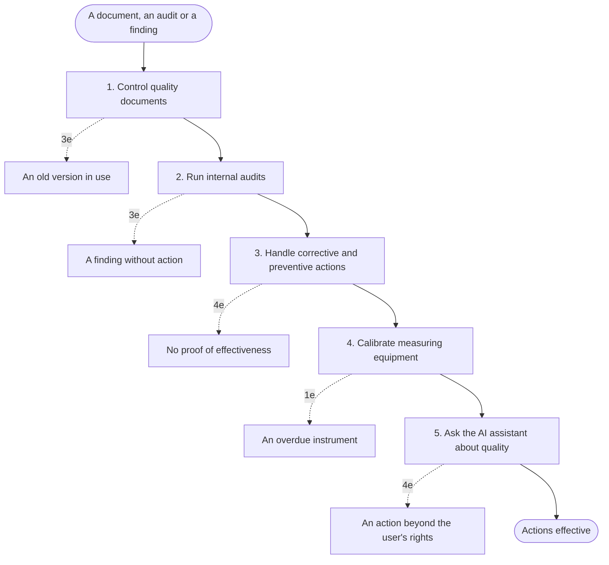

🏠 [Specs](../../../README.md) › 🏷️ [Sectors](../../README.md) › 🏭 [SC05 Manufacturing](../README.md) ›
🔀 [Flows](README.md) › 🔀 FL-SC05-04 Quality system

# 🔀 FL-SC05-04 Quality system

**Status:** ✅ specified

## Summary

The quality system: documents, audits, actions, calibration and the AI assistant. It covers
[UC-SC05-07 Control quality documents](../use-cases/04-quality-system/uc-sc05-07-control-quality-documents.md),
[UC-SC05-08 Run internal audits](../use-cases/04-quality-system/uc-sc05-08-run-internal-audits.md),
[UC-SC05-09 Handle corrective and preventive actions](../use-cases/04-quality-system/uc-sc05-09-handle-corrective-and-preventive-actions.md),
[UC-SC05-12 Calibrate measuring equipment](../use-cases/04-quality-system/uc-sc05-12-calibrate-measuring-equipment.md),
[UC-SC05-15 Ask the AI assistant about quality](../use-cases/04-quality-system/uc-sc05-15-ask-the-assistant-about-quality.md).

## Personas

- [U20 Production operator](../../../01-users/personas/u20-production-operator.md)
- [U21 Production planner](../../../01-users/personas/u21-production-planner.md)
- [U27 Quality manager](../../../01-users/personas/u27-quality-manager.md)

## Flowchart

## Sequence diagram

See each use case.

## Steps

| Step | Persona | Screen | Use case | What happens |
|---|---|---|---|---|
| 1 | U27, U20 | [S-SC05-07](../screens/04-quality-system/s-sc05-07-documents.md) | [UC-SC05-07](../use-cases/04-quality-system/uc-sc05-07-control-quality-documents.md) | The quality manager drafts procedures, instructions and forms, has them approved, publishes the new version and withdraws the old one from the shop floor |
| 2 | U27 | [S-SC05-08](../screens/04-quality-system/s-sc05-08-audits.md) | [UC-SC05-08](../use-cases/04-quality-system/uc-sc05-08-run-internal-audits.md) | The quality manager plans internal audits, audits with a checklist on the tablet, and records findings, each becoming an action |
| 3 | U27, U21 | [S-SC05-09](../screens/04-quality-system/s-sc05-09-actions.md) | [UC-SC05-09](../use-cases/04-quality-system/uc-sc05-09-handle-corrective-and-preventive-actions.md) | The quality manager opens an action, the team analyses the root cause, acts, and closes it only with a check that it worked |
| 4 | U27 | [S-SC05-12](../screens/04-quality-system/s-sc05-12-calibration.md) | [UC-SC05-12](../use-cases/04-quality-system/uc-sc05-12-calibrate-measuring-equipment.md) | The quality manager plans calibrations, calibrates or sends instruments out, and records results with F12's calibration, an overdue instrument cannot record checks |
| 5 | U27, U21 | [S-SC05-15](../screens/04-quality-system/s-sc05-15-quality-assistant.md) | [UC-SC05-15](../use-cases/04-quality-system/uc-sc05-15-ask-the-assistant-about-quality.md) | The quality manager or the planner asks the AI assistant about open actions, audit readiness or a procedure's current version, within their role's rights |

### Entities and screens

| Entity | States in this flow | Shown at step and screen | Aggregated view |
|---|---|---|---|
| [E-SC05-07 Controlled document](../data/e-sc05-07-controlled-document.md) | Draft, Approved, Withdrawn | 1 [S-SC05-07](../screens/04-quality-system/s-sc05-07-documents.md); 5 [S-SC05-15](../screens/04-quality-system/s-sc05-15-quality-assistant.md) | Controlled documents |
| [E-SC05-08 Audit](../data/e-sc05-08-audit.md) | Open, Closed | 2 [S-SC05-08](../screens/04-quality-system/s-sc05-08-audits.md) | Audits |
| [E-F3-04 Assistant change batch](../../../02-functional/f03-assistant/data/e-f03-04-assistant-change-batch.md) | Proposed, Cancelled, Done, Partly done, Undone | Shown elsewhere: [S-F3-01 Assistant panel](../../../02-functional/f03-assistant/screens/01-ask-the-assistant/s-f03-01-assistant-panel.md) | Assistant change batches |
| [E-SC05-09 Quality action](../data/e-sc05-09-quality-action.md) | Open, Done, Effective | 2 [S-SC05-08](../screens/04-quality-system/s-sc05-08-audits.md); 3 [S-SC05-09](../screens/04-quality-system/s-sc05-09-actions.md); 5 [S-SC05-15](../screens/04-quality-system/s-sc05-15-quality-assistant.md) | Quality actions |
| [E-F12-09 Equipment](../../../02-functional/f12-manufacturing/data/e-f12-09-equipment.md) | Active | Shown elsewhere: [S-F12-08 Maintenance](../../../02-functional/f12-manufacturing/screens/04-quality-and-maintenance/s-f12-08-maintenance.md) | Equipments |
| [E-F1-03 User](../../../02-functional/f01-administration/data/e-f01-03-user.md) | Invited, Active, Deactivated | Shown elsewhere: [S-F1-03 Users](../../../02-functional/f01-administration/screens/03-user-lifecycle/s-f01-03-users.md) | Users |
| [E-F1-06 Role](../../../02-functional/f01-administration/data/e-f01-06-role.md) | Active | Shown elsewhere: [S-F1-06 Role editor](../../../02-functional/f01-administration/screens/04-edit-a-role/s-f01-06-role-editor.md) | Roles |

## Errors

- [UC-SC05-07](../use-cases/04-quality-system/uc-sc05-07-control-quality-documents.md) 3e. An old version in use: it is
  withdrawn from the shop floor.
- [UC-SC05-07](../use-cases/04-quality-system/uc-sc05-07-control-quality-documents.md) 1e. A standard's text pasted: it
  is refused and a link to the licensed copy asked
  ([BR-SC05-15](../business-rules/br-sc05-15-standards-texts-licensed.md)).
- [UC-SC05-08](../use-cases/04-quality-system/uc-sc05-08-run-internal-audits.md) 3e. A finding without action: the audit
  cannot be closed.
- [UC-SC05-08](../use-cases/04-quality-system/uc-sc05-08-run-internal-audits.md) 2e. No network in the workshop: the
  checklist is kept on the tablet and synced.
- [UC-SC05-09](../use-cases/04-quality-system/uc-sc05-09-handle-corrective-and-preventive-actions.md) 4e. No proof of
  effectiveness: it cannot be closed.
- [UC-SC05-09](../use-cases/04-quality-system/uc-sc05-09-handle-corrective-and-preventive-actions.md) 3e. The due date
  passed: the owner and the quality manager are reminded.
- [UC-SC05-12](../use-cases/04-quality-system/uc-sc05-12-calibrate-measuring-equipment.md) 1e. An overdue instrument: it
  cannot record checks, [BR-SC05-12](../business-rules/br-sc05-12-instruments-calibrated-before-use.md),
  [BR-F12-16](../../../02-functional/f12-manufacturing/business-rules/br-f12-16-only-calibrated-instruments-record-checks.md).
- [UC-SC05-12](../use-cases/04-quality-system/uc-sc05-12-calibrate-measuring-equipment.md) 2e. The lab's certificate
  missing: the calibration stays pending.
- [UC-SC05-15](../use-cases/04-quality-system/uc-sc05-15-ask-the-assistant-about-quality.md) 4e. An action beyond the
  user's rights: the AI assistant refuses and says which role can do it.
- [UC-SC05-15](../use-cases/04-quality-system/uc-sc05-15-ask-the-assistant-about-quality.md) 2e. No data to answer: the
  AI assistant says so and does not guess.

## Images

Every step and error, for each persona taking part, in light and dark mode (D120). Steps are numbered as in the Steps
table; E rows are the error cases.

| Step | Persona | Device | Light | Dark |
|---|---|---|---|---|
| 1 | U27 | desktop | [light](../images/04-quality-system/u27-quality-manager/1-documents-desktop-light.png) | [dark](../images/04-quality-system/u27-quality-manager/1-documents-desktop-dark.png) |
| 1 | U27 | tablet | [light](../images/04-quality-system/u27-quality-manager/1-documents-tablet-light.png) | [dark](../images/04-quality-system/u27-quality-manager/1-documents-tablet-dark.png) |
| 1 | U20 | tablet | [light](../images/04-quality-system/u20-production-operator/1-documents-tablet-light.png) | [dark](../images/04-quality-system/u20-production-operator/1-documents-tablet-dark.png) |
| 2 | U27 | desktop | [light](../images/04-quality-system/u27-quality-manager/2-audit-desktop-light.png) | [dark](../images/04-quality-system/u27-quality-manager/2-audit-desktop-dark.png) |
| 2 | U27 | tablet | [light](../images/04-quality-system/u27-quality-manager/2-audit-tablet-light.png) | [dark](../images/04-quality-system/u27-quality-manager/2-audit-tablet-dark.png) |
| 3 | U27 | desktop | [light](../images/04-quality-system/u27-quality-manager/3-actions-desktop-light.png) | [dark](../images/04-quality-system/u27-quality-manager/3-actions-desktop-dark.png) |
| 3 | U27 | tablet | [light](../images/04-quality-system/u27-quality-manager/3-actions-tablet-light.png) | [dark](../images/04-quality-system/u27-quality-manager/3-actions-tablet-dark.png) |
| 3 | U21 | desktop | [light](../images/04-quality-system/u21-production-planner/3-actions-desktop-light.png) | [dark](../images/04-quality-system/u21-production-planner/3-actions-desktop-dark.png) |
| 3 | U21 | phone | [light](../images/04-quality-system/u21-production-planner/3-actions-phone-light.png) | [dark](../images/04-quality-system/u21-production-planner/3-actions-phone-dark.png) |
| 4 | U27 | desktop | [light](../images/04-quality-system/u27-quality-manager/4-calibration-desktop-light.png) | [dark](../images/04-quality-system/u27-quality-manager/4-calibration-desktop-dark.png) |
| 4 | U27 | tablet | [light](../images/04-quality-system/u27-quality-manager/4-calibration-tablet-light.png) | [dark](../images/04-quality-system/u27-quality-manager/4-calibration-tablet-dark.png) |
| 5 | U27 | desktop | [light](../images/04-quality-system/u27-quality-manager/5-assistant-desktop-light.png) | [dark](../images/04-quality-system/u27-quality-manager/5-assistant-desktop-dark.png) |
| 5 | U27 | tablet | [light](../images/04-quality-system/u27-quality-manager/5-assistant-tablet-light.png) | [dark](../images/04-quality-system/u27-quality-manager/5-assistant-tablet-dark.png) |
| 5 | U21 | desktop | [light](../images/04-quality-system/u21-production-planner/5-assistant-desktop-light.png) | [dark](../images/04-quality-system/u21-production-planner/5-assistant-desktop-dark.png) |
| 5 | U21 | phone | [light](../images/04-quality-system/u21-production-planner/5-assistant-phone-light.png) | [dark](../images/04-quality-system/u21-production-planner/5-assistant-phone-dark.png) |
| E1 | U27 | desktop | [light](../images/04-quality-system/u27-quality-manager/e1-action-no-proof-desktop-light.png) | [dark](../images/04-quality-system/u27-quality-manager/e1-action-no-proof-desktop-dark.png) |
| E1 | U27 | tablet | [light](../images/04-quality-system/u27-quality-manager/e1-action-no-proof-tablet-light.png) | [dark](../images/04-quality-system/u27-quality-manager/e1-action-no-proof-tablet-dark.png) |

## Open questions

None.

---

⬅️ [FL-SC05-03 Packaging](fl-sc05-03-packaging.md) · ⬆️ [Up](README.md) ·
➡️ [FL-SC05-05 Suppliers and customers](fl-sc05-05-suppliers-and-customers.md)
