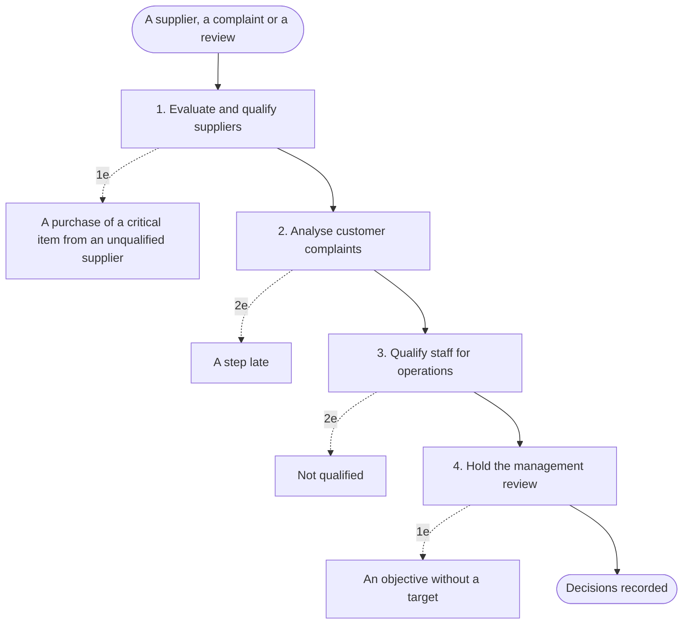

🏠 [Specs](../../../README.md) › 🏷️ [Sectors](../../README.md) › 🏭 [SC05 Manufacturing](../README.md) ›
🔀 [Flows](README.md) › 🔀 FL-SC05-05 Suppliers and customers

# 🔀 FL-SC05-05 Suppliers and customers

**Status:** ✅ specified

## Summary

Suppliers, complaints, people's qualifications and the management review. It covers
[UC-SC05-10 Evaluate and qualify suppliers](../use-cases/05-suppliers-and-customers/uc-sc05-10-evaluate-and-qualify-suppliers.md),
[UC-SC05-11 Analyse customer complaints](../use-cases/05-suppliers-and-customers/uc-sc05-11-analyse-customer-complaints.md),
[UC-SC05-13 Qualify staff for operations](../use-cases/05-suppliers-and-customers/uc-sc05-13-qualify-staff-for-operations.md),
[UC-SC05-14 Hold the management review](../use-cases/05-suppliers-and-customers/uc-sc05-14-hold-the-management-review.md).

## Personas

- [U03 Sales](../../../01-users/personas/u03-sales.md)
- [U04 Purchasing and stock](../../../01-users/personas/u04-purchasing.md)
- [U06 Human resources](../../../01-users/personas/u06-hr.md)
- [U13 Owner](../../../01-users/personas/u13-owner.md)
- [U20 Production operator](../../../01-users/personas/u20-production-operator.md)
- [U27 Quality manager](../../../01-users/personas/u27-quality-manager.md)

## Flowchart

## Sequence diagram

See each use case.

## Steps

| Step | Persona | Screen | Use case | What happens |
|---|---|---|---|---|
| 1 | U27, U04 | [S-SC05-10](../screens/05-suppliers-and-customers/s-sc05-10-supplier-quality.md) | [UC-SC05-10](../use-cases/05-suppliers-and-customers/uc-sc05-10-evaluate-and-qualify-suppliers.md) | The quality manager and purchasing rate suppliers from deliveries, quality and audits, qualify them for critical items, and review the list yearly |
| 2 | U27, U03 | [S-SC05-11](../screens/05-suppliers-and-customers/s-sc05-11-complaints-8d.md) | [UC-SC05-11](../use-cases/05-suppliers-and-customers/uc-sc05-11-analyse-customer-complaints.md) | Sales records a quality complaint, the quality manager analyses it in the eight disciplines, each step dated, and answers the customer |
| 3 | U27, U06, U20 | [S-SC05-13](../screens/05-suppliers-and-customers/s-sc05-13-qualifications.md) | [UC-SC05-13](../use-cases/05-suppliers-and-customers/uc-sc05-13-qualify-staff-for-operations.md) | The quality manager and HR train and qualify operators per operation with F12's qualification requirements, and renew them before they lapse |
| 4 | U13, U27 | [S-SC05-14](../screens/05-suppliers-and-customers/s-sc05-14-management-review.md) | [UC-SC05-14](../use-cases/05-suppliers-and-customers/uc-sc05-14-hold-the-management-review.md) | The owner and the quality manager prepare the yearly management review with objectives and indicators, hold it and record its decisions |

### Entities and screens

| Entity | States in this flow | Shown at step and screen | Aggregated view |
|---|---|---|---|
| [E-SC04-10 Complaint](../../sc04-home-care/data/e-sc04-10-complaint.md) | Open, Answered, Closed | Shown elsewhere: [S-SC04-12 Quality](../../sc04-home-care/screens/05-people-and-quality/s-sc04-12-quality.md) | Complaints |
| [E-F7-06 Item](../../../02-functional/f07-purchasing-and-stock/data/e-f07-06-item.md) | Active | Shown elsewhere: [S-F7-21 Stock levels](../../../02-functional/f07-purchasing-and-stock/screens/03-replenish/s-f07-21-stock-levels.md) | Items |
| [E-SC05-11 8D report](../data/e-sc05-11-8d-report.md) | Sent, Complete | 2 [S-SC05-11](../screens/05-suppliers-and-customers/s-sc05-11-complaints-8d.md) | 8D reports |
| [E-SC05-14 Management review](../data/e-sc05-14-management-review.md) | Prepared, Held | 4 [S-SC05-14](../screens/05-suppliers-and-customers/s-sc05-14-management-review.md) | Management reviews |
| [E-F12-17 Qualification requirement](../../../02-functional/f12-manufacturing/data/e-f12-17-qualification-requirement.md) | Active | 3 [S-SC05-13](../screens/05-suppliers-and-customers/s-sc05-13-qualifications.md) | Qualification requirements |

## Errors

- [UC-SC05-10](../use-cases/05-suppliers-and-customers/uc-sc05-10-evaluate-and-qualify-suppliers.md) 1e. A purchase of a
  critical item from an unqualified supplier: the order is blocked
  ([BR-SC05-10](../business-rules/br-sc05-10-suppliers-qualified-before-use.md)).
- [UC-SC05-10](../use-cases/05-suppliers-and-customers/uc-sc05-10-evaluate-and-qualify-suppliers.md) 2e. A score under
  the threshold: the supplier is put under watch.
- [UC-SC05-11](../use-cases/05-suppliers-and-customers/uc-sc05-11-analyse-customer-complaints.md) 2e. A step late: the
  quality manager is alerted.
- [UC-SC05-11](../use-cases/05-suppliers-and-customers/uc-sc05-11-analyse-customer-complaints.md) 1e. A complaint about
  a lot: the lot's other deliveries are listed.
- [UC-SC05-13](../use-cases/05-suppliers-and-customers/uc-sc05-13-qualify-staff-for-operations.md) 2e. Not qualified:
  the operator's start is refused, [BR-SC05-13](../business-rules/br-sc05-13-operators-qualified-for-the-operation.md),
  [BR-F12-17](../../../02-functional/f12-manufacturing/business-rules/br-f12-17-operators-sign-in-only-where-qualified.md).
- [UC-SC05-13](../use-cases/05-suppliers-and-customers/uc-sc05-13-qualify-staff-for-operations.md) 3e. A renewal missed:
  HR and the quality manager are alerted.
- [UC-SC05-14](../use-cases/05-suppliers-and-customers/uc-sc05-14-hold-the-management-review.md) 1e. An objective
  without a target: it is flagged.
- [UC-SC05-14](../use-cases/05-suppliers-and-customers/uc-sc05-14-hold-the-management-review.md) 2e. More than a year
  since the last review: the owner is reminded.

## Images

Every step and error, for each persona taking part, in light and dark mode (D120). Steps are numbered as in the Steps
table; E rows are the error cases.

| Step | Persona | Device | Light | Dark |
|---|---|---|---|---|
| 1 | U27 | desktop | [light](../images/05-suppliers-and-customers/u27-quality-manager/1-suppliers-desktop-light.png) | [dark](../images/05-suppliers-and-customers/u27-quality-manager/1-suppliers-desktop-dark.png) |
| 1 | U27 | tablet | [light](../images/05-suppliers-and-customers/u27-quality-manager/1-suppliers-tablet-light.png) | [dark](../images/05-suppliers-and-customers/u27-quality-manager/1-suppliers-tablet-dark.png) |
| 1 | U04 | desktop | [light](../images/05-suppliers-and-customers/u04-purchasing/1-suppliers-desktop-light.png) | [dark](../images/05-suppliers-and-customers/u04-purchasing/1-suppliers-desktop-dark.png) |
| 2 | U27 | desktop | [light](../images/05-suppliers-and-customers/u27-quality-manager/2-complaint-8d-desktop-light.png) | [dark](../images/05-suppliers-and-customers/u27-quality-manager/2-complaint-8d-desktop-dark.png) |
| 2 | U27 | tablet | [light](../images/05-suppliers-and-customers/u27-quality-manager/2-complaint-8d-tablet-light.png) | [dark](../images/05-suppliers-and-customers/u27-quality-manager/2-complaint-8d-tablet-dark.png) |
| 2 | U03 | desktop | [light](../images/05-suppliers-and-customers/u03-sales/2-complaint-8d-desktop-light.png) | [dark](../images/05-suppliers-and-customers/u03-sales/2-complaint-8d-desktop-dark.png) |
| 2 | U03 | phone | [light](../images/05-suppliers-and-customers/u03-sales/2-complaint-8d-phone-light.png) | [dark](../images/05-suppliers-and-customers/u03-sales/2-complaint-8d-phone-dark.png) |
| 2 | U03 | tablet | [light](../images/05-suppliers-and-customers/u03-sales/2-complaint-8d-tablet-light.png) | [dark](../images/05-suppliers-and-customers/u03-sales/2-complaint-8d-tablet-dark.png) |
| 3 | U27 | desktop | [light](../images/05-suppliers-and-customers/u27-quality-manager/3-qualifications-desktop-light.png) | [dark](../images/05-suppliers-and-customers/u27-quality-manager/3-qualifications-desktop-dark.png) |
| 3 | U27 | tablet | [light](../images/05-suppliers-and-customers/u27-quality-manager/3-qualifications-tablet-light.png) | [dark](../images/05-suppliers-and-customers/u27-quality-manager/3-qualifications-tablet-dark.png) |
| 3 | U06 | desktop | [light](../images/05-suppliers-and-customers/u06-hr/3-qualifications-desktop-light.png) | [dark](../images/05-suppliers-and-customers/u06-hr/3-qualifications-desktop-dark.png) |
| 3 | U20 | tablet | [light](../images/05-suppliers-and-customers/u20-production-operator/3-qualifications-tablet-light.png) | [dark](../images/05-suppliers-and-customers/u20-production-operator/3-qualifications-tablet-dark.png) |
| 4 | U13 | desktop | [light](../images/05-suppliers-and-customers/u13-owner/4-management-review-desktop-light.png) | [dark](../images/05-suppliers-and-customers/u13-owner/4-management-review-desktop-dark.png) |
| 4 | U13 | phone | [light](../images/05-suppliers-and-customers/u13-owner/4-management-review-phone-light.png) | [dark](../images/05-suppliers-and-customers/u13-owner/4-management-review-phone-dark.png) |
| 4 | U27 | desktop | [light](../images/05-suppliers-and-customers/u27-quality-manager/4-management-review-desktop-light.png) | [dark](../images/05-suppliers-and-customers/u27-quality-manager/4-management-review-desktop-dark.png) |
| 4 | U27 | tablet | [light](../images/05-suppliers-and-customers/u27-quality-manager/4-management-review-tablet-light.png) | [dark](../images/05-suppliers-and-customers/u27-quality-manager/4-management-review-tablet-dark.png) |
| E1 | U04 | desktop | [light](../images/05-suppliers-and-customers/u04-purchasing/e1-unqualified-supplier-desktop-light.png) | [dark](../images/05-suppliers-and-customers/u04-purchasing/e1-unqualified-supplier-desktop-dark.png) |

## Open questions

None.

---

⬅️ [FL-SC05-04 Quality system](fl-sc05-04-quality-system.md) · ⬆️ [Up](README.md) ·
➡️ [FL-SC05-06 Excise, refurbishment, personalisation and cutting](fl-sc05-06-excise-refurbishment-and-cutting.md)
