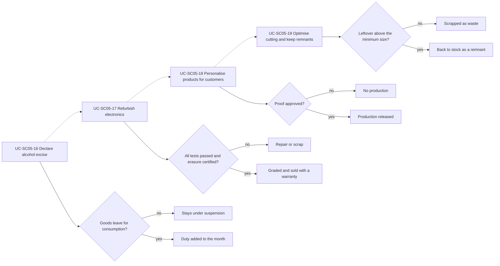
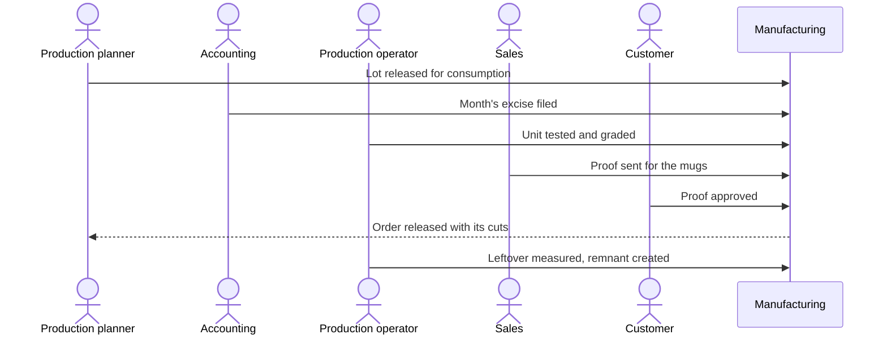

🏠 [Specs](../../../README.md) › 🏷️ [Sectors](../../README.md) › 🏭 [SC05 Manufacturing](../README.md) ›
🔀 [Flows](README.md) › 🔀 FL-SC05-06 Excise, refurbishment, personalisation and cutting

# 🔀 FL-SC05-06 Excise, refurbishment, personalisation and cutting

**Status:** ✅ specified

## Summary

Four situations of manufacturers that the sector had not covered: declaring alcohol excise from a bonded warehouse,
refurbishing and grading electronics, personalising products from a proof the customer approves, and cutting material
with remnants put back into stock ([D549](../../../06-decisions/sectors/d549-benchmark-gaps-sc05-manufacturing.md)).

## Personas

- [U21 Production planner](../../../01-users/personas/u21-production-planner.md), who follows the bonded stock and plans
  the cuts
- [U05 Accounting](../../../01-users/personas/u05-accounting.md), who files the excise
- [U20 Production operator](../../../01-users/personas/u20-production-operator.md), who tests units and cuts at the
  bench
- [U27 Quality manager](../../../01-users/personas/u27-quality-manager.md), who confirms the grades
- [U03 Sales](../../../01-users/personas/u03-sales.md), who prepares the proofs
- [U09 Customer](../../../01-users/personas/u09-customer.md), who approves a proof

## Flowchart

## Sequence diagram

## Steps

| Step | Persona | Screen | Use case | What happens |
|---|---|---|---|---|
| 1 | [U21](../../../01-users/personas/u21-production-planner.md) | [S-SC05-16](../screens/06-excise-refurbishment-and-cutting/s-sc05-16-alcohol-excise.md) | [UC-SC05-16](../use-cases/06-excise-refurbishment-and-cutting/uc-sc05-16-declare-alcohol-excise.md) | The production planner records each release from the bonded warehouse and accounting files the month's excise |
| 2 | [U20](../../../01-users/personas/u20-production-operator.md) | [S-SC05-17](../screens/06-excise-refurbishment-and-cutting/s-sc05-17-refurbishment.md) | [UC-SC05-17](../use-cases/06-excise-refurbishment-and-cutting/uc-sc05-17-refurbish-electronics.md) | The operator tests, repairs and scans each used unit and the quality manager confirms the grades |
| 3 | [U03](../../../01-users/personas/u03-sales.md) | [S-SC05-18](../screens/06-excise-refurbishment-and-cutting/s-sc05-18-personalisation.md) | [UC-SC05-18](../use-cases/06-excise-refurbishment-and-cutting/uc-sc05-18-personalise-products-for-customers.md) | Sales sends the proof of a personalised order and the customer approves it on the phone |
| 4 | [U21](../../../01-users/personas/u21-production-planner.md) | [S-SC05-19](../screens/06-excise-refurbishment-and-cutting/s-sc05-19-cutting.md) | [UC-SC05-19](../use-cases/06-excise-refurbishment-and-cutting/uc-sc05-19-optimise-cutting-and-keep-remnants.md) | The planner plans the cuts on remnants first and the operator puts usable leftovers back into stock |

### Entities and screens

| Entity | States in this flow | Shown at step and screen | Aggregated view |
|---|---|---|---|
| [E-SC05-15 Bonded stock](../data/e-sc05-15-bonded-stock.md) | Bonded, Released, Shipped, Declared | 1 [S-SC05-16](../screens/06-excise-refurbishment-and-cutting/s-sc05-16-alcohol-excise.md) | Bonded stocks |
| [E-SC05-16 Graded unit](../data/e-sc05-16-graded-unit.md) | Received, Tested, Graded, Sold, Scrapped | 2 [S-SC05-17](../screens/06-excise-refurbishment-and-cutting/s-sc05-17-refurbishment.md) | Graded units |
| [E-SC05-17 Proof](../data/e-sc05-17-proof.md) | Draft, Sent, Approved, Superseded, Expired, Used | 3 [S-SC05-18](../screens/06-excise-refurbishment-and-cutting/s-sc05-18-personalisation.md) | Proofs |
| [E-SC05-18 Remnant](../data/e-sc05-18-remnant.md) | Planned, Stocked, Used, Scrapped | 4 [S-SC05-19](../screens/06-excise-refurbishment-and-cutting/s-sc05-19-cutting.md) | Remnants |
| [E-SC05-03 Configuration rule](../data/e-sc05-03-configuration-rule.md) | Active | Shown elsewhere: [S-SC05-03 Configurator](../screens/02-made-to-order/s-sc05-03-configurator.md) | Configuration rules |
| [E-SC05-05 Customer-supplied part](../data/e-sc05-05-customer-supplied-part.md) | Active | Shown elsewhere: [S-SC05-05 Customer parts](../screens/02-made-to-order/s-sc05-05-customer-parts.md) | Customer-supplied parts |

## Errors

- **E1 The proof is not approved.** A manufacturing order is launched on a personalised line whose proof is not
  Approved: the launch is refused and the state of the proof is shown
  ([BR-SC05-18](../business-rules/br-sc05-18-production-starts-only-after-the-proof-is-approved.md), step 3).

## Images

Every step and error, for each persona taking part, in light and dark mode (D120). Steps are numbered as in the Steps
table; E rows are the error cases.

| Step | Persona | Device | Light | Dark |
|---|---|---|---|---|
| 1 | U21 | desktop | [light](../images/06-excise-refurbishment-and-cutting/u21-production-planner/1-alcohol-excise-desktop-light.png) | [dark](../images/06-excise-refurbishment-and-cutting/u21-production-planner/1-alcohol-excise-desktop-dark.png) |
| 1 | U05 | desktop | [light](../images/06-excise-refurbishment-and-cutting/u05-accounting/1-alcohol-excise-desktop-light.png) | [dark](../images/06-excise-refurbishment-and-cutting/u05-accounting/1-alcohol-excise-desktop-dark.png) |
| 1 | U21 | phone | [light](../images/06-excise-refurbishment-and-cutting/u21-production-planner/1-alcohol-excise-phone-light.png) | [dark](../images/06-excise-refurbishment-and-cutting/u21-production-planner/1-alcohol-excise-phone-dark.png) |
| 2 | U20 | tablet | [light](../images/06-excise-refurbishment-and-cutting/u20-production-operator/2-refurbishment-tablet-light.png) | [dark](../images/06-excise-refurbishment-and-cutting/u20-production-operator/2-refurbishment-tablet-dark.png) |
| 2 | U27 | desktop | [light](../images/06-excise-refurbishment-and-cutting/u27-quality-manager/2-refurbishment-desktop-light.png) | [dark](../images/06-excise-refurbishment-and-cutting/u27-quality-manager/2-refurbishment-desktop-dark.png) |
| 3 | U03 | desktop | [light](../images/06-excise-refurbishment-and-cutting/u03-sales/3-personalisation-desktop-light.png) | [dark](../images/06-excise-refurbishment-and-cutting/u03-sales/3-personalisation-desktop-dark.png) |
| 3 | U09 | phone | [light](../images/06-excise-refurbishment-and-cutting/u09-customer/3-personalisation-phone-light.png) | [dark](../images/06-excise-refurbishment-and-cutting/u09-customer/3-personalisation-phone-dark.png) |
| 3 | U03 | phone | [light](../images/06-excise-refurbishment-and-cutting/u03-sales/3-personalisation-phone-light.png) | [dark](../images/06-excise-refurbishment-and-cutting/u03-sales/3-personalisation-phone-dark.png) |
| 3 | U03 | tablet | [light](../images/06-excise-refurbishment-and-cutting/u03-sales/3-personalisation-tablet-light.png) | [dark](../images/06-excise-refurbishment-and-cutting/u03-sales/3-personalisation-tablet-dark.png) |
| 4 | U21 | desktop | [light](../images/06-excise-refurbishment-and-cutting/u21-production-planner/4-cutting-desktop-light.png) | [dark](../images/06-excise-refurbishment-and-cutting/u21-production-planner/4-cutting-desktop-dark.png) |
| 4 | U20 | tablet | [light](../images/06-excise-refurbishment-and-cutting/u20-production-operator/4-cutting-tablet-light.png) | [dark](../images/06-excise-refurbishment-and-cutting/u20-production-operator/4-cutting-tablet-dark.png) |
| 4 | U21 | phone | [light](../images/06-excise-refurbishment-and-cutting/u21-production-planner/4-cutting-phone-light.png) | [dark](../images/06-excise-refurbishment-and-cutting/u21-production-planner/4-cutting-phone-dark.png) |
| E1 | U21 | desktop | [light](../images/06-excise-refurbishment-and-cutting/u21-production-planner/e1-the-proof-is-not-approved-desktop-light.png) | [dark](../images/06-excise-refurbishment-and-cutting/u21-production-planner/e1-the-proof-is-not-approved-desktop-dark.png) |
| E1 | U21 | phone | [light](../images/06-excise-refurbishment-and-cutting/u21-production-planner/e1-the-proof-is-not-approved-phone-light.png) | [dark](../images/06-excise-refurbishment-and-cutting/u21-production-planner/e1-the-proof-is-not-approved-phone-dark.png) |

## Open questions

None.

---

⬅️ [FL-SC05-05 Suppliers and customers](fl-sc05-05-suppliers-and-customers.md) · ⬆️ [Up](README.md)
