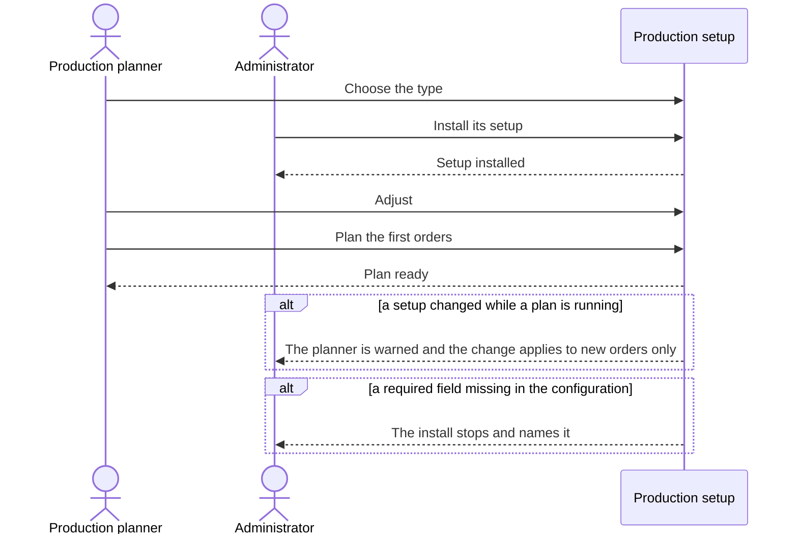

🏠 [Specs](../../../../README.md) › 🏷️ [Sectors](../../../README.md) › 🏭 [SC05 Manufacturing](../../README.md) ›
📝 [Use cases](../README.md) › 📝 [Use cases: FL-SC05-01 Production setups](README.md) ›
📝 UC-SC05-01 Set up the production type

# 📝 UC-SC05-01 Set up the production type

**Status:** ✅ specified

## Summary

The production planner and the administrator choose the plant's production type, discrete, batch or process, install its
F12 setup and adjust it before planning starts.

## Personas

- [U21 Production planner](../../../../01-users/personas/u21-production-planner.md)
- [U07 Administrator](../../../../01-users/personas/u07-administrator.md)

## Goal

F12 working the way the plant produces.

## Trigger

The sector pack is installed, or a new site starts producing.

## Frequency

Once per site, rarely changed.

## Preconditions

- The SC05 sector pack is installed for the company,
  [UC-F14-02](../../../../02-functional/f14-plugin-store/use-cases/01-find-and-install/uc-f14-02-install-a-plugin-or-sector-pack.md),
  and its users have their roles,
  [UC-F1-06](../../../../02-functional/f01-administration/use-cases/04-edit-a-role/uc-f01-06-edit-a-role-and-its-record-rules.md).

## Postconditions

- **Success:** the setup is installed for the site and planning uses it.
- **Failed:** the site keeps its previous setup.

## Main flow

1. The production planner chooses the type per site on
   [S-SC05-01 Production setup](../../screens/01-production-setups/s-sc05-01-production-setup.md).
2. The administrator installs the setup: order screens, work centres and the fields the type needs,
   [UC-F2-11](../../../../02-functional/f02-no-code-configuration/use-cases/06-share-a-configuration/uc-f02-11-export-or-import-a-configuration-as-a-pack.md).
3. The production planner adjusts the work centres and routings,
   [UC-F12-02](../../../../02-functional/f12-manufacturing/use-cases/01-define-the-products/uc-f12-02-define-work-centres-and-routings.md).
4. The production planner plans the first orders with the setup,
   [UC-F12-03](../../../../02-functional/f12-manufacturing/use-cases/02-plan-production/uc-f12-03-plan-production.md).

## Alternative flows

- 1a. Mixed types per site: each site has its own type.

## Error flows

- 2e. A setup changed while a plan is running: the planner is warned and the change applies to new orders only.
- 2f. A required field missing in the configuration: the install stops and names it.
- Any step: a call to a service or an outside system fails: it is retried first
  ([BR-F3-32](../../../../02-functional/f03-assistant/business-rules/br-f03-32-retry-before-an-error.md)), then the
  error message pattern ([D122](../../../../06-decisions/ux/d122-error-message-standard.md)) says what failed; what was
  typed is kept.

## Business rules

- [BR-SC05-01 The sector follows F12 and the country pack](../../business-rules/br-sc05-01-manufacturing-sector-follows-the-country-pack.md)

## Entities

- [E-SC05-01 Production setup](../../data/e-sc05-01-production-setup.md)

## Permissions

The production planner and administrator roles; the record rules of their role and site apply,
[UC-F1-06](../../../../02-functional/f01-administration/use-cases/04-edit-a-role/uc-f01-06-edit-a-role-and-its-record-rules.md).

## Notifications

None beyond the in-app updates of the records concerned.

## Audit events

Every creation, change and state change of production setup records, with who, when and the values before and after
(T3).

## AI involvement

The AI assistant answers questions on the production setup records of this use case, with links, and prepares them as
drafts the user confirms. It works within the user's rights,
[BR-F3-34](../../../../02-functional/f03-assistant/business-rules/br-f03-34-every-capability-is-reachable-from-the-assistant.md),
and never deletes or does anything irreversible without the user's confirmation,
[BR-F3-07](../../../../02-functional/f03-assistant/business-rules/br-f03-07-no-deletes-no-irreversible-acts.md).

## API, MCP and A2A exposure

Through the API and webhooks (T5) and the MCP and A2A gateway (T6), with the caller's rights,
[BR-F3-34](../../../../02-functional/f03-assistant/business-rules/br-f03-34-every-capability-is-reachable-from-the-assistant.md),
reading, creating and changing the records of this use case; nothing irreversible without a person's confirmation.

## Screens

- [S-SC05-01 Production setup](../../screens/01-production-setups/s-sc05-01-production-setup.md)

## Flowchart

See [FL-SC05-01 Production setups](../../flows/fl-sc05-01-production-setups.md#flowchart).

## Sequence diagram

## Acceptance criteria

1. **Given** the example factory's Lyon plant set to batch **when** the setup is installed **then** manufacturing orders
   in Lyon show batch size, recipe and yield.
2. **Given** Lyon in batch and Vienne in discrete **when** both are set **then** each site has its own type.
3. **Given** Lyon with 12 orders in progress **when** the type changes **then** the planner is warned and the change
   applies to new orders only.

## Non-functional notes

[D408](../../../../06-decisions/technical/d408-performance-and-profiles.md)'s targets
([performance](../../../../05-non-functional/performance.md)): 95 % of screens within 1 second; lists paged on the
server, the first page within 1 second; reports within 5 seconds or in the background. WCAG 2.2 AA and RGAA
([D46](../../../../06-decisions/ux/d46-accessibility-standard.md)).

## Regulatory references

Legal values from the France country pack:
[CR-FR-074 Conformity of machinery](../../../../10-country-packs/france/products/cr-fr-074-machinery-conformity.md).

## Related use cases

- [UC-SC05-02 Manage recipes with potency, yields and batch scaling](uc-sc05-02-manage-recipes-with-potency-yields-and-batch-scaling.md)

## Open questions

None.

---

⬆️ [Up](README.md) · ➡️ [UC-SC05-02](uc-sc05-02-manage-recipes-with-potency-yields-and-batch-scaling.md)
