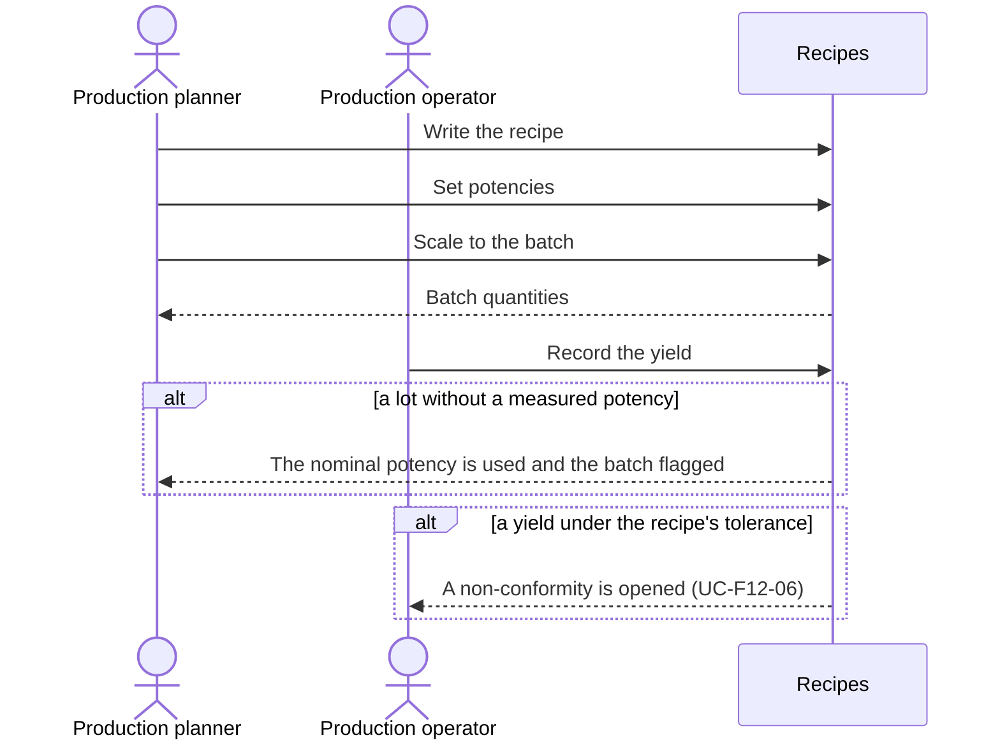

🏠 [Specs](../../../../README.md) › 🏷️ [Sectors](../../../README.md) › 🏭 [SC05 Manufacturing](../../README.md) ›
📝 [Use cases](../README.md) › 📝 [Use cases: FL-SC05-01 Production setups](README.md) ›
📝 UC-SC05-02 Manage recipes with potency, yields and batch scaling

# 📝 UC-SC05-02 Manage recipes with potency, yields and batch scaling

**Status:** ✅ specified

## Summary

The production planner writes batch recipes with the shared recipes capability and adds what the process plant needs:
ingredient potency correction and yields recorded per batch.

## Personas

- [U21 Production planner](../../../../01-users/personas/u21-production-planner.md)
- [U20 Production operator](../../../../01-users/personas/u20-production-operator.md)

## Goal

Batches that come out right whatever the batch size and the raw materials' strength.

## Trigger

A new product, or a raw material lot with a measured potency.

## Frequency

Recipes a few times a year; potency at each lot.

## Preconditions

- The SC05 sector pack is installed for the company,
  [UC-F14-02](../../../../02-functional/f14-plugin-store/use-cases/01-find-and-install/uc-f14-02-install-a-plugin-or-sector-pack.md),
  and its users have their roles,
  [UC-F1-06](../../../../02-functional/f01-administration/use-cases/04-edit-a-role/uc-f01-06-edit-a-role-and-its-record-rules.md).

## Postconditions

- **Success:** the batch is scaled and corrected by potency, and its yield recorded.
- **Failed:** the batch is not released.

## Main flow

1. The production planner writes the recipe on
   [S-SC05-02 Recipes](../../screens/01-production-setups/s-sc05-02-recipes.md) with ingredients, tolerances and yield,
   [UC-F12-31](../../../../02-functional/f12-manufacturing/use-cases/09-recipes-and-batches/uc-f12-31-define-a-recipe-and-produce-in-batches.md).
2. The production planner records each ingredient's nominal potency; lots bring their measured one.
3. Simple-ERP scales to the batch size,
   [BR-F12-26](../../../../02-functional/f12-manufacturing/business-rules/br-f12-26-recipes-scale-to-the-batch-and-keep-their-tolerances.md),
   and corrects by potency ([BR-SC05-02](../../business-rules/br-sc05-02-recipes-scale-with-potency.md)).
4. After the batch, the operator records the output; the yield is kept per batch.

## Alternative flows

- 4a. A rework batch: an off-spec batch goes back in as an ingredient of a new one.

## Error flows

- 3e. A lot without a measured potency: the nominal potency is used and the batch flagged.
- 4e. A yield under the recipe's tolerance: a non-conformity is opened,
  [UC-F12-06](../../../../02-functional/f12-manufacturing/use-cases/03-make-the-products/uc-f12-06-consume-components-trace-lots-and-serials.md).
- Any step: a call to a service or an outside system fails: it is retried first
  ([BR-F3-32](../../../../02-functional/f03-assistant/business-rules/br-f03-32-retry-before-an-error.md)), then the
  error message pattern ([D122](../../../../06-decisions/ux/d122-error-message-standard.md)) says what failed; what was
  typed is kept.

## Business rules

- [BR-SC05-02 Recipes scale with potency](../../business-rules/br-sc05-02-recipes-scale-with-potency.md)
- [BR-F12-26 Recipes scale to the batch and keep their tolerances](../../../../02-functional/f12-manufacturing/business-rules/br-f12-26-recipes-scale-to-the-batch-and-keep-their-tolerances.md)

## Entities

- [E-SC05-02 Batch recipe](../../data/e-sc05-02-batch-recipe.md)
- [E-F12-25 Recipe](../../../../02-functional/f12-manufacturing/data/e-f12-25-recipe.md)

## Permissions

The production planner and production operator roles; the record rules of their role and site apply,
[UC-F1-06](../../../../02-functional/f01-administration/use-cases/04-edit-a-role/uc-f01-06-edit-a-role-and-its-record-rules.md).

## Notifications

None beyond the in-app updates of the records concerned.

## Audit events

Every creation, change and state change of batch recipe, recipe records, with who, when and the values before and after
(T3).

## AI involvement

The AI assistant answers questions on the batch recipe, recipe records of this use case, with links, and prepares them
as drafts the user confirms. It works within the user's rights,
[BR-F3-34](../../../../02-functional/f03-assistant/business-rules/br-f03-34-every-capability-is-reachable-from-the-assistant.md),
and never deletes or does anything irreversible without the user's confirmation,
[BR-F3-07](../../../../02-functional/f03-assistant/business-rules/br-f03-07-no-deletes-no-irreversible-acts.md).

## API, MCP and A2A exposure

Through the API and webhooks (T5) and the MCP and A2A gateway (T6), with the caller's rights,
[BR-F3-34](../../../../02-functional/f03-assistant/business-rules/br-f03-34-every-capability-is-reachable-from-the-assistant.md),
reading, creating and changing the records of this use case; nothing irreversible without a person's confirmation.

## Screens

- [S-SC05-02 Recipes](../../screens/01-production-setups/s-sc05-02-recipes.md)

## Flowchart

See [FL-SC05-01 Production setups](../../flows/fl-sc05-01-production-setups.md#flowchart).

## Sequence diagram

## Acceptance criteria

1. **Given** the example factory's Sauce S2 v3 with tomato at 60 % nominal and a lot measured at 50 % **when** a 500 kg
   batch is scaled **then** the tomato quantity is raised by a fifth to give the same strength.
2. **Given** tomato lot L-77 without potency **when** a 500 kg batch is scaled **then** the nominal potency is used and
   the batch flagged.

## Non-functional notes

[D408](../../../../06-decisions/technical/d408-performance-and-profiles.md)'s targets
([performance](../../../../05-non-functional/performance.md)): 95 % of screens within 1 second; lists paged on the
server, the first page within 1 second; reports within 5 seconds or in the background. WCAG 2.2 AA and RGAA
([D46](../../../../06-decisions/ux/d46-accessibility-standard.md)).

## Regulatory references

None specific to this use case; the sector's legal rules are listed in [SC05 regulatory](../../regulatory.md).

## Related use cases

- [UC-SC05-01 Set up the production type](uc-sc05-01-set-up-the-production-type.md)

## Open questions

None.

---

⬅️ [UC-SC05-01 Set up the production type](uc-sc05-01-set-up-the-production-type.md) · ⬆️ [Up](README.md) ·
➡️ [UC-SC05-03 Configure a product to order](../02-made-to-order/uc-sc05-03-configure-a-product-to-order.md)
