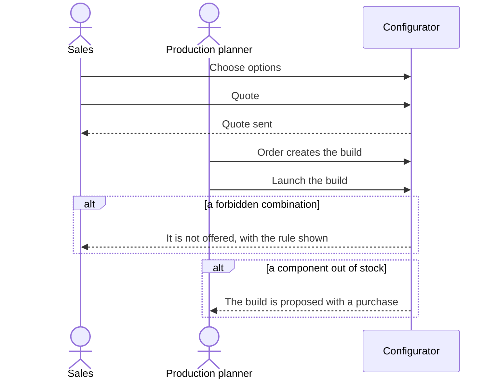

🏠 [Specs](../../../../README.md) › 🏷️ [Sectors](../../../README.md) › 🏭 [SC05 Manufacturing](../../README.md) ›
📝 [Use cases](../README.md) › 📝 [Use cases: FL-SC05-02 Made to order](README.md) ›
📝 UC-SC05-03 Configure a product to order

# 📝 UC-SC05-03 Configure a product to order

**Status:** ✅ specified

## Summary

Sales configures a product from its options in a quote; only valid combinations are offered; the order builds the bill
of materials and routing of the chosen combination.

## Personas

- [U03 Sales](../../../../01-users/personas/u03-sales.md)
- [U21 Production planner](../../../../01-users/personas/u21-production-planner.md)

## Goal

Quotes that can be built, and builds that match the quote.

## Trigger

A customer asks for a configurable product.

## Frequency

Daily in a made-to-order plant.

## Preconditions

- The SC05 sector pack is installed for the company,
  [UC-F14-02](../../../../02-functional/f14-plugin-store/use-cases/01-find-and-install/uc-f14-02-install-a-plugin-or-sector-pack.md),
  and its users have their roles,
  [UC-F1-06](../../../../02-functional/f01-administration/use-cases/04-edit-a-role/uc-f01-06-edit-a-role-and-its-record-rules.md).

## Postconditions

- **Success:** the order holds the combination's bill of materials and routing.
- **Failed:** the quote stays a draft.

## Main flow

1. Sales chooses the options on [S-SC05-03 Configurator](../../screens/02-made-to-order/s-sc05-03-configurator.md),
   [UC-F6-14](../../../../02-functional/f06-customers-and-sales/use-cases/05-benchmark-additions/uc-f06-14-configure-products-in-a-quote.md);
   only allowed combinations show ([BR-SC05-03](../../business-rules/br-sc05-03-configured-products-stay-valid.md)).
2. Simple-ERP prices the combination; sales sends the quote.
3. On order, the bill of materials and routing are built and a manufacturing order proposed,
   [UC-F12-03](../../../../02-functional/f12-manufacturing/use-cases/02-plan-production/uc-f12-03-plan-production.md).
4. The production planner launches the order with the combination's routing,
   [UC-F12-04](../../../../02-functional/f12-manufacturing/use-cases/03-make-the-products/uc-f12-04-launch-and-follow-manufacturing-orders.md).

## Alternative flows

- 1a. The configurator on the online shop: customers configure themselves under the same rules,
  [UC-F11-11](../../../../02-functional/f11-online-shop/use-cases/04-special-sales/uc-f11-11-sell-b2b-online.md).

## Error flows

- 1e. A forbidden combination: it is not offered, with the rule shown.
- 3e. A component out of stock: the build is proposed with a purchase.
- Any step: a call to a service or an outside system fails: it is retried first
  ([BR-F3-32](../../../../02-functional/f03-assistant/business-rules/br-f03-32-retry-before-an-error.md)), then the
  error message pattern ([D122](../../../../06-decisions/ux/d122-error-message-standard.md)) says what failed; what was
  typed is kept.

## Business rules

- [BR-SC05-03 Configured products stay valid](../../business-rules/br-sc05-03-configured-products-stay-valid.md)

## Entities

- [E-SC05-03 Configuration rule](../../data/e-sc05-03-configuration-rule.md)

## Permissions

The sales and production planner roles; the record rules of their role and site apply,
[UC-F1-06](../../../../02-functional/f01-administration/use-cases/04-edit-a-role/uc-f01-06-edit-a-role-and-its-record-rules.md).

## Notifications

None beyond the in-app updates of the records concerned.

## Audit events

Every creation, change and state change of configuration rule records, with who, when and the values before and after
(T3).

## AI involvement

The AI assistant answers questions on the configuration rule records of this use case, with links, and prepares them as
drafts the user confirms. It works within the user's rights,
[BR-F3-34](../../../../02-functional/f03-assistant/business-rules/br-f03-34-every-capability-is-reachable-from-the-assistant.md),
and never deletes or does anything irreversible without the user's confirmation,
[BR-F3-07](../../../../02-functional/f03-assistant/business-rules/br-f03-07-no-deletes-no-irreversible-acts.md).

## API, MCP and A2A exposure

Through the API and webhooks (T5) and the MCP and A2A gateway (T6), with the caller's rights,
[BR-F3-34](../../../../02-functional/f03-assistant/business-rules/br-f03-34-every-capability-is-reachable-from-the-assistant.md),
reading, creating and changing the records of this use case; nothing irreversible without a person's confirmation.

## Screens

- [S-SC05-03 Configurator](../../screens/02-made-to-order/s-sc05-03-configurator.md)

## Flowchart

See [FL-SC05-02 Made to order](../../flows/fl-sc05-02-made-to-order.md#flowchart).

## Sequence diagram

## Acceptance criteria

1. **Given** the example factory's Gate G1 at 2.5 m with motor M1 **when** it is ordered **then** a manufacturing order
   with that combination's bill of materials is proposed.
2. **Given** Gate G1 at 3 m wide with motor M1 **when** sales picks M1 **then** it is not offered, with the rule shown.

## Non-functional notes

[D408](../../../../06-decisions/technical/d408-performance-and-profiles.md)'s targets
([performance](../../../../05-non-functional/performance.md)): 95 % of screens within 1 second; lists paged on the
server, the first page within 1 second; reports within 5 seconds or in the background. WCAG 2.2 AA and RGAA
([D46](../../../../06-decisions/ux/d46-accessibility-standard.md)).

## Regulatory references

None specific to this use case; the sector's legal rules are listed in [SC05 regulatory](../../regulatory.md).

## Related use cases

- [UC-SC05-04 Engineer to order](uc-sc05-04-engineer-to-order.md)

## Open questions

None.

---

⬅️ [UC-SC05-02](../01-production-setups/uc-sc05-02-manage-recipes-with-potency-yields-and-batch-scaling.md) ·
⬆️ [Up](README.md) · ➡️ [UC-SC05-04 Engineer to order](uc-sc05-04-engineer-to-order.md)
