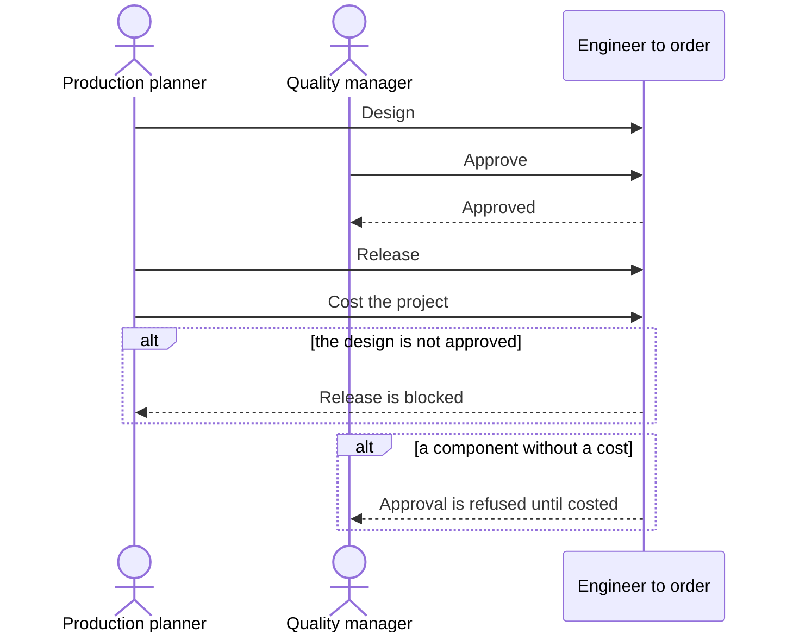

🏠 [Specs](../../../../README.md) › 🏷️ [Sectors](../../../README.md) › 🏭 [SC05 Manufacturing](../../README.md) ›
📝 [Use cases](../README.md) › 📝 [Use cases: FL-SC05-02 Made to order](README.md) › 📝 UC-SC05-04 Engineer to order

# 📝 UC-SC05-04 Engineer to order

**Status:** ✅ specified

## Summary

For a one-off project, the production planner designs its own bill of materials and routing, has them approved by
quality, and releases them for production.

## Personas

- [U21 Production planner](../../../../01-users/personas/u21-production-planner.md)
- [U27 Quality manager](../../../../01-users/personas/u27-quality-manager.md)

## Goal

A one-off product built from an approved design.

## Trigger

A project order.

## Frequency

A few a month.

## Preconditions

- The SC05 sector pack is installed for the company,
  [UC-F14-02](../../../../02-functional/f14-plugin-store/use-cases/01-find-and-install/uc-f14-02-install-a-plugin-or-sector-pack.md),
  and its users have their roles,
  [UC-F1-06](../../../../02-functional/f01-administration/use-cases/04-edit-a-role/uc-f01-06-edit-a-role-and-its-record-rules.md).

## Postconditions

- **Success:** the design is approved and released to production.
- **Failed:** production stays blocked.

## Main flow

1. The production planner builds the project's bill of materials and routing on
   [S-SC05-04 Engineer to order](../../screens/02-made-to-order/s-sc05-04-engineer-to-order.md).
2. The quality manager approves the version
   ([BR-SC05-04](../../business-rules/br-sc05-04-engineered-orders-keep-their-own-design.md)).
3. The production planner releases it; orders use it,
   [UC-F12-04](../../../../02-functional/f12-manufacturing/use-cases/03-make-the-products/uc-f12-04-launch-and-follow-manufacturing-orders.md).
4. Actual costs are compared with the design's cost per order,
   [BR-F12-11](../../../../02-functional/f12-manufacturing/business-rules/br-f12-11-production-costed-per-order.md).

## Alternative flows

- 3a. A change during the build: a new version goes through an engineering change,
  [UC-F12-11](../../../../02-functional/f12-manufacturing/use-cases/03-make-the-products/uc-f12-11-unbuild-rework-and-repair.md).

## Error flows

- 3e. The design is not approved: release is blocked.
- 2e. A component without a cost: approval is refused until costed.
- Any step: a call to a service or an outside system fails: it is retried first
  ([BR-F3-32](../../../../02-functional/f03-assistant/business-rules/br-f03-32-retry-before-an-error.md)), then the
  error message pattern ([D122](../../../../06-decisions/ux/d122-error-message-standard.md)) says what failed; what was
  typed is kept.

## Business rules

- [BR-SC05-04 Engineered orders keep their own design](../../business-rules/br-sc05-04-engineered-orders-keep-their-own-design.md)
- [BR-F12-02 An order keeps its versions](../../../../02-functional/f12-manufacturing/business-rules/br-f12-02-an-order-keeps-its-versions.md)

## Entities

- [E-SC05-04 Engineered design](../../data/e-sc05-04-engineered-design.md)

## Permissions

The production planner and quality manager roles; the record rules of their role and site apply,
[UC-F1-06](../../../../02-functional/f01-administration/use-cases/04-edit-a-role/uc-f01-06-edit-a-role-and-its-record-rules.md).

## Notifications

None beyond the in-app updates of the records concerned.

## Audit events

Every creation, change and state change of engineered design records, with who, when and the values before and after
(T3).

## AI involvement

The AI assistant answers questions on the engineered design records of this use case, with links, and prepares them as
drafts the user confirms. It works within the user's rights,
[BR-F3-34](../../../../02-functional/f03-assistant/business-rules/br-f03-34-every-capability-is-reachable-from-the-assistant.md),
and never deletes or does anything irreversible without the user's confirmation,
[BR-F3-07](../../../../02-functional/f03-assistant/business-rules/br-f03-07-no-deletes-no-irreversible-acts.md).

## API, MCP and A2A exposure

Through the API and webhooks (T5) and the MCP and A2A gateway (T6), with the caller's rights,
[BR-F3-34](../../../../02-functional/f03-assistant/business-rules/br-f03-34-every-capability-is-reachable-from-the-assistant.md),
reading, creating and changing the records of this use case; nothing irreversible without a person's confirmation.

## Screens

- [S-SC05-04 Engineer to order](../../screens/02-made-to-order/s-sc05-04-engineer-to-order.md)

## Flowchart

See [FL-SC05-02 Made to order](../../flows/fl-sc05-02-made-to-order.md#flowchart).

## Sequence diagram

## Acceptance criteria

1. **Given** the example factory's project P-88 v2 with 42 lines approved on 3 November **when** it is released **then**
   manufacturing orders of P-88 use v2.
2. **Given** project P-88 v2 not approved **when** the planner releases it **then** release is blocked.

## Non-functional notes

[D408](../../../../06-decisions/technical/d408-performance-and-profiles.md)'s targets
([performance](../../../../05-non-functional/performance.md)): 95 % of screens within 1 second; lists paged on the
server, the first page within 1 second; reports within 5 seconds or in the background. WCAG 2.2 AA and RGAA
([D46](../../../../06-decisions/ux/d46-accessibility-standard.md)).

## Regulatory references

None specific to this use case; the sector's legal rules are listed in [SC05 regulatory](../../regulatory.md).

## Related use cases

- [UC-SC05-03 Configure a product to order](uc-sc05-03-configure-a-product-to-order.md)

## Open questions

None.

---

⬅️ [UC-SC05-03 Configure a product to order](uc-sc05-03-configure-a-product-to-order.md) · ⬆️ [Up](README.md) ·
➡️ [UC-SC05-05 Handle customer-supplied parts](uc-sc05-05-handle-customer-supplied-parts.md)
