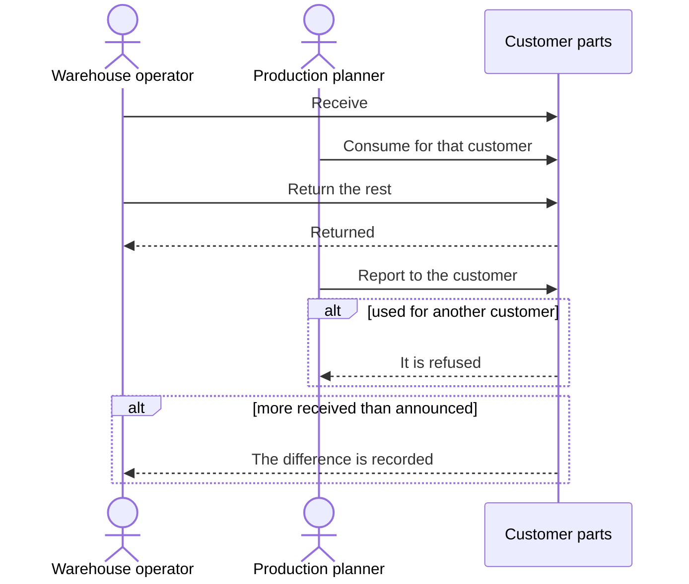

🏠 [Specs](../../../../README.md) › 🏷️ [Sectors](../../../README.md) › 🏭 [SC05 Manufacturing](../../README.md) ›
📝 [Use cases](../README.md) › 📝 [Use cases: FL-SC05-02 Made to order](README.md) ›
📝 UC-SC05-05 Handle customer-supplied parts

# 📝 UC-SC05-05 Handle customer-supplied parts

**Status:** ✅ specified

## Summary

The warehouse receives parts supplied by a customer, keeps them apart and unvalued, consumes them only for that
customer's orders and returns the rest.

## Personas

- [U15 Warehouse operator](../../../../01-users/personas/u15-warehouse-operator.md)
- [U21 Production planner](../../../../01-users/personas/u21-production-planner.md)

## Goal

Customer parts never mixed with the company's stock.

## Trigger

A customer sends parts.

## Frequency

Weekly for subcontract work.

## Preconditions

- The SC05 sector pack is installed for the company,
  [UC-F14-02](../../../../02-functional/f14-plugin-store/use-cases/01-find-and-install/uc-f14-02-install-a-plugin-or-sector-pack.md),
  and its users have their roles,
  [UC-F1-06](../../../../02-functional/f01-administration/use-cases/04-edit-a-role/uc-f01-06-edit-a-role-and-its-record-rules.md).

## Postconditions

- **Success:** parts are consumed for that customer or returned.
- **Failed:** the receipt is refused with its reason.

## Main flow

1. The warehouse operator receives the parts on
   [S-SC05-05 Customer parts](../../screens/02-made-to-order/s-sc05-05-customer-parts.md) at zero value
   ([BR-SC05-05](../../business-rules/br-sc05-05-customer-parts-stay-the-customer-s.md)).
2. Orders for that customer consume them.
3. The warehouse operator returns the rest with a delivery note,
   [UC-F7-06](../../../../02-functional/f07-purchasing-and-stock/use-cases/04-pick-pack-and-ship/uc-f07-06-pick-pack-and-ship.md).
4. The customer gets a statement of parts received, used and returned.

## Alternative flows

- 1a. Damaged on receipt: the damage is recorded with photos and the customer told.

## Error flows

- 2e. Used for another customer: it is refused.
- 1e. More received than announced: the difference is recorded.
- Any step: a call to a service or an outside system fails: it is retried first
  ([BR-F3-32](../../../../02-functional/f03-assistant/business-rules/br-f03-32-retry-before-an-error.md)), then the
  error message pattern ([D122](../../../../06-decisions/ux/d122-error-message-standard.md)) says what failed; what was
  typed is kept.

## Business rules

- [BR-SC05-05 Customer parts stay the customer's](../../business-rules/br-sc05-05-customer-parts-stay-the-customer-s.md)
- [BR-F12-12 Subcontracted stock stays ours](../../../../02-functional/f12-manufacturing/business-rules/br-f12-12-subcontracted-stock-stays-ours.md)

## Entities

- [E-SC05-05 Customer-supplied part](../../data/e-sc05-05-customer-supplied-part.md)

## Permissions

The warehouse operator and production planner roles; the record rules of their role and site apply,
[UC-F1-06](../../../../02-functional/f01-administration/use-cases/04-edit-a-role/uc-f01-06-edit-a-role-and-its-record-rules.md).

## Notifications

None beyond the in-app updates of the records concerned.

## Audit events

Every creation, change and state change of customer-supplied part records, with who, when and the values before and
after (T3).

## AI involvement

The AI assistant answers questions on the customer-supplied part records of this use case, with links, and prepares them
as drafts the user confirms. It works within the user's rights,
[BR-F3-34](../../../../02-functional/f03-assistant/business-rules/br-f03-34-every-capability-is-reachable-from-the-assistant.md),
and never deletes or does anything irreversible without the user's confirmation,
[BR-F3-07](../../../../02-functional/f03-assistant/business-rules/br-f03-07-no-deletes-no-irreversible-acts.md).

## API, MCP and A2A exposure

Through the API and webhooks (T5) and the MCP and A2A gateway (T6), with the caller's rights,
[BR-F3-34](../../../../02-functional/f03-assistant/business-rules/br-f03-34-every-capability-is-reachable-from-the-assistant.md),
reading, creating and changing the records of this use case; nothing irreversible without a person's confirmation.

## Screens

- [S-SC05-05 Customer parts](../../screens/02-made-to-order/s-sc05-05-customer-parts.md)

## Flowchart

See [FL-SC05-02 Made to order](../../flows/fl-sc05-02-made-to-order.md#flowchart).

## Sequence diagram

## Acceptance criteria

1. **Given** the example factory's 50 castings C4 from Acme **when** they are received **then** they show in Acme's
   stock at zero value.
2. **Given** Acme's casting C4 **when** an order for another customer reserves it **then** it is refused.

## Non-functional notes

[D408](../../../../06-decisions/technical/d408-performance-and-profiles.md)'s targets
([performance](../../../../05-non-functional/performance.md)): 95 % of screens within 1 second; lists paged on the
server, the first page within 1 second; reports within 5 seconds or in the background. WCAG 2.2 AA and RGAA
([D46](../../../../06-decisions/ux/d46-accessibility-standard.md)).

## Regulatory references

None specific to this use case; the sector's legal rules are listed in [SC05 regulatory](../../regulatory.md).

## Related use cases

- [UC-SC05-03 Configure a product to order](uc-sc05-03-configure-a-product-to-order.md)

## Open questions

None.

---

⬅️ [UC-SC05-04 Engineer to order](uc-sc05-04-engineer-to-order.md) · ⬆️ [Up](README.md) ·
➡️ [UC-SC05-06 Package and label](../03-packaging/uc-sc05-06-package-and-label.md)
