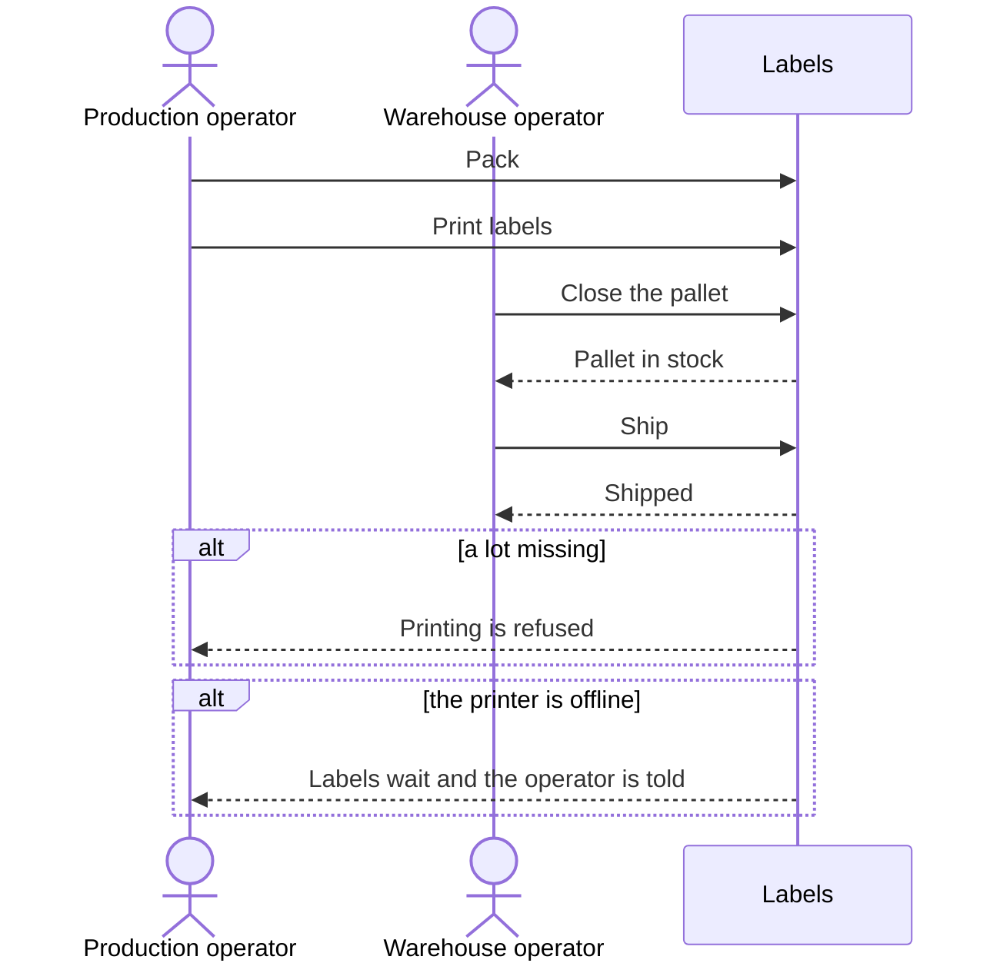

🏠 [Specs](../../../../README.md) › 🏷️ [Sectors](../../../README.md) › 🏭 [SC05 Manufacturing](../../README.md) ›
📝 [Use cases](../README.md) › 📝 [Use cases: FL-SC05-03 Packaging](README.md) › 📝 UC-SC05-06 Package and label

# 📝 UC-SC05-06 Package and label

**Status:** ✅ specified

## Summary

The production operator packs the output, prints unit, case and pallet labels with barcode, lot and dates, and closes
the pallet for the warehouse.

## Personas

- [U20 Production operator](../../../../01-users/personas/u20-production-operator.md)
- [U15 Warehouse operator](../../../../01-users/personas/u15-warehouse-operator.md)

## Goal

Every package traceable by its label.

## Trigger

The end of a manufacturing order or a batch.

## Frequency

Many times a day.

## Preconditions

- The SC05 sector pack is installed for the company,
  [UC-F14-02](../../../../02-functional/f14-plugin-store/use-cases/01-find-and-install/uc-f14-02-install-a-plugin-or-sector-pack.md),
  and its users have their roles,
  [UC-F1-06](../../../../02-functional/f01-administration/use-cases/04-edit-a-role/uc-f01-06-edit-a-role-and-its-record-rules.md).

## Postconditions

- **Success:** the pallet is closed with its labels and in stock.
- **Failed:** the pallet stays open.

## Main flow

1. The production operator packs on [S-SC05-06 Labels](../../screens/03-packaging/s-sc05-06-labels.md) at the line's
   tablet.
2. Simple-ERP prints unit, case and pallet labels with barcode, lot and dates
   ([BR-SC05-06](../../business-rules/br-sc05-06-labels-carry-lot-and-barcode.md)).
3. The warehouse operator scans and stores it.
4. The pallet ships with its SSCC on the delivery note,
   [UC-F7-06](../../../../02-functional/f07-purchasing-and-stock/use-cases/04-pick-pack-and-ship/uc-f07-06-pick-pack-and-ship.md).

## Alternative flows

- 2a. The customer's label format: the customer's template is used.

## Error flows

- 2e. A lot missing: printing is refused.
- 2f. The printer is offline: labels wait and the operator is told.
- Any step: a call to a service or an outside system fails: it is retried first
  ([BR-F3-32](../../../../02-functional/f03-assistant/business-rules/br-f03-32-retry-before-an-error.md)), then the
  error message pattern ([D122](../../../../06-decisions/ux/d122-error-message-standard.md)) says what failed; what was
  typed is kept.

## Business rules

- [BR-SC05-06 Labels carry lot and barcode](../../business-rules/br-sc05-06-labels-carry-lot-and-barcode.md)
- [BR-F12-04 Lots traced both ways](../../../../02-functional/f12-manufacturing/business-rules/br-f12-04-lots-traced-both-ways.md)

## Entities

- [E-SC05-06 Label template](../../data/e-sc05-06-label-template.md)
- [E-SC15-14 Pallet](../../../sc15-wholesale-and-distribution/data/e-sc15-14-pallet.md)

## Permissions

The production operator and warehouse operator roles; the record rules of their role and site apply,
[UC-F1-06](../../../../02-functional/f01-administration/use-cases/04-edit-a-role/uc-f01-06-edit-a-role-and-its-record-rules.md).

## Notifications

None beyond the in-app updates of the records concerned.

## Audit events

Every creation, change and state change of label template records, with who, when and the values before and after (T3).

## AI involvement

The AI assistant answers questions on the label template records of this use case, with links, and prepares them as
drafts the user confirms. It works within the user's rights,
[BR-F3-34](../../../../02-functional/f03-assistant/business-rules/br-f03-34-every-capability-is-reachable-from-the-assistant.md),
and never deletes or does anything irreversible without the user's confirmation,
[BR-F3-07](../../../../02-functional/f03-assistant/business-rules/br-f03-07-no-deletes-no-irreversible-acts.md).

## API, MCP and A2A exposure

Through the API and webhooks (T5) and the MCP and A2A gateway (T6), with the caller's rights,
[BR-F3-34](../../../../02-functional/f03-assistant/business-rules/br-f03-34-every-capability-is-reachable-from-the-assistant.md),
reading, creating and changing the records of this use case; nothing irreversible without a person's confirmation.

## Screens

- [S-SC05-06 Labels](../../screens/03-packaging/s-sc05-06-labels.md)

## Flowchart

See [FL-SC05-03 Packaging](../../flows/fl-sc05-03-packaging.md#flowchart).

## Sequence diagram

## Acceptance criteria

1. **Given** the example factory's pallet of Sauce S2 lot L-120 **when** its label is printed **then** it shows the
   SSCC, lot L-120 and the best-before date.
2. **Given** a batch of Sauce S2 without its lot **when** labels are printed **then** printing is refused.

## Non-functional notes

The line tablet keeps working without the network,
[UC-F12-26](../../../../02-functional/f12-manufacturing/use-cases/11-finite-schedule-and-the-tablet/uc-f12-26-keep-working-on-the-tablet-without-the-network.md).
[D408](../../../../06-decisions/technical/d408-performance-and-profiles.md)'s targets
([performance](../../../../05-non-functional/performance.md)): 95 % of screens within 1 second; lists paged on the
server, the first page within 1 second; reports within 5 seconds or in the background. WCAG 2.2 AA and RGAA
([D46](../../../../06-decisions/ux/d46-accessibility-standard.md)).

## Regulatory references

Legal values from the France country pack:
[CR-FR-061 Food traceability](../../../../10-country-packs/france/products/cr-fr-061-food-traceability.md).

## Related use cases

- [UC-SC05-02 Manage recipes with potency, yields and batch scaling](../01-production-setups/uc-sc05-02-manage-recipes-with-potency-yields-and-batch-scaling.md)

## Open questions

None.

---

⬅️ [UC-SC05-05 Handle customer-supplied parts](../02-made-to-order/uc-sc05-05-handle-customer-supplied-parts.md) ·
⬆️ [Up](README.md) ·
➡️ [UC-SC05-07 Control quality documents](../04-quality-system/uc-sc05-07-control-quality-documents.md)
