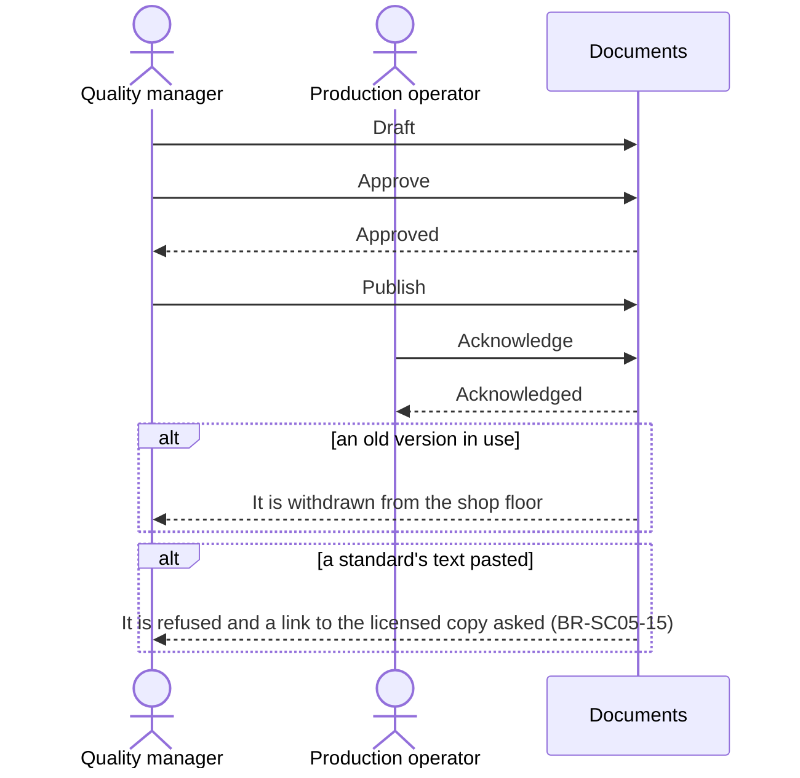

🏠 [Specs](../../../../README.md) › 🏷️ [Sectors](../../../README.md) › 🏭 [SC05 Manufacturing](../../README.md) ›
📝 [Use cases](../README.md) › 📝 [Use cases: FL-SC05-04 Quality system](README.md) ›
📝 UC-SC05-07 Control quality documents

# 📝 UC-SC05-07 Control quality documents

**Status:** ✅ specified

## Summary

The quality manager drafts procedures, instructions and forms, has them approved, publishes the new version and
withdraws the old one from the shop floor.

## Personas

- [U27 Quality manager](../../../../01-users/personas/u27-quality-manager.md)
- [U20 Production operator](../../../../01-users/personas/u20-production-operator.md)

## Goal

Only current approved documents in use.

## Trigger

A new document, a change or a periodic review.

## Frequency

Several a month.

## Preconditions

- The SC05 sector pack is installed for the company,
  [UC-F14-02](../../../../02-functional/f14-plugin-store/use-cases/01-find-and-install/uc-f14-02-install-a-plugin-or-sector-pack.md),
  and its users have their roles,
  [UC-F1-06](../../../../02-functional/f01-administration/use-cases/04-edit-a-role/uc-f01-06-edit-a-role-and-its-record-rules.md).

## Postconditions

- **Success:** the new version is published and the old one withdrawn.
- **Failed:** the old version stays in use.

## Main flow

1. The quality manager drafts the document on
   [S-SC05-07 Documents](../../screens/04-quality-system/s-sc05-07-documents.md).
2. The approver approves the version,
   [UC-F2-29](../../../../02-functional/f02-no-code-configuration/use-cases/11-rights-translations-and-approvals/uc-f02-29-set-up-an-approval-chain.md).
3. SimpleERP publishes it and withdraws the old one,
   [BR-SC05-07](../../business-rules/br-sc05-07-only-current-documents-in-use.md),
   [UC-F12-28](../../../../02-functional/f12-manufacturing/use-cases/10-people-and-tools/uc-f12-28-publish-versioned-work-instructions.md).
4. Operators acknowledge the new version before working with it,
   [BR-F12-23](../../../../02-functional/f12-manufacturing/business-rules/br-f12-23-a-new-instruction-version-is-acknowledged-before-work.md).

## Alternative flows

- 1a. A periodic review: the document is confirmed without change or revised.

## Error flows

- 3e. An old version in use: it is withdrawn from the shop floor.
- 1e. A standard's text pasted: it is refused and a link to the licensed copy asked
  ([BR-SC05-15](../../business-rules/br-sc05-15-standards-texts-licensed.md)).
- Any step: a call to a service or an outside system fails: it is retried first
  ([BR-F3-32](../../../../02-functional/f03-assistant/business-rules/br-f03-32-retry-before-an-error.md)), then the
  error message pattern ([D122](../../../../06-decisions/ux/d122-error-message-standard.md)) says what failed; what was
  typed is kept.

## Business rules

- [BR-SC05-07 Only current documents in use](../../business-rules/br-sc05-07-only-current-documents-in-use.md)
- [BR-SC05-15 Standards' texts licensed](../../business-rules/br-sc05-15-standards-texts-licensed.md)

## Entities

- [E-SC05-07 Controlled document](../../data/e-sc05-07-controlled-document.md)

## Permissions

The quality manager and production operator roles; the record rules of their role and site apply,
[UC-F1-06](../../../../02-functional/f01-administration/use-cases/04-edit-a-role/uc-f01-06-edit-a-role-and-its-record-rules.md).

## Notifications

None beyond the in-app updates of the records concerned.

## Audit events

Every creation, change and state change of controlled document records, with who, when and the values before and after
(T3).

## AI involvement

The AI assistant answers questions on the controlled document records of this use case, with links, and prepares them as
drafts the user confirms. It works within the user's rights,
[BR-F3-34](../../../../02-functional/f03-assistant/business-rules/br-f03-34-every-capability-is-reachable-from-the-assistant.md),
and never deletes or does anything irreversible without the user's confirmation,
[BR-F3-07](../../../../02-functional/f03-assistant/business-rules/br-f03-07-no-deletes-no-irreversible-acts.md).

## API, MCP and A2A exposure

Through the API and webhooks (T5) and the MCP and A2A gateway (T6), with the caller's rights,
[BR-F3-34](../../../../02-functional/f03-assistant/business-rules/br-f03-34-every-capability-is-reachable-from-the-assistant.md),
reading, creating and changing the records of this use case; nothing irreversible without a person's confirmation.

## Screens

- [S-SC05-07 Documents](../../screens/04-quality-system/s-sc05-07-documents.md)

## Flowchart

See [FL-SC05-04 Quality system](../../flows/fl-sc05-04-quality-system.md#flowchart).

## Sequence diagram

## Acceptance criteria

1. **Given** the example factory's procedure PR-07 v4 approved on 2 November **when** it is published **then** tablets
   show only v4.
2. **Given** PR-07 v3 opened on a tablet after v4 **when** the operator opens it **then** it is withdrawn from the shop
   floor.

## Non-functional notes

[D408](../../../../06-decisions/technical/d408-performance-and-profiles.md)'s targets
([performance](../../../../05-non-functional/performance.md)): 95 % of screens within 1 second; lists paged on the
server, the first page within 1 second; reports within 5 seconds or in the background. WCAG 2.2 AA and RGAA
([D46](../../../../06-decisions/ux/d46-accessibility-standard.md)).

## Regulatory references

None specific to this use case; the sector's legal rules are listed in [SC05 regulatory](../../regulatory.md).

## Related use cases

- [UC-SC05-08 Run internal audits](uc-sc05-08-run-internal-audits.md)

## Open questions

None.

---

⬅️ [UC-SC05-06 Package and label](../03-packaging/uc-sc05-06-package-and-label.md) · ⬆️ [Up](README.md) ·
➡️ [UC-SC05-08 Run internal audits](uc-sc05-08-run-internal-audits.md)
