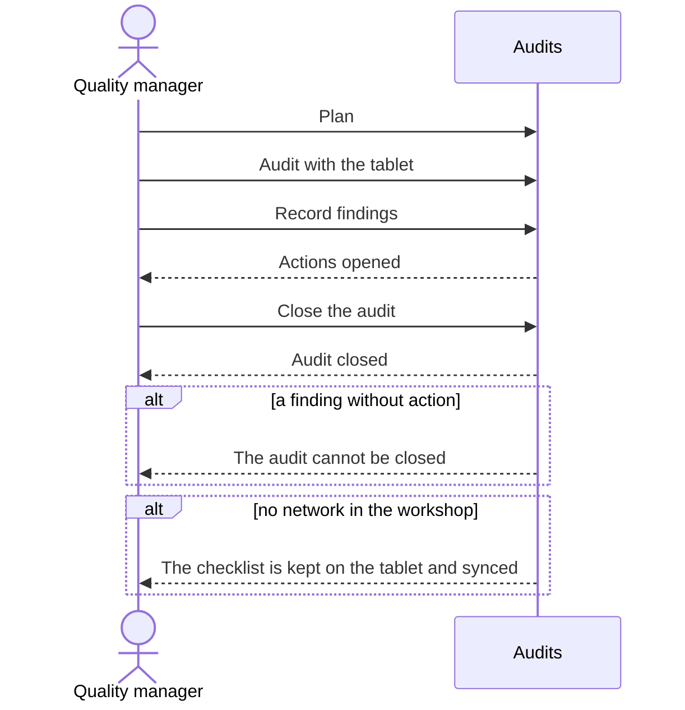

🏠 [Specs](../../../../README.md) › 🏷️ [Sectors](../../../README.md) › 🏭 [SC05 Manufacturing](../../README.md) ›
📝 [Use cases](../README.md) › 📝 [Use cases: FL-SC05-04 Quality system](README.md) › 📝 UC-SC05-08 Run internal audits

# 📝 UC-SC05-08 Run internal audits

**Status:** ✅ specified

## Summary

The quality manager plans internal audits, audits with a checklist on the tablet, and records findings, each becoming an
action.

## Personas

- [U27 Quality manager](../../../../01-users/personas/u27-quality-manager.md)

## Goal

The quality system checked and its gaps acted on.

## Trigger

The audit plan.

## Frequency

Monthly per process.

## Preconditions

- The SC05 sector pack is installed for the company,
  [UC-F14-02](../../../../02-functional/f14-plugin-store/use-cases/01-find-and-install/uc-f14-02-install-a-plugin-or-sector-pack.md),
  and its users have their roles,
  [UC-F1-06](../../../../02-functional/f01-administration/use-cases/04-edit-a-role/uc-f01-06-edit-a-role-and-its-record-rules.md).

## Postconditions

- **Success:** findings are recorded and each has its action.
- **Failed:** the audit stays open.

## Main flow

1. The quality manager plans the audit on [S-SC05-08 Audits](../../screens/04-quality-system/s-sc05-08-audits.md).
2. The quality manager follows the checklist on the tablet, with photos.
3. Each finding becomes an action, [BR-SC05-08](../../business-rules/br-sc05-08-audit-findings-become-actions.md),
   [UC-SC05-09](uc-sc05-09-handle-corrective-and-preventive-actions.md).
4. Once each finding has its action, the quality manager closes the audit and plans the next.

## Alternative flows

- 1a. A supplier audit: the findings go to the supplier's rating
  ([UC-SC05-10](../05-suppliers-and-customers/uc-sc05-10-evaluate-and-qualify-suppliers.md)).

## Error flows

- 3e. A finding without action: the audit cannot be closed.
- 2e. No network in the workshop: the checklist is kept on the tablet and synced.
- Any step: a call to a service or an outside system fails: it is retried first
  ([BR-F3-32](../../../../02-functional/f03-assistant/business-rules/br-f03-32-retry-before-an-error.md)), then the
  error message pattern ([D122](../../../../06-decisions/ux/d122-error-message-standard.md)) says what failed; what was
  typed is kept.

## Business rules

- [BR-SC05-08 Audit findings become actions](../../business-rules/br-sc05-08-audit-findings-become-actions.md)

## Entities

- [E-SC05-08 Audit](../../data/e-sc05-08-audit.md)
- [E-SC05-09 Quality action](../../data/e-sc05-09-quality-action.md)

## Permissions

The quality manager roles; the record rules of their role and site apply,
[UC-F1-06](../../../../02-functional/f01-administration/use-cases/04-edit-a-role/uc-f01-06-edit-a-role-and-its-record-rules.md).

## Notifications

None beyond the in-app updates of the records concerned.

## Audit events

Every creation, change and state change of audit, quality action records, with who, when and the values before and after
(T3).

## AI involvement

The AI assistant answers questions on the audit, quality action records of this use case, with links, and prepares them
as drafts the user confirms. It works within the user's rights,
[BR-F3-34](../../../../02-functional/f03-assistant/business-rules/br-f03-34-every-capability-is-reachable-from-the-assistant.md),
and never deletes or does anything irreversible without the user's confirmation,
[BR-F3-07](../../../../02-functional/f03-assistant/business-rules/br-f03-07-no-deletes-no-irreversible-acts.md).

## API, MCP and A2A exposure

Through the API and webhooks (T5) and the MCP and A2A gateway (T6), with the caller's rights,
[BR-F3-34](../../../../02-functional/f03-assistant/business-rules/br-f03-34-every-capability-is-reachable-from-the-assistant.md),
reading, creating and changing the records of this use case; nothing irreversible without a person's confirmation.

## Screens

- [S-SC05-08 Audits](../../screens/04-quality-system/s-sc05-08-audits.md)

## Flowchart

See [FL-SC05-04 Quality system](../../flows/fl-sc05-04-quality-system.md#flowchart).

## Sequence diagram

## Acceptance criteria

1. **Given** the example factory's welding audit on 12 November with 2 minor findings **when** it is closed **then** 2
   actions are open with owners and due dates.
2. **Given** welding audit of 12 November with 2 minor findings, one without action **when** it is closed **then** the
   audit cannot be closed.

## Non-functional notes

[D408](../../../../06-decisions/technical/d408-performance-and-profiles.md)'s targets
([performance](../../../../05-non-functional/performance.md)): 95 % of screens within 1 second; lists paged on the
server, the first page within 1 second; reports within 5 seconds or in the background. WCAG 2.2 AA and RGAA
([D46](../../../../06-decisions/ux/d46-accessibility-standard.md)).

## Regulatory references

None specific to this use case; the sector's legal rules are listed in [SC05 regulatory](../../regulatory.md).

## Related use cases

- [UC-SC05-09 Handle corrective and preventive actions](uc-sc05-09-handle-corrective-and-preventive-actions.md)

## Open questions

None.

---

⬅️ [UC-SC05-07 Control quality documents](uc-sc05-07-control-quality-documents.md) · ⬆️ [Up](README.md) ·
➡️ [UC-SC05-09 Handle corrective and preventive actions](uc-sc05-09-handle-corrective-and-preventive-actions.md)
