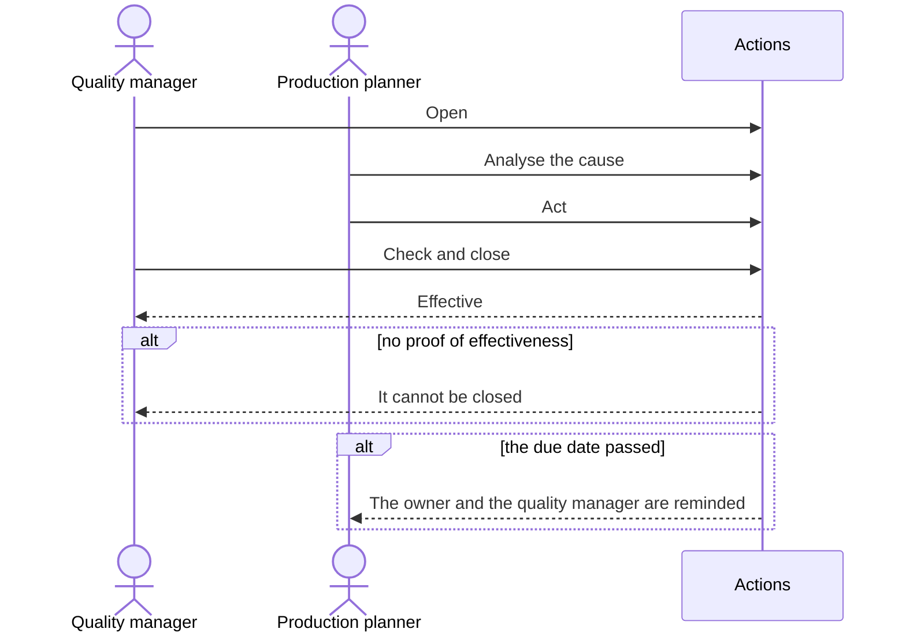

🏠 [Specs](../../../../README.md) › 🏷️ [Sectors](../../../README.md) › 🏭 [SC05 Manufacturing](../../README.md) ›
📝 [Use cases](../README.md) › 📝 [Use cases: FL-SC05-04 Quality system](README.md) ›
📝 UC-SC05-09 Handle corrective and preventive actions

# 📝 UC-SC05-09 Handle corrective and preventive actions

**Status:** ✅ specified

## Summary

The quality manager opens an action, the team analyses the root cause, acts, and closes it only with a check that it
worked.

## Personas

- [U27 Quality manager](../../../../01-users/personas/u27-quality-manager.md)
- [U21 Production planner](../../../../01-users/personas/u21-production-planner.md)

## Goal

Problems fixed for good.

## Trigger

An audit finding, a non-conformity or a complaint.

## Frequency

Weekly.

## Preconditions

- The SC05 sector pack is installed for the company,
  [UC-F14-02](../../../../02-functional/f14-plugin-store/use-cases/01-find-and-install/uc-f14-02-install-a-plugin-or-sector-pack.md),
  and its users have their roles,
  [UC-F1-06](../../../../02-functional/f01-administration/use-cases/04-edit-a-role/uc-f01-06-edit-a-role-and-its-record-rules.md).

## Postconditions

- **Success:** the action is closed as effective.
- **Failed:** the action stays open with its due date.

## Main flow

1. The quality manager opens the action on [S-SC05-09 Actions](../../screens/04-quality-system/s-sc05-09-actions.md)
   from its source.
2. The production planner records the root cause.
3. The planner records the action taken.
4. The quality manager checks it worked and closes it
   ([BR-SC05-09](../../business-rules/br-sc05-09-actions-closed-with-proof.md)).

## Alternative flows

- 1a. An action from an F12 non-conformity: it opens from the non-conformity,
  [UC-F12-06](../../../../02-functional/f12-manufacturing/use-cases/03-make-the-products/uc-f12-06-consume-components-trace-lots-and-serials.md).

## Error flows

- 4e. No proof of effectiveness: it cannot be closed.
- 3e. The due date passed: the owner and the quality manager are reminded.
- Any step: a call to a service or an outside system fails: it is retried first
  ([BR-F3-32](../../../../02-functional/f03-assistant/business-rules/br-f03-32-retry-before-an-error.md)), then the
  error message pattern ([D122](../../../../06-decisions/ux/d122-error-message-standard.md)) says what failed; what was
  typed is kept.

## Business rules

- [BR-SC05-09 Actions closed with proof](../../business-rules/br-sc05-09-actions-closed-with-proof.md)

## Entities

- [E-SC05-09 Quality action](../../data/e-sc05-09-quality-action.md)

## Permissions

The quality manager and production planner roles; the record rules of their role and site apply,
[UC-F1-06](../../../../02-functional/f01-administration/use-cases/04-edit-a-role/uc-f01-06-edit-a-role-and-its-record-rules.md).

## Notifications

None beyond the in-app updates of the records concerned.

## Audit events

Every creation, change and state change of quality action records, with who, when and the values before and after (T3).

## AI involvement

The AI assistant answers questions on the quality action records of this use case, with links, and prepares them as
drafts the user confirms. It works within the user's rights,
[BR-F3-34](../../../../02-functional/f03-assistant/business-rules/br-f03-34-every-capability-is-reachable-from-the-assistant.md),
and never deletes or does anything irreversible without the user's confirmation,
[BR-F3-07](../../../../02-functional/f03-assistant/business-rules/br-f03-07-no-deletes-no-irreversible-acts.md).

## API, MCP and A2A exposure

Through the API and webhooks (T5) and the MCP and A2A gateway (T6), with the caller's rights,
[BR-F3-34](../../../../02-functional/f03-assistant/business-rules/br-f03-34-every-capability-is-reachable-from-the-assistant.md),
reading, creating and changing the records of this use case; nothing irreversible without a person's confirmation.

## Screens

- [S-SC05-09 Actions](../../screens/04-quality-system/s-sc05-09-actions.md)

## Flowchart

See [FL-SC05-04 Quality system](../../flows/fl-sc05-04-quality-system.md#flowchart).

## Sequence diagram

## Acceptance criteria

1. **Given** the example factory's CA-41 from an audit, root cause "worn jig", jig replaced and 3 checks passed **when**
   it is closed **then** it is effective.
2. **Given** CA-41 without a check **when** the quality manager closes it **then** it cannot be closed.

## Non-functional notes

[D408](../../../../06-decisions/technical/d408-performance-and-profiles.md)'s targets
([performance](../../../../05-non-functional/performance.md)): 95 % of screens within 1 second; lists paged on the
server, the first page within 1 second; reports within 5 seconds or in the background. WCAG 2.2 AA and RGAA
([D46](../../../../06-decisions/ux/d46-accessibility-standard.md)).

## Regulatory references

None specific to this use case; the sector's legal rules are listed in [SC05 regulatory](../../regulatory.md).

## Related use cases

- [UC-SC05-08 Run internal audits](uc-sc05-08-run-internal-audits.md)

## Open questions

None.

---

⬅️ [UC-SC05-08 Run internal audits](uc-sc05-08-run-internal-audits.md) · ⬆️ [Up](README.md) ·
➡️ [UC-SC05-10](../05-suppliers-and-customers/uc-sc05-10-evaluate-and-qualify-suppliers.md)
