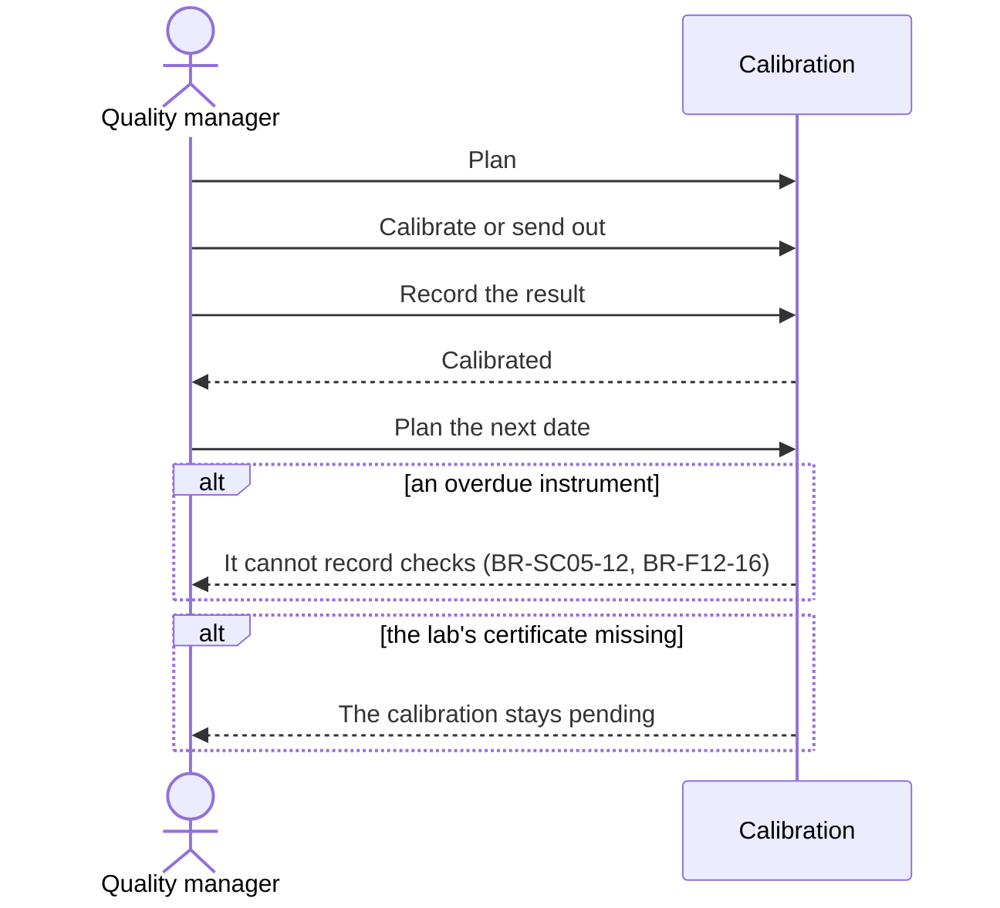

🏠 [Specs](../../../../README.md) › 🏷️ [Sectors](../../../README.md) › 🏭 [SC05 Manufacturing](../../README.md) ›
📝 [Use cases](../README.md) › 📝 [Use cases: FL-SC05-04 Quality system](README.md) ›
📝 UC-SC05-12 Calibrate measuring equipment

# 📝 UC-SC05-12 Calibrate measuring equipment

**Status:** ✅ specified

## Summary

The quality manager plans calibrations, calibrates or sends instruments out, and records results with F12's calibration;
an overdue instrument cannot record checks.

## Personas

- [U27 Quality manager](../../../../01-users/personas/u27-quality-manager.md)

## Goal

Every quality check measured with a calibrated instrument.

## Trigger

A calibration due date.

## Frequency

Monthly plan.

## Preconditions

- The SC05 sector pack is installed for the company,
  [UC-F14-02](../../../../02-functional/f14-plugin-store/use-cases/01-find-and-install/uc-f14-02-install-a-plugin-or-sector-pack.md),
  and its users have their roles,
  [UC-F1-06](../../../../02-functional/f01-administration/use-cases/04-edit-a-role/uc-f01-06-edit-a-role-and-its-record-rules.md).

## Postconditions

- **Success:** the instrument is calibrated with its certificate and next date.
- **Failed:** the instrument is blocked.

## Main flow

1. The quality manager plans calibrations on
   [S-SC05-12 Calibration](../../screens/04-quality-system/s-sc05-12-calibration.md),
   [UC-F12-21](../../../../02-functional/f12-manufacturing/use-cases/10-people-and-tools/uc-f12-21-calibrate-measuring-equipment.md).
2. The instrument is calibrated in house or sent to a lab.
3. The result, certificate and next date are recorded.
4. The next calibration date is planned from the instrument's interval.

## Alternative flows

- 3a. Out of tolerance found: the checks made since the last calibration are listed for review.

## Error flows

- 1e. An overdue instrument: it cannot record checks,
  [BR-SC05-12](../../business-rules/br-sc05-12-instruments-calibrated-before-use.md),
  [BR-F12-16](../../../../02-functional/f12-manufacturing/business-rules/br-f12-16-only-calibrated-instruments-record-checks.md).
- 2e. The lab's certificate missing: the calibration stays pending.
- Any step: a call to a service or an outside system fails: it is retried first
  ([BR-F3-32](../../../../02-functional/f03-assistant/business-rules/br-f03-32-retry-before-an-error.md)), then the
  error message pattern ([D122](../../../../06-decisions/ux/d122-error-message-standard.md)) says what failed; what was
  typed is kept.

## Business rules

- [BR-SC05-12 Instruments calibrated before use](../../business-rules/br-sc05-12-instruments-calibrated-before-use.md)
- [BR-F12-16 Only calibrated instruments record checks](../../../../02-functional/f12-manufacturing/business-rules/br-f12-16-only-calibrated-instruments-record-checks.md)

## Entities

- [E-SC05-12 Instrument](../../data/e-sc05-12-instrument.md)
- [E-F12-16 Calibration](../../../../02-functional/f12-manufacturing/data/e-f12-16-calibration.md)

## Permissions

The quality manager roles; the record rules of their role and site apply,
[UC-F1-06](../../../../02-functional/f01-administration/use-cases/04-edit-a-role/uc-f01-06-edit-a-role-and-its-record-rules.md).

## Notifications

None beyond the in-app updates of the records concerned.

## Audit events

Every creation, change and state change of instrument, calibration records, with who, when and the values before and
after (T3).

## AI involvement

The AI assistant answers questions on the instrument, calibration records of this use case, with links, and prepares
them as drafts the user confirms. It works within the user's rights,
[BR-F3-34](../../../../02-functional/f03-assistant/business-rules/br-f03-34-every-capability-is-reachable-from-the-assistant.md),
and never deletes or does anything irreversible without the user's confirmation,
[BR-F3-07](../../../../02-functional/f03-assistant/business-rules/br-f03-07-no-deletes-no-irreversible-acts.md).

## API, MCP and A2A exposure

Through the API and webhooks (T5) and the MCP and A2A gateway (T6), with the caller's rights,
[BR-F3-34](../../../../02-functional/f03-assistant/business-rules/br-f03-34-every-capability-is-reachable-from-the-assistant.md),
reading, creating and changing the records of this use case; nothing irreversible without a person's confirmation.

## Screens

- [S-SC05-12 Calibration](../../screens/04-quality-system/s-sc05-12-calibration.md)

## Flowchart

See [FL-SC05-04 Quality system](../../flows/fl-sc05-04-quality-system.md#flowchart).

## Sequence diagram

## Acceptance criteria

1. **Given** the example factory's caliper CAL-12 calibrated in May 2026 **when** a check is recorded in November 2026
   **then** it is accepted.
2. **Given** caliper CAL-12 due in May 2027 **when** it is used in June 2027 **then** it cannot record checks,
   [BR-SC05-12](../../business-rules/br-sc05-12-instruments-calibrated-before-use.md),
   [BR-F12-16](../../../../02-functional/f12-manufacturing/business-rules/br-f12-16-only-calibrated-instruments-record-checks.md).

## Non-functional notes

[D408](../../../../06-decisions/technical/d408-performance-and-profiles.md)'s targets
([performance](../../../../05-non-functional/performance.md)): 95 % of screens within 1 second; lists paged on the
server, the first page within 1 second; reports within 5 seconds or in the background. WCAG 2.2 AA and RGAA
([D46](../../../../06-decisions/ux/d46-accessibility-standard.md)).

## Regulatory references

None specific to this use case; the sector's legal rules are listed in [SC05 regulatory](../../regulatory.md).

## Related use cases

- [UC-SC05-08 Run internal audits](uc-sc05-08-run-internal-audits.md)

## Open questions

None.

---

⬅️ [UC-SC05-11 Analyse customer complaints](../05-suppliers-and-customers/uc-sc05-11-analyse-customer-complaints.md) ·
⬆️ [Up](README.md) ·
➡️ [UC-SC05-13 Qualify staff for operations](../05-suppliers-and-customers/uc-sc05-13-qualify-staff-for-operations.md)
