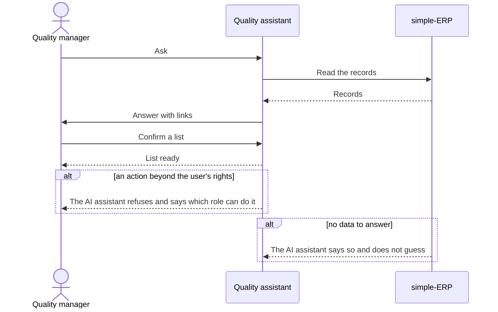

🏠 [Specs](../../../../README.md) › 🏷️ [Sectors](../../../README.md) › 🏭 [SC05 Manufacturing](../../README.md) ›
📝 [Use cases](../README.md) › 📝 [Use cases: FL-SC05-04 Quality system](README.md) ›
📝 UC-SC05-15 Ask the AI assistant about quality

# 📝 UC-SC05-15 Ask the AI assistant about quality

**Status:** ✅ specified

## Summary

The quality manager or the planner asks the AI assistant about open actions, audit readiness or a procedure's current
version, within their role's rights.

## Personas

- [U27 Quality manager](../../../../01-users/personas/u27-quality-manager.md)
- [U21 Production planner](../../../../01-users/personas/u21-production-planner.md)

## Goal

Answers without hunting through screens.

## Trigger

A question to the AI assistant.

## Frequency

Daily.

## Preconditions

- The SC05 sector pack is installed for the company,
  [UC-F14-02](../../../../02-functional/f14-plugin-store/use-cases/01-find-and-install/uc-f14-02-install-a-plugin-or-sector-pack.md),
  and its users have their roles,
  [UC-F1-06](../../../../02-functional/f01-administration/use-cases/04-edit-a-role/uc-f01-06-edit-a-role-and-its-record-rules.md).

## Postconditions

- **Success:** the answer cites the records, or the prepared list is confirmed.
- **Failed:** the AI assistant says it cannot answer or act, and why.

## Main flow

1. The quality manager asks on
   [S-SC05-15 Quality assistant](../../screens/04-quality-system/s-sc05-15-quality-assistant.md): "Which actions are
   overdue?".
2. The AI assistant reads the actions within the user's rights.
3. The AI assistant lists them with links.
4. The quality manager asks for the audit evidence list; the AI assistant prepares it,
   [UC-F3-04](../../../../02-functional/f03-assistant/use-cases/04-summarise-or-draft/uc-f03-04-summarise-and-draft.md).

## Alternative flows

- 1a. The planner asks for a procedure's current version: the AI assistant links the approved version.

## Error flows

- 4e. An action beyond the user's rights: the AI assistant refuses and says which role can do it.
- 2e. No data to answer: the AI assistant says so and does not guess.
- Any step: a call to a service or an outside system fails: it is retried first
  ([BR-F3-32](../../../../02-functional/f03-assistant/business-rules/br-f03-32-retry-before-an-error.md)), then the
  error message pattern ([D122](../../../../06-decisions/ux/d122-error-message-standard.md)) says what failed; what was
  typed is kept.

## Business rules

- [BR-SC05-01 The sector follows F12 and the country pack](../../business-rules/br-sc05-01-manufacturing-sector-follows-the-country-pack.md)
- [BR-F3-34 All capabilities via the AI assistant](../../../../02-functional/f03-assistant/business-rules/br-f03-34-every-capability-is-reachable-from-the-assistant.md)
- [BR-F3-07 No deletes, no irreversible acts](../../../../02-functional/f03-assistant/business-rules/br-f03-07-no-deletes-no-irreversible-acts.md)

## Entities

- [E-SC05-09 Quality action](../../data/e-sc05-09-quality-action.md)
- [E-SC05-07 Controlled document](../../data/e-sc05-07-controlled-document.md)

## Permissions

The quality manager and production planner roles; the record rules of their role and site apply,
[UC-F1-06](../../../../02-functional/f01-administration/use-cases/04-edit-a-role/uc-f01-06-edit-a-role-and-its-record-rules.md).

## Notifications

None beyond the in-app updates of the records concerned.

## Audit events

Every creation, change and state change of quality action, controlled document records, with who, when and the values
before and after (T3).

## AI involvement

The AI assistant answers questions on the quality action, controlled document records of this use case, with links, and
prepares them as drafts the user confirms. It works within the user's rights,
[BR-F3-34](../../../../02-functional/f03-assistant/business-rules/br-f03-34-every-capability-is-reachable-from-the-assistant.md),
and never deletes or does anything irreversible without the user's confirmation,
[BR-F3-07](../../../../02-functional/f03-assistant/business-rules/br-f03-07-no-deletes-no-irreversible-acts.md).

## API, MCP and A2A exposure

Through the API and webhooks (T5) and the MCP and A2A gateway (T6), with the caller's rights,
[BR-F3-34](../../../../02-functional/f03-assistant/business-rules/br-f03-34-every-capability-is-reachable-from-the-assistant.md),
reading, creating and changing the records of this use case; nothing irreversible without a person's confirmation.

## Screens

- [S-SC05-15 Quality assistant](../../screens/04-quality-system/s-sc05-15-quality-assistant.md)

## Flowchart

See [FL-SC05-04 Quality system](../../flows/fl-sc05-04-quality-system.md#flowchart).

## Sequence diagram

## Acceptance criteria

1. **Given** the example factory's 2 overdue actions **when** the quality manager asks **then** the AI assistant lists
   the 2 with links.
2. **Given** PR-07 **when** the planner asks **then** the AI assistant links the approved version.
3. **Given** an operator asking to close CA-41 **when** he asks **then** the AI assistant refuses and says which role
   can do it.

## Non-functional notes

[D408](../../../../06-decisions/technical/d408-performance-and-profiles.md)'s targets
([performance](../../../../05-non-functional/performance.md)): 95 % of screens within 1 second; lists paged on the
server, the first page within 1 second; reports within 5 seconds or in the background. WCAG 2.2 AA and RGAA
([D46](../../../../06-decisions/ux/d46-accessibility-standard.md)).

## Regulatory references

None specific to this use case; the sector's legal rules are listed in [SC05 regulatory](../../regulatory.md).

## Related use cases

- [UC-SC05-09 Handle corrective and preventive actions](uc-sc05-09-handle-corrective-and-preventive-actions.md)

## Open questions

None.

---

⬅️ [UC-SC05-14 Hold the management review](../05-suppliers-and-customers/uc-sc05-14-hold-the-management-review.md) ·
⬆️ [Up](README.md) ·
➡️ [UC-SC05-16 Declare alcohol excise](../06-excise-refurbishment-and-cutting/uc-sc05-16-declare-alcohol-excise.md)
