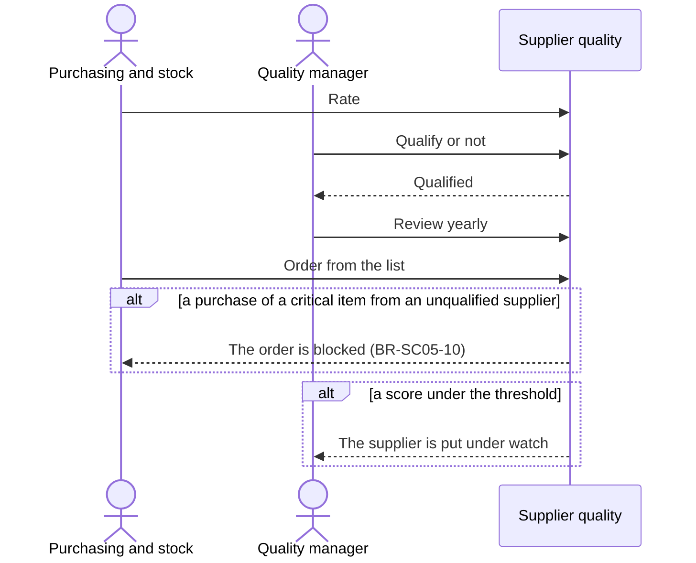

🏠 [Specs](../../../../README.md) › 🏷️ [Sectors](../../../README.md) › 🏭 [SC05 Manufacturing](../../README.md) ›
📝 [Use cases](../README.md) › 📝 [Use cases: FL-SC05-05 Suppliers and customers](README.md) ›
📝 UC-SC05-10 Evaluate and qualify suppliers

# 📝 UC-SC05-10 Evaluate and qualify suppliers

**Status:** ✅ specified

## Summary

The quality manager and purchasing rate suppliers from deliveries, quality and audits, qualify them for critical items,
and review the list yearly.

## Personas

- [U27 Quality manager](../../../../01-users/personas/u27-quality-manager.md)
- [U04 Purchasing and stock](../../../../01-users/personas/u04-purchasing.md)

## Goal

Critical items bought only from qualified suppliers.

## Trigger

A new supplier, the yearly review, or a quality issue.

## Frequency

Yearly per supplier.

## Preconditions

- The SC05 sector pack is installed for the company,
  [UC-F14-02](../../../../02-functional/f14-plugin-store/use-cases/01-find-and-install/uc-f14-02-install-a-plugin-or-sector-pack.md),
  and its users have their roles,
  [UC-F1-06](../../../../02-functional/f01-administration/use-cases/04-edit-a-role/uc-f01-06-edit-a-role-and-its-record-rules.md).

## Postconditions

- **Success:** the supplier is qualified or not, with its score.
- **Failed:** the supplier stays unqualified for critical items.

## Main flow

1. Purchasing reviews the rating on
   [S-SC05-10 Supplier quality](../../screens/05-suppliers-and-customers/s-sc05-10-supplier-quality.md) from deliveries
   and quality,
   [UC-F7-19](../../../../02-functional/f07-purchasing-and-stock/use-cases/07-supplier-agreements-and-performance/uc-f07-19-follow-supplier-performance.md).
2. The quality manager qualifies the supplier.
3. The list is reviewed yearly.
4. Purchasing orders critical items only from the qualified list,
   [UC-F7-02](../../../../02-functional/f07-purchasing-and-stock/use-cases/01-procure/uc-f07-02-order-from-a-supplier.md).

## Alternative flows

- 2a. A conditional approval: the supplier is qualified until a date with conditions.

## Error flows

- 1e. A purchase of a critical item from an unqualified supplier: the order is blocked
  ([BR-SC05-10](../../business-rules/br-sc05-10-suppliers-qualified-before-use.md)).
- 2e. A score under the threshold: the supplier is put under watch.
- Any step: a call to a service or an outside system fails: it is retried first
  ([BR-F3-32](../../../../02-functional/f03-assistant/business-rules/br-f03-32-retry-before-an-error.md)), then the
  error message pattern ([D122](../../../../06-decisions/ux/d122-error-message-standard.md)) says what failed; what was
  typed is kept.

## Business rules

- [BR-SC05-10 Suppliers qualified before use](../../business-rules/br-sc05-10-suppliers-qualified-before-use.md)

## Entities

- [E-SC05-10 Supplier rating](../../data/e-sc05-10-supplier-rating.md)

## Permissions

The quality manager and purchasing and stock roles; the record rules of their role and site apply,
[UC-F1-06](../../../../02-functional/f01-administration/use-cases/04-edit-a-role/uc-f01-06-edit-a-role-and-its-record-rules.md).

## Notifications

None beyond the in-app updates of the records concerned.

## Audit events

Every creation, change and state change of supplier rating records, with who, when and the values before and after (T3).

## AI involvement

The AI assistant answers questions on the supplier rating records of this use case, with links, and prepares them as
drafts the user confirms. It works within the user's rights,
[BR-F3-34](../../../../02-functional/f03-assistant/business-rules/br-f03-34-every-capability-is-reachable-from-the-assistant.md),
and never deletes or does anything irreversible without the user's confirmation,
[BR-F3-07](../../../../02-functional/f03-assistant/business-rules/br-f03-07-no-deletes-no-irreversible-acts.md).

## API, MCP and A2A exposure

Through the API and webhooks (T5) and the MCP and A2A gateway (T6), with the caller's rights,
[BR-F3-34](../../../../02-functional/f03-assistant/business-rules/br-f03-34-every-capability-is-reachable-from-the-assistant.md),
reading, creating and changing the records of this use case; nothing irreversible without a person's confirmation.

## Screens

- [S-SC05-10 Supplier quality](../../screens/05-suppliers-and-customers/s-sc05-10-supplier-quality.md)

## Flowchart

See [FL-SC05-05 Suppliers and customers](../../flows/fl-sc05-05-suppliers-and-customers.md#flowchart).

## Sequence diagram

## Acceptance criteria

1. **Given** the example factory's supplier Metal SA scoring 87 **when** it is qualified **then** orders of critical
   items to it pass.
2. **Given** a new steel supplier not qualified **when** an order for critical steel is placed **then** the order is
   blocked ([BR-SC05-10](../../business-rules/br-sc05-10-suppliers-qualified-before-use.md)).

## Non-functional notes

[D408](../../../../06-decisions/technical/d408-performance-and-profiles.md)'s targets
([performance](../../../../05-non-functional/performance.md)): 95 % of screens within 1 second; lists paged on the
server, the first page within 1 second; reports within 5 seconds or in the background. WCAG 2.2 AA and RGAA
([D46](../../../../06-decisions/ux/d46-accessibility-standard.md)).

## Regulatory references

None specific to this use case; the sector's legal rules are listed in [SC05 regulatory](../../regulatory.md).

## Related use cases

- [UC-SC05-11 Analyse customer complaints](uc-sc05-11-analyse-customer-complaints.md)

## Open questions

None.

---

⬅️ [UC-SC05-09](../04-quality-system/uc-sc05-09-handle-corrective-and-preventive-actions.md) · ⬆️ [Up](README.md) ·
➡️ [UC-SC05-11 Analyse customer complaints](uc-sc05-11-analyse-customer-complaints.md)
