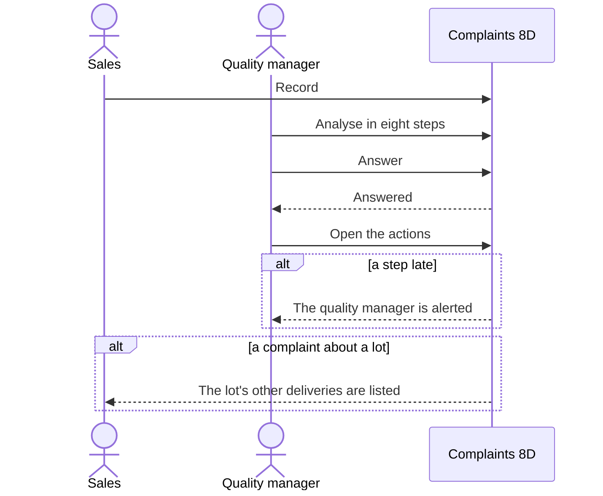

🏠 [Specs](../../../../README.md) › 🏷️ [Sectors](../../../README.md) › 🏭 [SC05 Manufacturing](../../README.md) ›
📝 [Use cases](../README.md) › 📝 [Use cases: FL-SC05-05 Suppliers and customers](README.md) ›
📝 UC-SC05-11 Analyse customer complaints

# 📝 UC-SC05-11 Analyse customer complaints

**Status:** 🔄 waiting for the owner

## Summary

Sales records a quality complaint; the quality manager analyses it in the eight disciplines, each step dated, and
answers the customer.

## Personas

- [U27 Quality manager](../../../../01-users/personas/u27-quality-manager.md)
- [U03 Sales](../../../../01-users/personas/u03-sales.md)

## Goal

Complaints answered with their root cause and fix.

## Trigger

A customer's quality complaint.

## Frequency

A few a month.

## Preconditions

- The SC05 sector pack is installed for the company,
  [UC-F14-02](../../../../02-functional/f14-plugin-store/use-cases/01-find-and-install/uc-f14-02-install-a-plugin-or-sector-pack.md),
  and its users have their roles,
  [UC-F1-06](../../../../02-functional/f01-administration/use-cases/04-edit-a-role/uc-f01-06-edit-a-role-and-its-record-rules.md).

## Postconditions

- **Success:** the 8D report is complete and sent.
- **Failed:** the complaint stays open and alerts.

## Main flow

1. Sales records the complaint on
   [S-SC05-11 Complaints 8D](../../screens/05-suppliers-and-customers/s-sc05-11-complaints-8d.md).
2. The quality manager fills D1 to D8, each dated
   ([BR-SC05-11](../../business-rules/br-sc05-11-complaints-analysed-in-eight-steps.md)).
3. The report is sent to the customer.
4. The corrective actions of D5 and D6 open in the action list
   ([UC-SC05-09](../04-quality-system/uc-sc05-09-handle-corrective-and-preventive-actions.md)).

## Alternative flows

- 3a. The customer's own form: the answer is exported in that form.

## Error flows

- 2e. A step late: the quality manager is alerted ((Proposed) containment D3 within 24 hours).
- 1e. A complaint about a lot: the lot's other deliveries are listed.
- Any step: a call to a service or an outside system fails: it is retried first
  ([BR-F3-32](../../../../02-functional/f03-assistant/business-rules/br-f03-32-retry-before-an-error.md)), then the
  error message pattern ([D122](../../../../06-decisions/ux/d122-error-message-standard.md)) says what failed; what was
  typed is kept.

## Business rules

- [BR-SC05-11 Complaints analysed in eight steps](../../business-rules/br-sc05-11-complaints-analysed-in-eight-steps.md)

## Entities

- [E-SC05-11 8D report](../../data/e-sc05-11-8d-report.md)

## Permissions

The quality manager and sales roles; the record rules of their role and site apply,
[UC-F1-06](../../../../02-functional/f01-administration/use-cases/04-edit-a-role/uc-f01-06-edit-a-role-and-its-record-rules.md).

## Notifications

None beyond the in-app updates of the records concerned.

## Audit events

Every creation, change and state change of 8d report records, with who, when and the values before and after (T3).

## AI involvement

The AI assistant answers questions on the 8d report records of this use case, with links, and prepares them as drafts
the user confirms. It works within the user's rights,
[BR-F3-34](../../../../02-functional/f03-assistant/business-rules/br-f03-34-every-capability-is-reachable-from-the-assistant.md),
and never deletes or does anything irreversible without the user's confirmation,
[BR-F3-07](../../../../02-functional/f03-assistant/business-rules/br-f03-07-no-deletes-no-irreversible-acts.md).

## API, MCP and A2A exposure

Through the API and webhooks (T5) and the MCP and A2A gateway (T6), with the caller's rights,
[BR-F3-34](../../../../02-functional/f03-assistant/business-rules/br-f03-34-every-capability-is-reachable-from-the-assistant.md),
reading, creating and changing the records of this use case; nothing irreversible without a person's confirmation.

## Screens

- [S-SC05-11 Complaints 8D](../../screens/05-suppliers-and-customers/s-sc05-11-complaints-8d.md)

## Flowchart

See [FL-SC05-05 Suppliers and customers](../../flows/fl-sc05-05-suppliers-and-customers.md#flowchart).

## Sequence diagram

## Acceptance criteria

1. **Given** the example factory's complaint CC-12 at D4 **when** D5 to D8 are filled **then** the report is sent to the
   customer.
2. **Given** complaint CC-12 without D3 after 2 days **when** the delay passes **then** the quality manager is alerted
   ((Proposed) containment D3 within 24 hours).

## Non-functional notes

[D408](../../../../06-decisions/technical/d408-performance-and-profiles.md)'s targets
([performance](../../../../05-non-functional/performance.md)): 95 % of screens within 1 second; lists paged on the
server, the first page within 1 second; reports within 5 seconds or in the background. WCAG 2.2 AA and RGAA
([D46](../../../../06-decisions/ux/d46-accessibility-standard.md)).

## Regulatory references

None specific to this use case; the sector's legal rules are listed in [SC05 regulatory](../../regulatory.md).

## Related use cases

- [UC-SC05-09 Handle corrective and preventive actions](../04-quality-system/uc-sc05-09-handle-corrective-and-preventive-actions.md)

## Open questions

None open; the items marked (Proposed) wait for the owner in the [waiting list](../../../../09-waiting/README.md).

---

⬅️ [UC-SC05-10 Evaluate and qualify suppliers](uc-sc05-10-evaluate-and-qualify-suppliers.md) · ⬆️ [Up](README.md) ·
➡️ [UC-SC05-12 Calibrate measuring equipment](../04-quality-system/uc-sc05-12-calibrate-measuring-equipment.md)
