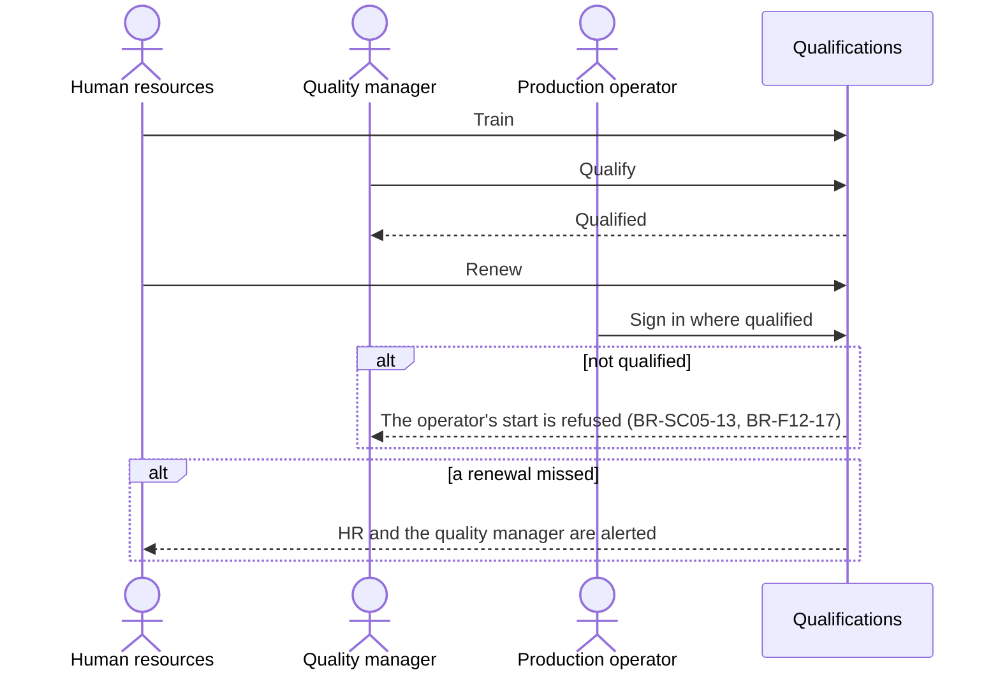

🏠 [Specs](../../../../README.md) › 🏷️ [Sectors](../../../README.md) › 🏭 [SC05 Manufacturing](../../README.md) ›
📝 [Use cases](../README.md) › 📝 [Use cases: FL-SC05-05 Suppliers and customers](README.md) ›
📝 UC-SC05-13 Qualify staff for operations

# 📝 UC-SC05-13 Qualify staff for operations

**Status:** ✅ specified

## Summary

The quality manager and HR train and qualify operators per operation with F12's qualification requirements, and renew
them before they lapse.

## Personas

- [U27 Quality manager](../../../../01-users/personas/u27-quality-manager.md)
- [U06 Human resources](../../../../01-users/personas/u06-hr.md)
- [U20 Production operator](../../../../01-users/personas/u20-production-operator.md)

## Goal

Every operation done by a qualified person.

## Trigger

A new operator, an operation or an expiry.

## Frequency

Monthly.

## Preconditions

- The SC05 sector pack is installed for the company,
  [UC-F14-02](../../../../02-functional/f14-plugin-store/use-cases/01-find-and-install/uc-f14-02-install-a-plugin-or-sector-pack.md),
  and its users have their roles,
  [UC-F1-06](../../../../02-functional/f01-administration/use-cases/04-edit-a-role/uc-f01-06-edit-a-role-and-its-record-rules.md).

## Postconditions

- **Success:** the qualification is valid until its date.
- **Failed:** the operator cannot start the operation.

## Main flow

1. HR plans the training,
   [UC-F9-25](../../../../02-functional/f09-hr-and-projects/use-cases/09-train-and-protect/uc-f09-25-run-the-training-plan-with-opco-funding.md).
2. The quality manager records the qualification on
   [S-SC05-13 Qualifications](../../screens/05-suppliers-and-customers/s-sc05-13-qualifications.md),
   [UC-F12-22](../../../../02-functional/f12-manufacturing/use-cases/10-people-and-tools/uc-f12-22-require-operator-qualifications-per-work-centre.md).
3. HR plans renewal before expiry.
4. At the work centre, the operator signs in only where qualified,
   [BR-F12-17](../../../../02-functional/f12-manufacturing/business-rules/br-f12-17-operators-sign-in-only-where-qualified.md).

## Alternative flows

- 2a. A temporary authorisation: under a tutor until a date.

## Error flows

- 2e. Not qualified: the operator's start is refused,
  [BR-SC05-13](../../business-rules/br-sc05-13-operators-qualified-for-the-operation.md),
  [BR-F12-17](../../../../02-functional/f12-manufacturing/business-rules/br-f12-17-operators-sign-in-only-where-qualified.md).
- 3e. A renewal missed: HR and the quality manager are alerted.
- Any step: a call to a service or an outside system fails: it is retried first
  ([BR-F3-32](../../../../02-functional/f03-assistant/business-rules/br-f03-32-retry-before-an-error.md)), then the
  error message pattern ([D122](../../../../06-decisions/ux/d122-error-message-standard.md)) says what failed; what was
  typed is kept.

## Business rules

- [BR-SC05-13 Operators qualified for the operation](../../business-rules/br-sc05-13-operators-qualified-for-the-operation.md)
- [BR-F12-17 Operators sign in only where qualified](../../../../02-functional/f12-manufacturing/business-rules/br-f12-17-operators-sign-in-only-where-qualified.md)

## Entities

- [E-SC05-13 Operation qualification](../../data/e-sc05-13-operation-qualification.md)
- [E-F12-17 Qualification requirement](../../../../02-functional/f12-manufacturing/data/e-f12-17-qualification-requirement.md)

## Permissions

The quality manager, human resources and production operator roles; the record rules of their role and site apply,
[UC-F1-06](../../../../02-functional/f01-administration/use-cases/04-edit-a-role/uc-f01-06-edit-a-role-and-its-record-rules.md).

## Notifications

None beyond the in-app updates of the records concerned.

## Audit events

Every creation, change and state change of operation qualification, qualification requirement records, with who, when
and the values before and after (T3).

## AI involvement

The AI assistant answers questions on the operation qualification, qualification requirement records of this use case,
with links, and prepares them as drafts the user confirms. It works within the user's rights,
[BR-F3-34](../../../../02-functional/f03-assistant/business-rules/br-f03-34-every-capability-is-reachable-from-the-assistant.md),
and never deletes or does anything irreversible without the user's confirmation,
[BR-F3-07](../../../../02-functional/f03-assistant/business-rules/br-f03-07-no-deletes-no-irreversible-acts.md).

## API, MCP and A2A exposure

Through the API and webhooks (T5) and the MCP and A2A gateway (T6), with the caller's rights,
[BR-F3-34](../../../../02-functional/f03-assistant/business-rules/br-f03-34-every-capability-is-reachable-from-the-assistant.md),
reading, creating and changing the records of this use case; nothing irreversible without a person's confirmation.

## Screens

- [S-SC05-13 Qualifications](../../screens/05-suppliers-and-customers/s-sc05-13-qualifications.md)

## Flowchart

See [FL-SC05-05 Suppliers and customers](../../flows/fl-sc05-05-suppliers-and-customers.md#flowchart).

## Sequence diagram

## Acceptance criteria

1. **Given** the example factory's P. N. qualified for welding until 2027-11 **when** he starts welding in 2026 **then**
   the start is accepted.
2. **Given** P. N. after 2027-11 for welding **when** he starts a welding operation **then** the operator's start is
   refused, [BR-SC05-13](../../business-rules/br-sc05-13-operators-qualified-for-the-operation.md),
   [BR-F12-17](../../../../02-functional/f12-manufacturing/business-rules/br-f12-17-operators-sign-in-only-where-qualified.md).

## Non-functional notes

[D408](../../../../06-decisions/technical/d408-performance-and-profiles.md)'s targets
([performance](../../../../05-non-functional/performance.md)): 95 % of screens within 1 second; lists paged on the
server, the first page within 1 second; reports within 5 seconds or in the background. WCAG 2.2 AA and RGAA
([D46](../../../../06-decisions/ux/d46-accessibility-standard.md)).

## Regulatory references

None specific to this use case; the sector's legal rules are listed in [SC05 regulatory](../../regulatory.md).

## Related use cases

- [UC-SC05-14 Hold the management review](uc-sc05-14-hold-the-management-review.md)

## Open questions

None.

---

⬅️ [UC-SC05-12 Calibrate measuring equipment](../04-quality-system/uc-sc05-12-calibrate-measuring-equipment.md) ·
⬆️ [Up](README.md) · ➡️ [UC-SC05-14 Hold the management review](uc-sc05-14-hold-the-management-review.md)
