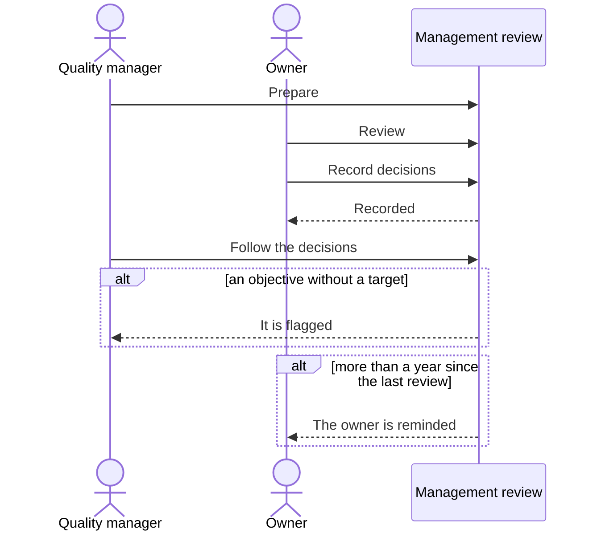

🏠 [Specs](../../../../README.md) › 🏷️ [Sectors](../../../README.md) › 🏭 [SC05 Manufacturing](../../README.md) ›
📝 [Use cases](../README.md) › 📝 [Use cases: FL-SC05-05 Suppliers and customers](README.md) ›
📝 UC-SC05-14 Hold the management review

# 📝 UC-SC05-14 Hold the management review

**Status:** ✅ specified

## Summary

The owner and the quality manager prepare the yearly management review with objectives and indicators, hold it and
record its decisions.

## Personas

- [U13 Owner](../../../../01-users/personas/u13-owner.md)
- [U27 Quality manager](../../../../01-users/personas/u27-quality-manager.md)

## Goal

Quality objectives reviewed and decided at least yearly.

## Trigger

The yearly date, or an incident.

## Frequency

Yearly.

## Preconditions

- The SC05 sector pack is installed for the company,
  [UC-F14-02](../../../../02-functional/f14-plugin-store/use-cases/01-find-and-install/uc-f14-02-install-a-plugin-or-sector-pack.md),
  and its users have their roles,
  [UC-F1-06](../../../../02-functional/f01-administration/use-cases/04-edit-a-role/uc-f01-06-edit-a-role-and-its-record-rules.md).

## Postconditions

- **Success:** decisions are recorded and become actions.
- **Failed:** the review is postponed with a date.

## Main flow

1. The quality manager prepares objectives and indicators on
   [S-SC05-14 Management review](../../screens/05-suppliers-and-customers/s-sc05-14-management-review.md).
2. The owner holds the review, recorded as a meeting,
   [UC-F4-03](../../../../02-functional/f04-meetings/use-cases/02-record-in-person-or-by-phone/uc-f04-03-record-an-in-person-meeting.md).
3. Decisions are recorded and become actions
   ([BR-SC05-14](../../business-rules/br-sc05-14-objectives-reviewed-yearly.md)).
4. The quality manager follows the decisions' actions until the next review.

## Alternative flows

- 1a. An extra review after an incident: it is held outside the yearly date.

## Error flows

- 1e. An objective without a target: it is flagged.
- 2e. More than a year since the last review: the owner is reminded.
- Any step: a call to a service or an outside system fails: it is retried first
  ([BR-F3-32](../../../../02-functional/f03-assistant/business-rules/br-f03-32-retry-before-an-error.md)), then the
  error message pattern ([D122](../../../../06-decisions/ux/d122-error-message-standard.md)) says what failed; what was
  typed is kept.

## Business rules

- [BR-SC05-14 Objectives reviewed yearly](../../business-rules/br-sc05-14-objectives-reviewed-yearly.md)

## Entities

- [E-SC05-14 Management review](../../data/e-sc05-14-management-review.md)

## Permissions

The owner and quality manager roles; the record rules of their role and site apply,
[UC-F1-06](../../../../02-functional/f01-administration/use-cases/04-edit-a-role/uc-f01-06-edit-a-role-and-its-record-rules.md).

## Notifications

None beyond the in-app updates of the records concerned.

## Audit events

Every creation, change and state change of management review records, with who, when and the values before and after
(T3).

## AI involvement

The AI assistant answers questions on the management review records of this use case, with links, and prepares them as
drafts the user confirms. It works within the user's rights,
[BR-F3-34](../../../../02-functional/f03-assistant/business-rules/br-f03-34-every-capability-is-reachable-from-the-assistant.md),
and never deletes or does anything irreversible without the user's confirmation,
[BR-F3-07](../../../../02-functional/f03-assistant/business-rules/br-f03-07-no-deletes-no-irreversible-acts.md).

## API, MCP and A2A exposure

Through the API and webhooks (T5) and the MCP and A2A gateway (T6), with the caller's rights,
[BR-F3-34](../../../../02-functional/f03-assistant/business-rules/br-f03-34-every-capability-is-reachable-from-the-assistant.md),
reading, creating and changing the records of this use case; nothing irreversible without a person's confirmation.

## Screens

- [S-SC05-14 Management review](../../screens/05-suppliers-and-customers/s-sc05-14-management-review.md)

## Flowchart

See [FL-SC05-05 Suppliers and customers](../../flows/fl-sc05-05-suppliers-and-customers.md#flowchart).

## Sequence diagram

## Acceptance criteria

1. **Given** the example factory's review on 2026-12-15 with the objective scrap under 1 % **when** it is recorded
   **then** the decisions show as actions with owners.
2. **Given** "reduce scrap" without a figure **when** the review is prepared **then** it is flagged.

## Non-functional notes

[D408](../../../../06-decisions/technical/d408-performance-and-profiles.md)'s targets
([performance](../../../../05-non-functional/performance.md)): 95 % of screens within 1 second; lists paged on the
server, the first page within 1 second; reports within 5 seconds or in the background. WCAG 2.2 AA and RGAA
([D46](../../../../06-decisions/ux/d46-accessibility-standard.md)).

## Regulatory references

None specific to this use case; the sector's legal rules are listed in [SC05 regulatory](../../regulatory.md).

## Related use cases

- [UC-SC05-09 Handle corrective and preventive actions](../04-quality-system/uc-sc05-09-handle-corrective-and-preventive-actions.md)

## Open questions

None.

---

⬅️ [UC-SC05-13 Qualify staff for operations](uc-sc05-13-qualify-staff-for-operations.md) · ⬆️ [Up](README.md) ·
➡️ [UC-SC05-15 Ask the AI assistant about quality](../04-quality-system/uc-sc05-15-ask-the-assistant-about-quality.md)
