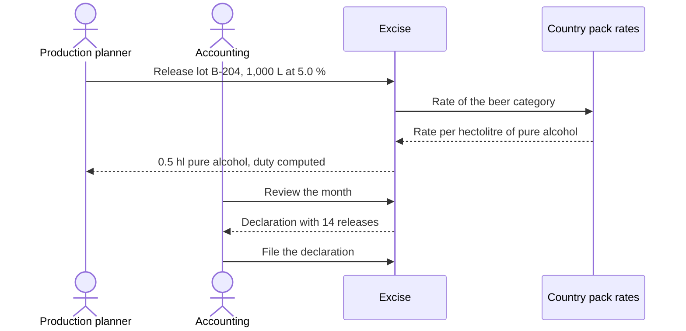

🏠 [Specs](../../../../README.md) › 🏷️ [Sectors](../../../README.md) › 🏭 [SC05 Manufacturing](../../README.md) ›
📝 [Use cases](../README.md) › 📝 [Use cases: FL-SC05-06 Excise, refurbishment, personalisation and cutting](README.md) ›
📝 UC-SC05-16 Declare alcohol excise

# 📝 UC-SC05-16 Declare alcohol excise

**Status:** 🔄 waiting for the owner

## Summary

A brewery, distillery or cider maker keeps its alcohol in a bonded warehouse, where no excise is due. The production
planner records each lot entering the warehouse with its volume and strength, and each movement out: released for
consumption (excise due), sent under suspension to another bonded warehouse, exported or destroyed. Accounting prepares
the monthly excise declaration from the releases and keeps the movement documents.

## Personas

- [U21 Production planner](../../../../01-users/personas/u21-production-planner.md)
- [U05 Accounting](../../../../01-users/personas/u05-accounting.md)

## Goal

Excise is declared for exactly the goods that left the bonded warehouse for consumption, at the rate of their category,
and every movement under suspension has its accompanying document.

## Trigger

A lot is produced into the bonded warehouse, a lot leaves it, or the month ends.

## Frequency

Several movements a week in a brewery, one declaration a month.

## Preconditions

- The company is approved as a bonded warehousekeeper and its approval number is entered in the settings.
- The lots are produced from a recipe or a manufacturing order
  ([E-F12-25 Recipe](../../../../02-functional/f12-manufacturing/data/e-f12-25-recipe.md),
  [E-F12-04](../../../../02-functional/f12-manufacturing/data/e-f12-04-manufacturing-order.md)).
- The excise categories and rates of the country pack are loaded for the period.

## Postconditions

- **Succeeded:** each lot is saved as bonded stock ([E-SC05-15 Bonded stock](../../data/e-sc05-15-bonded-stock.md)) with
  its movements, and the month's declaration lists every release with its volume of pure alcohol and the duty.
- **Failed:** no release is posted without its category and strength, no declaration is closed with a movement missing
  its document, and the gaps are listed.

## Main flow

1. The production planner opens the excise screen
   ([S-SC05-16](../../screens/06-excise-refurbishment-and-cutting/s-sc05-16-alcohol-excise.md)) and sees the bonded
   stock by lot.
2. When a batch is finished, simple-ERP creates the bonded stock from the lot: volume in litres, strength in percent and
   the category of the drink.
3. A customer order leaves the warehouse: the planner chooses Release for consumption, Send under suspension, Export or
   Destroy for the lot and the volume.
4. For a release, simple-ERP computes the volume of pure alcohol and the duty from the rate of the category
   ([BR-SC05-16](../../business-rules/br-sc05-16-excise-is-due-when-goods-leave-the-bonded-warehouse.md)) and adds the
   line to the month.
5. For a movement under suspension, it prepares the accompanying electronic document with the consignee's approval
   number and keeps it with the lot.
6. At month end accounting reviews the declaration, files it and posts the duty
   [UC-F8-07](../../../../02-functional/f08-accounting/use-cases/04-tax-assets-and-analytics/uc-f08-07-manage-vat-and-file-returns.md).

## Alternative flows

- 3a. Losses in the warehouse (evaporation, breakage): the planner records them with a reason and they leave the stock
  without duty within the tolerance of the country pack.
- 3b. Goods are returned by a customer after release: the line is reversed in the month and the duty is claimed back
  with the next declaration.
- 2a. Small producers use a reduced rate: the rate table of the country pack gives it for the yearly volume produced.

## Error flows

- 3e. The consignee's approval number is missing or not valid: the movement under suspension is refused and the number
  is asked for.
- 4e. The strength of the lot was never measured: the release is blocked until the strength is entered from the
  laboratory sheet.
- 6e. A movement has no document at month end: the declaration stays in review and lists the movement.
- Any step: a service does not answer; the call is retried first
  ([BR-F3-32](../../../../02-functional/f03-assistant/business-rules/br-f03-32-retry-before-an-error.md)), then the
  message follows the error pattern ([D122](../../../../06-decisions/ux/d122-error-message-standard.md)) and what the
  user typed stays on the screen.

## Business rules

- [BR-SC05-16](../../business-rules/br-sc05-16-excise-is-due-when-goods-leave-the-bonded-warehouse.md)
- [BR-SC05-06](../../business-rules/br-sc05-06-labels-carry-lot-and-barcode.md)

## Entities

- [E-SC05-15 Bonded stock](../../data/e-sc05-15-bonded-stock.md): created, changed, declared
- [E-F12-25 Recipe](../../../../02-functional/f12-manufacturing/data/e-f12-25-recipe.md): read, the recipe and its
  strength
- [E-F7-10](../../../../02-functional/f07-purchasing-and-stock/data/e-f07-10-lot-or-serial.md): read, the lot the stock
  comes from
- [E-F6-04 Order](../../../../02-functional/f06-customers-and-sales/data/e-f06-04-order.md): read, the order that
  releases the goods
- [E-F8-06 Tax return](../../../../02-functional/f08-accounting/data/e-f08-06-tax-return.md): created, the excise return
  filed at month end

## Permissions

Production planner records movements; accounting reviews, files and posts the duty. The owner reads the
declarations; production operators see the stock of their site only.

## Notifications

Accounting, in the app and by email: the declaration is due in five days or a movement has no document.

## Audit events

Each lot entered, each release, suspension, export, loss and destruction, each declaration and its lines, with the
volume, strength, rate, who and when.

## AI involvement

No AI step of its own. The AI assistant may open the screen and prefill it from the user's words; the user checks and
confirms
[BR-F3-07](../../../../02-functional/f03-assistant/business-rules/br-f03-07-no-deletes-no-irreversible-acts.md).

## API, MCP and A2A exposure

T5 operations of the capability for the personas above: create, read, update and list. The MCP tool of the
capability may read and propose, never confirm alone. No A2A skill.

## Screens

- [S-SC05-16](../../screens/06-excise-refurbishment-and-cutting/s-sc05-16-alcohol-excise.md)

## Flowchart

See
[FL-SC05-06 Excise, refurbishment, personalisation and cutting](../../flows/fl-sc05-06-excise-refurbishment-and-cutting.md#flowchart).

## Sequence diagram

## Acceptance criteria

1. **Given** a lot of 1,000 L of beer at 5.0 % and a rate of 3.50 EUR per percent and hectolitre in the pack's rate data
   **when** the planner releases it for consumption **then** the declaration line shows 0.5 hl of pure alcohol and a
   duty of 175.00 EUR.
2. **Given** a lot sent under suspension to another bonded warehouse **when** the planner confirms the movement **then**
   no duty is computed and the accompanying document is attached to the lot.
3. **Given** a release of a lot with no strength entered **when** the planner chooses Release **then** the release is
   refused and the missing strength is named.
4. **Given** a month with a movement that has no document **when** accounting opens the declaration **then** it stays in
   review and lists that movement.

## Non-functional notes

The screen answers within 2 seconds for 10,000 records; every change is audited.

## Regulatory references

Alcoholic drinks are held in a bonded warehouse approved by the customs authority, where no excise is due.
The duty becomes due when the goods leave it for consumption and is declared every month by the warehousekeeper, at a
rate per volume of pure alcohol that depends on the category of the drink. Movements under suspension travel with an
electronic accompanying document. The rates and the reduced rates for small producers are data of the France pack. The
France-pack rule is written later. Related:
[CR-FR-061](../../../../10-country-packs/france/products/cr-fr-061-food-traceability.md),
[CR-FR-007](../../../../10-country-packs/france/accounting/cr-fr-007-annual-stock-count.md).

- France-pack rule, (Proposed) until its law is read:
  [CR-FR-234 Alcohol excise and bonded warehouses](../../../../10-country-packs/france/tax-and-vat/cr-fr-234-alcohol-excise.md)

## Related use cases

- [UC-SC05-17 Refurbish electronics](uc-sc05-17-refurbish-electronics.md)
- [UC-F12-31](../../../../02-functional/f12-manufacturing/use-cases/09-recipes-and-batches/uc-f12-31-define-a-recipe-and-produce-in-batches.md)
- [UC-F7-08](../../../../02-functional/f07-purchasing-and-stock/use-cases/05-count-trace-and-analyse/uc-f07-08-trace-lots-and-serials-recall.md)

## Open questions

None.

---

⬅️ [UC-SC05-15 Ask the AI assistant about quality](../04-quality-system/uc-sc05-15-ask-the-assistant-about-quality.md) ·
⬆️ [Up](README.md) · ➡️ [UC-SC05-17 Refurbish electronics](uc-sc05-17-refurbish-electronics.md)
