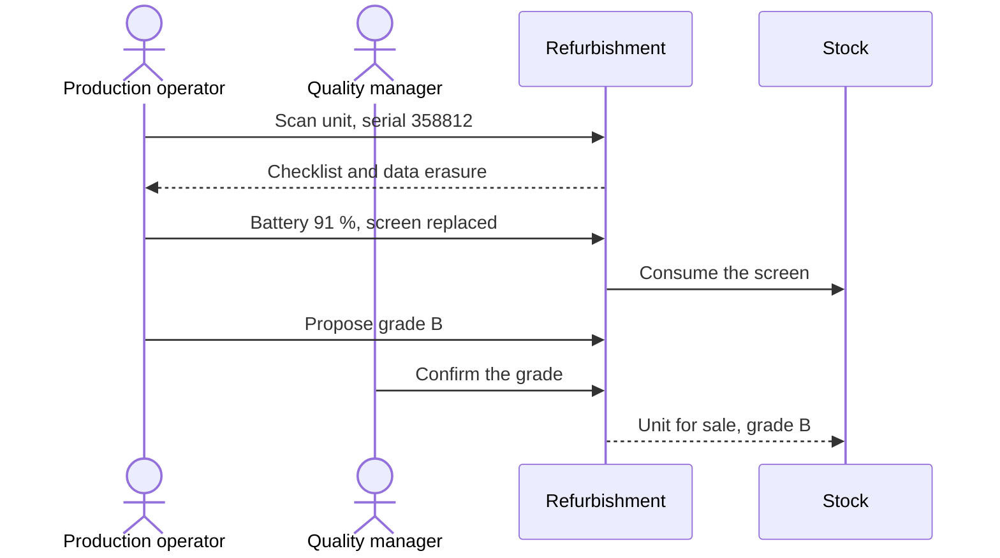

🏠 [Specs](../../../../README.md) › 🏷️ [Sectors](../../../README.md) › 🏭 [SC05 Manufacturing](../../README.md) ›
📝 [Use cases](../README.md) › 📝 [Use cases: FL-SC05-06 Excise, refurbishment, personalisation and cutting](README.md) ›
📝 UC-SC05-17 Refurbish electronics

# 📝 UC-SC05-17 Refurbish electronics

**Status:** ✅ specified

## Summary

A company refurbishing phones, laptops or other electronics receives used units, wipes them, tests them step by step,
replaces worn parts, grades each unit and sells it with a warranty. The operator works on a tablet at the bench and the
quality manager follows the grades and the return rate.

## Personas

- [U20 Production operator](../../../../01-users/personas/u20-production-operator.md)
- [U27 Quality manager](../../../../01-users/personas/u27-quality-manager.md)

## Goal

Every unit sold is tested, wiped of its previous owner's data and graded, and what was replaced stays traceable to the
unit.

## Trigger

A batch of used units is received, or a unit comes back from a customer.

## Frequency

Dozens to hundreds of units a day in a refurbishing workshop.

## Preconditions

- The test procedure of each product family is defined as quality checkpoints
  ([E-F12-07](../../../../02-functional/f12-manufacturing/data/e-f12-07-quality-control-point.md)).
- The grading scale (A, B, C) and its criteria are entered in the settings.
- The spare parts are items in stock
  ([E-F7-06 Item](../../../../02-functional/f07-purchasing-and-stock/data/e-f07-06-item.md)).

## Postconditions

- **Succeeded:** each unit is saved ([E-SC05-16 Graded unit](../../data/e-sc05-16-graded-unit.md)) with its serial
  number, test results, parts used, grade and warranty end date.
- **Failed:** a unit that fails a test is not graded and goes to repair or scrap, and no unit is sold without a grade.

## Main flow

1. The operator scans a received unit on the tablet
   ([S-SC05-17](../../screens/06-excise-refurbishment-and-cutting/s-sc05-17-refurbishment.md)) and its serial number
   creates the record.
2. The tablet runs the wipe and the checklist of the family: screen, battery health, ports, sensors and data erasure
   with its certificate.
3. The operator replaces any worn part, scanning it so that the part is consumed from stock
   [UC-F12-06](../../../../02-functional/f12-manufacturing/use-cases/03-make-the-products/uc-f12-06-consume-components-trace-lots-and-serials.md).
4. When all tests pass, the operator proposes a grade from the visual condition and the battery health.
5. The quality manager checks a sample of each day's units and confirms the grades
   ([BR-SC05-17](../../business-rules/br-sc05-17-every-refurbished-unit-is-graded-and-tested.md)).
6. The unit goes to stock as a graded item for sale with its warranty
   [UC-F6-31](../../../../02-functional/f06-customers-and-sales/use-cases/10-partners-contracts-and-warranties/uc-f06-31-handle-a-warranty-claim.md).

## Alternative flows

- 4a. A unit fails a test: it goes to repair
  [UC-F12-11](../../../../02-functional/f12-manufacturing/use-cases/03-make-the-products/uc-f12-11-unbuild-rework-and-repair.md)
  and returns to the tests afterwards.
- 2a. The unit is locked by its previous owner: it is set aside as Blocked and not graded.
- 1a. A returned unit of the same serial number reopens its record and keeps the history.

## Error flows

- 2e. The data erasure fails or has no certificate: the unit cannot pass to grading.
- 4e. A grade is proposed without a battery reading: the tablet asks for the reading.
- 5e. The sample shows a unit graded higher than its tests allow: the batch is held and re-graded.
- Any step: a service does not answer; the call is retried first
  ([BR-F3-32](../../../../02-functional/f03-assistant/business-rules/br-f03-32-retry-before-an-error.md)), then the
  message follows the error pattern ([D122](../../../../06-decisions/ux/d122-error-message-standard.md)) and what the
  user typed stays on the screen.

## Business rules

- [BR-SC05-17](../../business-rules/br-sc05-17-every-refurbished-unit-is-graded-and-tested.md)
- [BR-SC05-13](../../business-rules/br-sc05-13-operators-qualified-for-the-operation.md)

## Entities

- [E-SC05-16 Graded unit](../../data/e-sc05-16-graded-unit.md): created, changed, graded
- [E-F12-07](../../../../02-functional/f12-manufacturing/data/e-f12-07-quality-control-point.md): read and changed, the
  checkpoints of the tests
- [E-F7-10](../../../../02-functional/f07-purchasing-and-stock/data/e-f07-10-lot-or-serial.md): created, the serial
  number of the unit
- [E-F6-27 Warranty](../../../../02-functional/f06-customers-and-sales/data/e-f06-27-warranty.md): created, the warranty
  given at sale

## Permissions

Production operator tests and proposes grades; quality manager confirms them. Sales sees the grade and the
warranty only.

## Notifications

The quality manager, in the app: a batch is held after a sample or a grade is disputed.

## Audit events

Each test with its result, each part replaced, each data erasure with its certificate, each grade proposed and
confirmed, who and when.

## AI involvement

No AI step of its own. The AI assistant may open the screen and prefill it from the user's words; the user checks and
confirms
[BR-F3-07](../../../../02-functional/f03-assistant/business-rules/br-f03-07-no-deletes-no-irreversible-acts.md).

## API, MCP and A2A exposure

T5 operations of the capability for the personas above: create, read, update and list. The MCP tool of the
capability may read and propose, never confirm alone. No A2A skill.

## Screens

- [S-SC05-17](../../screens/06-excise-refurbishment-and-cutting/s-sc05-17-refurbishment.md)

## Flowchart

See
[FL-SC05-06 Excise, refurbishment, personalisation and cutting](../../flows/fl-sc05-06-excise-refurbishment-and-cutting.md#flowchart).

## Sequence diagram

## Acceptance criteria

1. **Given** a unit with a battery health of 91 % and a replaced screen **when** all tests pass **then** the tablet
   proposes grade B from the criteria in the settings.
2. **Given** a unit whose data erasure has no certificate **when** the operator tries to grade it **then** grading is
   refused and the erasure is asked for.
3. **Given** a sample of 5 units with one graded A that has a scratched frame **when** the quality manager checks them
   **then** the batch is held and the grades are redone.
4. **Given** a returned unit with a known serial number **when** it is scanned **then** the earlier record opens with
   its history.

## Non-functional notes

The screen answers within 2 seconds for 10,000 records; every change is audited.

## Regulatory references

Second-hand goods sold to consumers carry the legal guarantee of conformity, which the seller may shorten for
used goods but not below one year. A device sold as refurbished must have been tested and its worn parts replaced, and
the previous owner's personal data must be erased. Electronic equipment placed on the market is covered by the producer
responsibility identifier and its eco-contribution. The France-pack rule is written later. Related:
[CR-FR-067](../../../../10-country-packs/france/consumer/cr-fr-067-legal-guarantee-of-conformity.md),
[CR-FR-073](../../../../10-country-packs/france/products/cr-fr-073-epr-unique-identifier.md),
[CR-FR-052](../../../../10-country-packs/france/data-protection/cr-fr-052-storage-limitation.md).

## Related use cases

- [UC-SC05-16 Declare alcohol excise](uc-sc05-16-declare-alcohol-excise.md)
- [UC-SC05-18](uc-sc05-18-personalise-products-for-customers.md)
- [UC-SC05-13](../05-suppliers-and-customers/uc-sc05-13-qualify-staff-for-operations.md)
- [UC-F12-07](../../../../02-functional/f12-manufacturing/use-cases/04-quality-and-maintenance/uc-f12-07-run-quality-checks-and-handle-non-conformities.md)

## Open questions

None.

---

⬅️ [UC-SC05-16 Declare alcohol excise](uc-sc05-16-declare-alcohol-excise.md) · ⬆️ [Up](README.md) ·
➡️ [UC-SC05-18 Personalise products for customers](uc-sc05-18-personalise-products-for-customers.md)
