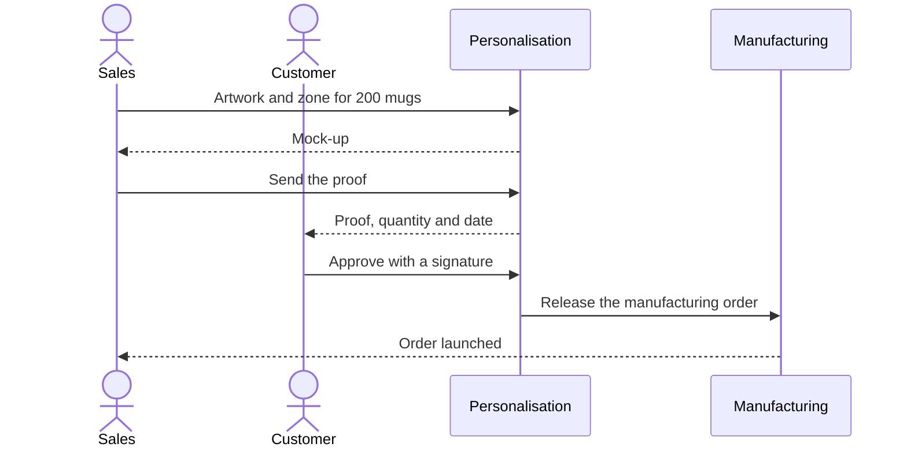

🏠 [Specs](../../../../README.md) › 🏷️ [Sectors](../../../README.md) › 🏭 [SC05 Manufacturing](../../README.md) ›
📝 [Use cases](../README.md) › 📝 [Use cases: FL-SC05-06 Excise, refurbishment, personalisation and cutting](README.md) ›
📝 UC-SC05-18 Personalise products for customers

# 📝 UC-SC05-18 Personalise products for customers

**Status:** ✅ specified

## Summary

Sales takes an order for products with the customer's logo or text (engraved, printed or embroidered), prepares a proof,
sends it to the customer and starts production only when the customer has approved it. The customer sees and answers the
proof on their phone.

## Personas

- [U03 Sales](../../../../01-users/personas/u03-sales.md)
- [U09 Customer](../../../../01-users/personas/u09-customer.md)

## Goal

Every personalised product is made from a proof the customer approved, so that no batch is made wrong and nothing is
made without agreement.

## Trigger

A customer orders a personalised product or sends an artwork.

## Frequency

Dozens of orders a week in a corporate gifts workshop.

## Preconditions

- The product has personalisation options (zones, methods, colours) in its configuration
  ([E-SC05-03 Configuration rule](../../data/e-sc05-03-configuration-rule.md)).
- The customer is a record
  ([E-F6-01](../../../../02-functional/f06-customers-and-sales/data/e-f06-01-customer-record.md)) with a quote or an
  order ([E-F6-03 Quote](../../../../02-functional/f06-customers-and-sales/data/e-f06-03-quote.md),
  [E-F6-04 Order](../../../../02-functional/f06-customers-and-sales/data/e-f06-04-order.md)).
- The artwork formats the workshop accepts are listed in the settings.

## Postconditions

- **Succeeded:** the proof is saved ([E-SC05-17 Proof](../../data/e-sc05-17-proof.md)) as Approved with the customer's
  agreement, and the manufacturing order starts from it.
- **Failed:** the proof stays Draft or Sent, no manufacturing order is released and the customer's remarks are kept.

## Main flow

1. Sales opens the personalisation screen
   ([S-SC05-18](../../screens/06-excise-refurbishment-and-cutting/s-sc05-18-personalisation.md)) on an order line and
   attaches the customer's artwork.
2. Sales chooses the zone, the method and the colours and SimpleERP renders a mock-up on the product.
3. Sales sends the proof; the customer receives it on the phone
   [UC-F6-11](../../../../02-functional/f06-customers-and-sales/use-cases/02-quote-to-order/uc-f06-11-use-the-customer-portal.md)
   with the quantity, the dates and the price.
4. The customer approves the proof with a signature or asks for changes, which create a new version
   ([BR-SC05-18](../../business-rules/br-sc05-18-production-starts-only-after-the-proof-is-approved.md)).
5. When the proof is Approved the manufacturing order is released
   [UC-F12-04](../../../../02-functional/f12-manufacturing/use-cases/03-make-the-products/uc-f12-04-launch-and-follow-manufacturing-orders.md)
   with the proof attached for the operators.
6. The proof stays with the order and is marked Used when the batch is delivered.

## Alternative flows

- 3a. The customer approves the first version: production is released the same day.
- 4a. The customer changes the quantity: the quote is revised and the proof is sent again.
- 6a. The customer disputes the result: the Approved proof is the reference to judge it.

## Error flows

- 2e. The artwork is below the minimum resolution for the method: the screen explains and asks for a vector file or a
  bigger image.
- 5e. A manufacturing order is launched on an order whose proof is not Approved: the launch is refused.
- 4e. The customer does not answer: the proof is reminded after three days and Expired after thirty.
- Any step: a service does not answer; the call is retried first
  ([BR-F3-32](../../../../02-functional/f03-assistant/business-rules/br-f03-32-retry-before-an-error.md)), then the
  message follows the error pattern ([D122](../../../../06-decisions/ux/d122-error-message-standard.md)) and what the
  user typed stays on the screen.

## Business rules

- [BR-SC05-18](../../business-rules/br-sc05-18-production-starts-only-after-the-proof-is-approved.md)
- [BR-SC05-03](../../business-rules/br-sc05-03-configured-products-stay-valid.md)

## Entities

- [E-SC05-17 Proof](../../data/e-sc05-17-proof.md): created, changed, approved
- [E-F6-04 Order](../../../../02-functional/f06-customers-and-sales/data/e-f06-04-order.md): read and changed, the order
  line that holds the proof
- [E-F12-04](../../../../02-functional/f12-manufacturing/data/e-f12-04-manufacturing-order.md): read, the order released
  by the approval
- [E-F6-01](../../../../02-functional/f06-customers-and-sales/data/e-f06-01-customer-record.md): read, the customer who
  approves

## Permissions

Sales creates and sends proofs; the customer approves their own proof; the production planner reads approved proofs.
Operators see the approved proof, never a draft.

## Notifications

The customer, by email and on the phone: a proof is waiting for their answer. Sales, in the app: a proof is approved or
changes are asked.

## Audit events

Each proof version, its sending, the customer's answer with the date, the signature and the device, and the release of
production.

## AI involvement

No AI step of its own. The AI assistant may open the screen and prefill it from the user's words; the user checks and
confirms
[BR-F3-07](../../../../02-functional/f03-assistant/business-rules/br-f03-07-no-deletes-no-irreversible-acts.md).

## API, MCP and A2A exposure

T5 operations of the capability for the personas above: create, read, update and list. The MCP tool of the
capability may read and propose, never confirm alone. No A2A skill.

## Screens

- [S-SC05-18](../../screens/06-excise-refurbishment-and-cutting/s-sc05-18-personalisation.md)

## Flowchart

See
[FL-SC05-06 Excise, refurbishment, personalisation and cutting](../../flows/fl-sc05-06-excise-refurbishment-and-cutting.md#flowchart).

## Sequence diagram

## Acceptance criteria

1. **Given** a proof sent to the customer for 200 mugs **when** the customer approves with a signature **then** the
   proof becomes Approved and the manufacturing order can be released.
2. **Given** a manufacturing order for a personalised line **when** the planner launches it while the proof is Sent
   **then** the launch is refused and the proof's state is shown.
3. **Given** a customer who asks for a colour change **when** they send their remark **then** a new version is created
   and the earlier one is marked Superseded.
4. **Given** a proof with no answer for 30 days **when** the delay ends **then** the proof becomes Expired and sales is
   told.

## Non-functional notes

The screen answers within 2 seconds for 10,000 records; every change is audited.

## Regulatory references

A consumer's right to withdraw from a distance sale does not apply to goods made to their specification, and
the proof the customer approved says so. The approval is kept as a proof of acceptance with the customer's signature.
The customer states that they hold the rights to the logo or text they send. The France-pack rule is written later.
Related: [CR-FR-036](../../../../10-country-packs/france/consumer/cr-fr-036-withdrawal-right.md),
[CR-FR-020](../../../../10-country-packs/france/invoicing/cr-fr-020-electronic-acceptance-and-signature.md).

## Related use cases

- [UC-SC05-17 Refurbish electronics](uc-sc05-17-refurbish-electronics.md)
- [UC-SC05-19](uc-sc05-19-optimise-cutting-and-keep-remnants.md)
- [UC-SC05-03](../02-made-to-order/uc-sc05-03-configure-a-product-to-order.md)
- [UC-F6-04](../../../../02-functional/f06-customers-and-sales/use-cases/02-quote-to-order/uc-f06-04-accept-or-sign-a-quote.md)

## Open questions

None.

---

⬅️ [UC-SC05-17 Refurbish electronics](uc-sc05-17-refurbish-electronics.md) · ⬆️ [Up](README.md) ·
➡️ [UC-SC05-19 Optimise cutting and keep remnants](uc-sc05-19-optimise-cutting-and-keep-remnants.md)
