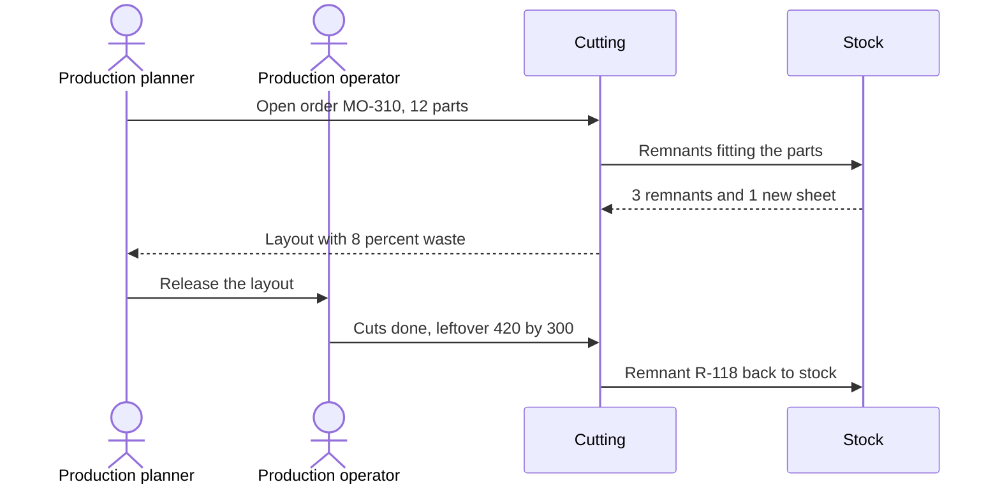

🏠 [Specs](../../../../README.md) › 🏷️ [Sectors](../../../README.md) › 🏭 [SC05 Manufacturing](../../README.md) ›
📝 [Use cases](../README.md) › 📝 [Use cases: FL-SC05-06 Excise, refurbishment, personalisation and cutting](README.md) ›
📝 UC-SC05-19 Optimise cutting and keep remnants

# 📝 UC-SC05-19 Optimise cutting and keep remnants

**Status:** ✅ specified

## Summary

A workshop cutting sheets, bars or rolls plans the cuts of an order on the stock it has, choosing the layout that wastes
least. Each leftover piece above a minimum size is put back into stock as a remnant with its dimensions and its material
certificate, ready for the next order.

## Personas

- [U21 Production planner](../../../../01-users/personas/u21-production-planner.md)
- [U20 Production operator](../../../../01-users/personas/u20-production-operator.md)

## Goal

Material is cut with the least waste, and every usable leftover is found again and used before new stock is opened.

## Trigger

A manufacturing order needs cut parts, or a cut is finished and leaves a leftover.

## Frequency

Every cutting order, several a day in a metal or glass workshop.

## Preconditions

- The raw material is stocked as sheets, bars or rolls with their dimensions
  ([E-F7-06 Item](../../../../02-functional/f07-purchasing-and-stock/data/e-f07-06-item.md),
  [E-F7-10](../../../../02-functional/f07-purchasing-and-stock/data/e-f07-10-lot-or-serial.md)).
- The parts to cut come from a bill of materials or a cut list
  ([E-F12-01](../../../../02-functional/f12-manufacturing/data/e-f12-01-bill-of-materials.md)).
- The minimum size of a remnant is set for the material in the settings.

## Postconditions

- **Succeeded:** the cuts are done as planned, the used material is consumed and each usable leftover is a remnant
  ([E-SC05-18 Remnant](../../data/e-sc05-18-remnant.md)) in stock with its dimensions and lot.
- **Failed:** no cut is started from a layout that does not fit the piece, and a leftover with no dimensions is not put
  into stock.

## Main flow

1. The production planner opens the cutting screen
   ([S-SC05-19 Cutting](../../screens/06-excise-refurbishment-and-cutting/s-sc05-19-cutting.md)) on a manufacturing
   order and sees the parts to cut with their dimensions.
2. SimpleERP proposes the layout on the remnants first, then on new stock, and shows the waste of each layout.
3. The planner chooses a layout and releases it to the operator's tablet
   [UC-F12-05](../../../../02-functional/f12-manufacturing/use-cases/03-make-the-products/uc-f12-05-work-on-the-shop-floor-tablet.md).
4. The operator confirms each cut and measures the leftover when it is finished.
5. A leftover above the minimum size is created as a remnant and goes back to stock with the lot and material
   certificate of its source
   ([BR-SC05-19](../../business-rules/br-sc05-19-remnants-above-the-minimum-size-go-back-to-stock.md)).
6. A leftover below the minimum size is scrapped and counted as waste.

## Alternative flows

- 2a. The grain or the coating of the material limits the rotation of the parts: the layout respects the direction of
  each part.
- 4a. The operator cuts differently from the layout: they record the real cuts and the layout is corrected.
- 5a. A remnant is too small for any order for a year: the planner proposes to scrap it.

## Error flows

- 2e. No layout fits a part in the largest piece in stock: the planner is told to order material.
- 5e. The source piece has no material certificate: the remnant is blocked from delivery to customers that require it.
- 4e. The measured leftover does not match the layout by more than the tolerance: the operator is asked to measure
  again.
- Any step: a service does not answer; the call is retried first
  ([BR-F3-32](../../../../02-functional/f03-assistant/business-rules/br-f03-32-retry-before-an-error.md)), then the
  message follows the error pattern ([D122](../../../../06-decisions/ux/d122-error-message-standard.md)) and what the
  user typed stays on the screen.

## Business rules

- [BR-SC05-19](../../business-rules/br-sc05-19-remnants-above-the-minimum-size-go-back-to-stock.md)
- [BR-SC05-06](../../business-rules/br-sc05-06-labels-carry-lot-and-barcode.md)

## Entities

- [E-SC05-18 Remnant](../../data/e-sc05-18-remnant.md): created, changed, scrapped
- [E-F12-04](../../../../02-functional/f12-manufacturing/data/e-f12-04-manufacturing-order.md): read, the order whose
  parts are cut
- [E-F7-10](../../../../02-functional/f07-purchasing-and-stock/data/e-f07-10-lot-or-serial.md): created, the lot of the
  remnant
- [E-F7-07 Location](../../../../02-functional/f07-purchasing-and-stock/data/e-f07-07-location.md): changed, the rack
  where the remnant is stored

## Permissions

Production planner plans and releases layouts; production operator confirms cuts and measures leftovers.
Purchasing reads the remnants to reduce what it orders.

## Notifications

The planner, in the app: a part fits no piece in stock, or a remnant has not moved for a year.

## Audit events

Each layout proposed and chosen, each cut confirmed, each remnant created, used or scrapped with its dimensions, who and
when.

## AI involvement

No AI step of its own. The AI assistant may open the screen and prefill it from the user's words; the user checks and
confirms
[BR-F3-07](../../../../02-functional/f03-assistant/business-rules/br-f03-07-no-deletes-no-irreversible-acts.md).

## API, MCP and A2A exposure

T5 operations of the capability for the personas above: create, read, update and list. The MCP tool of the
capability may read and propose, never confirm alone. No A2A skill.

## Screens

- [S-SC05-19 Cutting](../../screens/06-excise-refurbishment-and-cutting/s-sc05-19-cutting.md)

## Flowchart

See
[FL-SC05-06 Excise, refurbishment, personalisation and cutting](../../flows/fl-sc05-06-excise-refurbishment-and-cutting.md#flowchart).

## Sequence diagram

## Acceptance criteria

1. **Given** a minimum remnant size of 200 by 200 mm in the settings **when** a leftover of 420 by 300 mm is measured
   **then** it is created as a remnant and put back into stock.
2. **Given** a leftover of 150 by 90 mm **when** the operator confirms the cut **then** it is scrapped and counted as
   waste.
3. **Given** two remnants and a new sheet that can all hold the parts **when** the layout is proposed **then** the
   remnants are used first and the waste of each option is shown.
4. **Given** a part larger than every piece in stock **when** the planner opens the order **then** the screen asks to
   order material.

## Non-functional notes

The screen answers within 2 seconds for 10,000 records; every change is audited.

## Regulatory references

Offcuts that are scrapped are production waste and enter the waste register, and a remnant put back into
stock is valued at the cost of the material it came from, not at a higher price. The material certificate of the source
piece follows the remnant. The France-pack rules are [CR-FR-079 Waste register](../../../../10-country-packs/france/environment/cr-fr-079-waste-register.md) and [CR-FR-081 Production cost of manufactured stock](../../../../10-country-packs/france/accounting/cr-fr-081-production-cost-of-inventories.md). Related:
[CR-FR-079](../../../../10-country-packs/france/environment/cr-fr-079-waste-register.md),
[CR-FR-081](../../../../10-country-packs/france/accounting/cr-fr-081-production-cost-of-inventories.md).

## Related use cases

- [UC-SC05-18](uc-sc05-18-personalise-products-for-customers.md)
- [UC-SC05-05](../02-made-to-order/uc-sc05-05-handle-customer-supplied-parts.md)
- [UC-F12-04](../../../../02-functional/f12-manufacturing/use-cases/03-make-the-products/uc-f12-04-launch-and-follow-manufacturing-orders.md)

## Open questions

None.

---

⬅️ [UC-SC05-18 Personalise products for customers](uc-sc05-18-personalise-products-for-customers.md) ·
⬆️ [Up](README.md)
