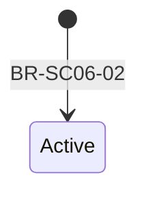

🏠 [Specs](../../../README.md) › 🏷️ [Sectors](../../README.md) › 🍽️ [SC06 Restaurant and hospitality](../README.md) ›
🗃️ [Data](README.md) › 🗃️ E-SC06-02 Menu dish

# 🗃️ E-SC06-02 Menu dish

**Status:** 🔄 waiting for the owner

## Purpose

A dish on a menu.

## Fields

| Name | Type | Required | Validation | Default | Example | Personal data | Custom fields |
|---|---|---|---|---|---|---|---|
| menu, dish | records | yes | - | - | Lunch, pesto pasta | no | no |
| price, allergens | amount, list | yes | BR-SC06-02 | - | 14.50, nuts, milk | no | no |
| home-made | yes, no | yes | BR-SC06-03 | no | yes | no | no |

## Relations

(Proposed) As its use cases.

## Lifecycle

## Indexes and search

(Proposed) By number, date, partner.

## Retention

Kept for the period of its kind of record in the country pack (D293), or else its kind's default in the
[retention schedule](../../../05-non-functional/data-retention.md).

## Audit

Every change.

## Import and export

(Proposed) CSV, FEC where relevant.

## Used by

- [UC-SC06-01](../use-cases/01-menus-and-food-safety/uc-sc06-01-cost-recipes-and-build-menus.md)
- [UC-SC06-02](../use-cases/01-menus-and-food-safety/uc-sc06-02-show-allergens-and-the-home-made-label.md)
- [UC-SC06-15](../use-cases/03-rooms-and-bookings/uc-sc06-15-ask-the-assistant-about-the-hotel-or-restaurant.md)

## Open questions

None.

---

⬅️ [E-SC06-01 Recipe](e-sc06-01-recipe.md) · ⬆️ [Up](README.md) ·
➡️ [E-SC06-03 Hygiene record](e-sc06-03-hygiene-record.md)
