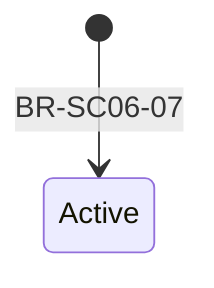

🏠 [Specs](../../../README.md) › 🏷️ [Sectors](../../README.md) › 🍽️ [SC06 Restaurant and hospitality](../README.md) ›
🗃️ [Data](README.md) › 🗃️ E-SC06-05 Staff benefit

# 🗃️ E-SC06-05 Staff benefit

**Status:** 🔄 waiting for the owner

## Purpose

A tip share or a staff meal.

## Fields

| Name | Type | Required | Validation | Default | Example | Personal data | Custom fields |
|---|---|---|---|---|---|---|---|
| person, period | records | yes | - | - | T. G., Nov | yes | no |
| kind, amount | tip, meal | yes | BR-SC06-07, BR-SC06-08 | - | tip, 84.00 | no | no |

## Relations

(Proposed) As its use cases.

## Lifecycle

## Indexes and search

(Proposed) By number, date, partner.

## Retention

Kept for the period of its kind of record in the country pack (D293), or else its kind's default in the
[retention schedule](../../../05-non-functional/data-retention.md).

## Audit

Every change.

## Import and export

(Proposed) CSV, FEC where relevant.

## Used by

- [UC-SC06-05](../use-cases/02-kitchen-stock-and-staff/uc-sc06-05-share-tips.md)
- [UC-SC06-06](../use-cases/02-kitchen-stock-and-staff/uc-sc06-06-record-staff-meals.md)

## Open questions

None.

---

⬅️ [E-SC06-04 Waste record](e-sc06-04-waste-record.md) · ⬆️ [Up](README.md) ·
➡️ [E-SC06-06 Hotel room](e-sc06-06-hotel-room.md)
