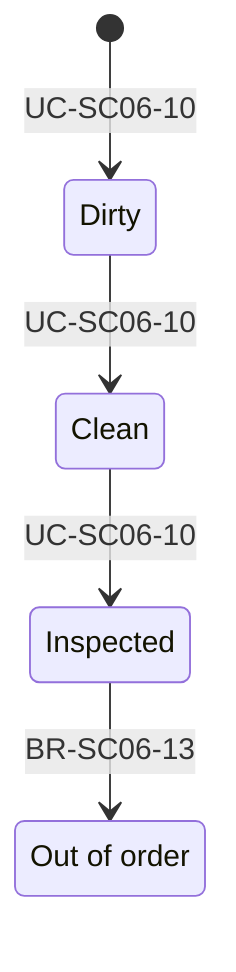

🏠 [Specs](../../../README.md) › 🏷️ [Sectors](../../README.md) › 🍽️ [SC06 Restaurant and hospitality](../README.md) ›
🗃️ [Data](README.md) › 🗃️ E-SC06-06 Hotel room

# 🗃️ E-SC06-06 Hotel room

**Status:** 🔄 waiting for the owner

## Purpose

A hotel room.

## Fields

| Name | Type | Required | Validation | Default | Example | Personal data | Custom fields |
|---|---|---|---|---|---|---|---|
| number, type | text | yes | unique | - | 214, double | no | no |
| status | dirty, clean, inspected, out of order | yes | BR-SC06-13 | clean | inspected | no | no |

## Relations

(Proposed) As its use cases.

## Lifecycle

## Indexes and search

(Proposed) By number, date, partner.

## Retention

Kept for the period of its kind of record in the country pack (D293), or else its kind's default in the
[retention schedule](../../../05-non-functional/data-retention.md).

## Audit

Every change.

## Import and export

(Proposed) CSV, FEC where relevant.

## Used by

- [UC-SC06-07](../use-cases/03-rooms-and-bookings/uc-sc06-07-manage-rooms-room-types-and-rates.md)
- [UC-SC06-10](../use-cases/04-stay-and-folio/uc-sc06-10-run-housekeeping.md)

## Open questions

None.

---

⬅️ [E-SC06-05 Staff benefit](e-sc06-05-staff-benefit.md) · ⬆️ [Up](README.md) ·
➡️ [E-SC06-07 Rate plan](e-sc06-07-rate-plan.md)
