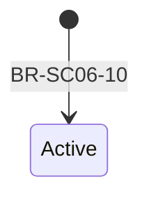

🏠 [Specs](../../../README.md) › 🏷️ [Sectors](../../README.md) › 🍽️ [SC06 Restaurant and hospitality](../README.md) ›
🗃️ [Data](README.md) › 🗃️ E-SC06-07 Rate plan

# 🗃️ E-SC06-07 Rate plan

**Status:** ✅ specified

## Purpose

Prices per room type and date.

## Fields

| Name | Type | Required | Validation | Default | Example | Personal data | Custom fields |
|---|---|---|---|---|---|---|---|
| type, plan | records | yes | - | - | double, flexible | no | no |
| date, price | date, amount | yes | BR-SC06-10 | - | Sat, 145 | no | no |

## Relations

As its use cases.

## Lifecycle

## Indexes and search

By number, date, partner.

## Retention

Kept for the period of its kind of record in the country pack (D293), or else its kind's default in the
[retention schedule](../../../05-non-functional/data-retention.md).

## Audit

Every change.

## Import and export

CSV, FEC where relevant.

## Used by

- [UC-SC06-07](../use-cases/03-rooms-and-bookings/uc-sc06-07-manage-rooms-room-types-and-rates.md)
- [UC-SC06-14](../use-cases/05-taxes-and-performance/uc-sc06-14-follow-occupancy-revenue-per-room-and-covers.md)

## Open questions

None.

---

⬅️ [E-SC06-06 Hotel room](e-sc06-06-hotel-room.md) · ⬆️ [Up](README.md) ·
➡️ [E-SC06-08 Room reservation](e-sc06-08-room-reservation.md)
