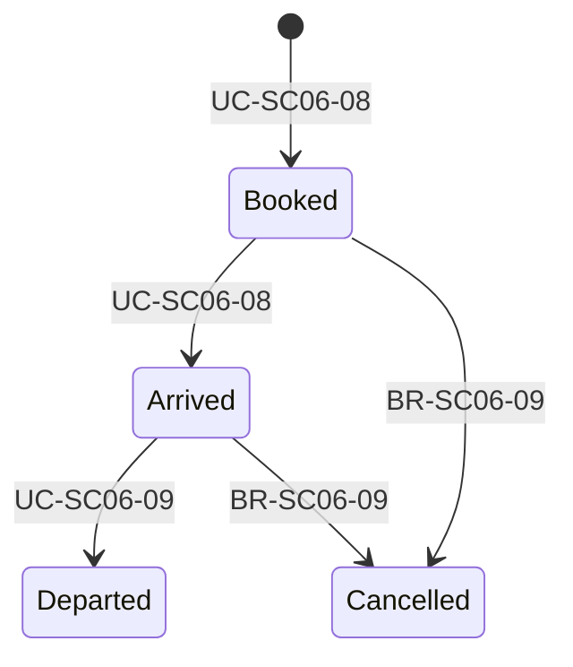

🏠 [Specs](../../../README.md) › 🏷️ [Sectors](../../README.md) › 🍽️ [SC06 Restaurant and hospitality](../README.md) ›
🗃️ [Data](README.md) › 🗃️ E-SC06-08 Room reservation

# 🗃️ E-SC06-08 Room reservation

**Status:** ✅ specified

## Purpose

A reservation.

## Fields

| Name | Type | Required | Validation | Default | Example | Personal data | Custom fields |
|---|---|---|---|---|---|---|---|
| guest, dates, room type | records | yes | BR-SC06-09 | - | J. M., 2 nights, double | yes | no |
| channel | direct or connector | yes | - | direct | Channel A | no | no |
| state | booked, arrived, departed, cancelled | yes | - | booked | arrived | no | no |

## Relations

As its use cases.

## Lifecycle

## Indexes and search

By number, date, partner.

## Retention

For the stay and the law's periods, then deleted:
[CR-FR-052 Personal data kept no longer than needed](../../../10-country-packs/france/data-protection/cr-fr-052-storage-limitation.md).

## Audit

Every change.

## Import and export

CSV, FEC where relevant.

## Used by

- [UC-SC06-08](../use-cases/03-rooms-and-bookings/uc-sc06-08-take-bookings-directly-and-through-channel-managers.md)
- [UC-SC06-09](../use-cases/04-stay-and-folio/uc-sc06-09-check-guests-in-and-out.md)
- [UC-SC06-15](../use-cases/03-rooms-and-bookings/uc-sc06-15-ask-the-assistant-about-the-hotel-or-restaurant.md)

## Open questions

None.

---

⬅️ [E-SC06-07 Rate plan](e-sc06-07-rate-plan.md) · ⬆️ [Up](README.md) · ➡️ [E-SC06-09 Folio](e-sc06-09-folio.md)
