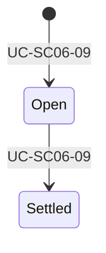

🏠 [Specs](../../../README.md) › 🏷️ [Sectors](../../README.md) › 🍽️ [SC06 Restaurant and hospitality](../README.md) ›
🗃️ [Data](README.md) › 🗃️ E-SC06-09 Folio

# 🗃️ E-SC06-09 Folio

**Status:** 🔄 waiting for the owner

## Purpose

A stay's bill.

## Fields

| Name | Type | Required | Validation | Default | Example | Personal data | Custom fields |
|---|---|---|---|---|---|---|---|
| booking | booking | yes | - | - | B-881 | no | no |
| charges | room, outlet, tax | yes | BR-SC06-11 | - | 2 nights, bar | no | no |
| state | open, settled | yes | - | open | settled | no | no |

## Relations

(Proposed) As its use cases.

## Lifecycle

## Indexes and search

(Proposed) By number, date, partner.

## Retention

As an accounting record:
[CR-FR-002 Accounting records kept 10 years](../../../10-country-packs/france/accounting/cr-fr-002-accounting-records-kept-ten-years.md).

## Audit

Every change.

## Import and export

(Proposed) CSV, FEC where relevant.

## Used by

- [UC-SC06-09](../use-cases/04-stay-and-folio/uc-sc06-09-check-guests-in-and-out.md)
- [UC-SC06-11](../use-cases/04-stay-and-folio/uc-sc06-11-merge-room-restaurant-and-bar-on-one-folio.md)
- [UC-SC06-14](../use-cases/05-taxes-and-performance/uc-sc06-14-follow-occupancy-revenue-per-room-and-covers.md)

## Open questions

None.

---

⬅️ [E-SC06-08 Room reservation](e-sc06-08-room-reservation.md) · ⬆️ [Up](README.md) ·
➡️ [E-SC06-10 Housekeeping task](e-sc06-10-housekeeping-task.md)
