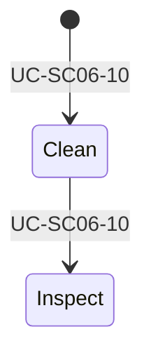

🏠 [Specs](../../../README.md) › 🏷️ [Sectors](../../README.md) › 🍽️ [SC06 Restaurant and hospitality](../README.md) ›
🗃️ [Data](README.md) › 🗃️ E-SC06-10 Housekeeping task

# 🗃️ E-SC06-10 Housekeeping task

**Status:** 🔄 waiting for the owner

## Purpose

A cleaning or check of a room.

## Fields

| Name | Type | Required | Validation | Default | Example | Personal data | Custom fields |
|---|---|---|---|---|---|---|---|
| room, date | records | yes | - | - | 214, 11 Nov | no | no |
| kind, state | clean, inspect | yes | - | - | done | no | no |

## Relations

(Proposed) As its use cases.

## Lifecycle

## Indexes and search

(Proposed) By number, date, partner.

## Retention

Kept for the period of its kind of record in the country pack (D293), or else its kind's default in the
[retention schedule](../../../05-non-functional/data-retention.md).

## Audit

Every change.

## Import and export

(Proposed) CSV, FEC where relevant.

## Used by

- [UC-SC06-10](../use-cases/04-stay-and-folio/uc-sc06-10-run-housekeeping.md)

## Open questions

None.

---

⬅️ [E-SC06-09 Folio](e-sc06-09-folio.md) · ⬆️ [Up](README.md) ·
➡️ [E-SC06-11 Tourist tax line](e-sc06-11-tourist-tax-line.md)
