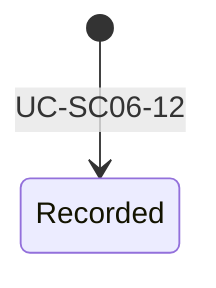

🏠 [Specs](../../../README.md) › 🏷️ [Sectors](../../README.md) › 🍽️ [SC06 Restaurant and hospitality](../README.md) ›
🗃️ [Data](README.md) › 🗃️ E-SC06-11 Tourist tax line

# 🗃️ E-SC06-11 Tourist tax line

**Status:** ✅ specified

## Purpose

Tax per night and guest.

## Fields

| Name | Type | Required | Validation | Default | Example | Personal data | Custom fields |
|---|---|---|---|---|---|---|---|
| folio, nights, guests | records | yes | BR-SC06-12 | - | B-881, 2, 2 | no | no |
| rate, amount | amounts | yes | - | - | 2.30, 9.20 | no | no |

## Relations

As its use cases.

## Lifecycle

## Indexes and search

By number, date, partner.

## Retention

As an accounting record:
[CR-FR-002 Accounting records kept 10 years](../../../10-country-packs/france/accounting/cr-fr-002-accounting-records-kept-ten-years.md).

## Audit

Every change.

## Import and export

CSV, FEC where relevant.

## Used by

- [UC-SC06-12](../use-cases/05-taxes-and-performance/uc-sc06-12-collect-the-tourist-tax.md)

## Open questions

None.

---

⬅️ [E-SC06-10 Housekeeping task](e-sc06-10-housekeeping-task.md) · ⬆️ [Up](README.md) ·
➡️ [E-SC06-12 Meal voucher payment](e-sc06-12-meal-voucher-payment.md)
