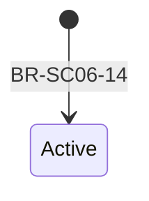

🏠 [Specs](../../../README.md) › 🏷️ [Sectors](../../README.md) › 🍽️ [SC06 Restaurant and hospitality](../README.md) ›
🗃️ [Data](README.md) › 🗃️ E-SC06-12 Meal voucher payment

# 🗃️ E-SC06-12 Meal voucher payment

**Status:** 🔄 waiting for the owner

## Purpose

A voucher taken at the till.

## Fields

| Name | Type | Required | Validation | Default | Example | Personal data | Custom fields |
|---|---|---|---|---|---|---|---|
| order, amount | records | yes | BR-SC06-14 | - | 2026-000184, 12.00 | no | no |
| issuer | text | no | - | - | Issuer A | no | no |

## Relations

(Proposed) As its use cases.

## Lifecycle

## Indexes and search

(Proposed) By number, date, partner.

## Retention

As an accounting record:
[CR-FR-002 Accounting records kept 10 years](../../../10-country-packs/france/accounting/cr-fr-002-accounting-records-kept-ten-years.md).

## Audit

Every change.

## Import and export

(Proposed) CSV, FEC where relevant.

## Used by

- [UC-SC06-13](../use-cases/05-taxes-and-performance/uc-sc06-13-accept-meal-vouchers.md)

## Open questions

None.

---

⬅️ [E-SC06-11 Tourist tax line](e-sc06-11-tourist-tax-line.md) · ⬆️ [Up](README.md) ·
➡️ [E-SC06-13 Pitch](e-sc06-13-pitch.md)
