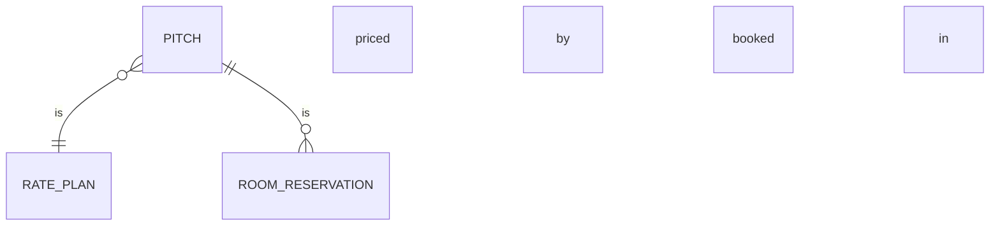
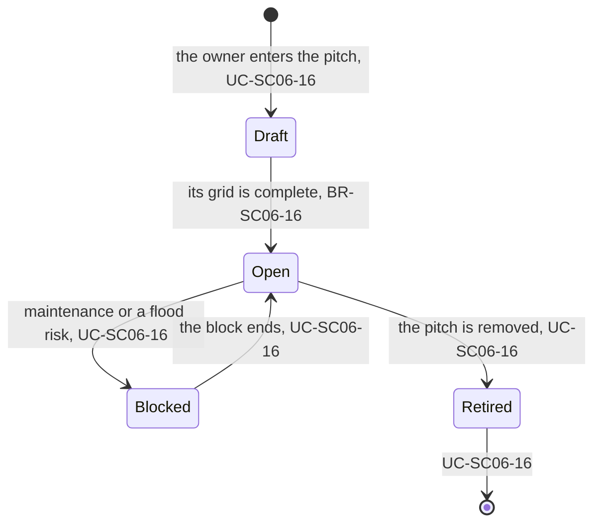

🏠 [Specs](../../../README.md) › 🏷️ [Sectors](../../README.md) › 🍽️ [SC06 Restaurant and hospitality](../README.md) ›
🗃️ [Data](README.md) › 🗃️ E-SC06-13 Pitch

# 🗃️ E-SC06-13 Pitch

**Status:** ✅ specified

## Purpose

One pitch of the campsite with its type, area, supply and the grid that prices it
([D550](../../../06-decisions/sectors/d550-benchmark-gaps-sc06-hospitality.md)). It is the unit that is sold, as the
room is for a hotel ([E-SC06-06 Hotel room](e-sc06-06-hotel-room.md)), with its own equipment and price grid.

## Fields

| Name | Type | Required | Validation | Default | Example | Personal data | Custom fields |
|---|---|---|---|---|---|---|---|
| number | text | yes | unique in the campsite | - | 44 | no | no |
| type | tent, caravan, motorhome, mobile home | yes | one of the four | caravan | caravan | no | no |
| area | number in m2 | yes | above 0 | - | 110 | no | no |
| power | number in amperes | no | 0 or more | 0 | 10 | no | no |
| grid | rate plan (E-SC06-07) | yes | a plan of the company | - | Summer 2026 | no | no |
| night price | amount in EUR | no | computed from the grid | - | 38.00 | no | no |
| services | list | no | water, drain, wifi | none | water, drain | no | no |
| blocked until | date | no | not before today | - | 2026-08-20 | no | no |
| state | Draft, Open, Blocked, Retired | yes | the lifecycle below | Draft | Open | no | no |
| owner | user | yes | a user of the company | the creator | Claire P. | yes | no |

## Relations

- [E-SC06-07 Rate plan](e-sc06-07-rate-plan.md)
- [E-SC06-08 Room reservation](e-sc06-08-room-reservation.md)
- [E-SC06-06 Hotel room](e-sc06-06-hotel-room.md)

## Lifecycle

## Indexes and search

By number, type, state and free dates.

## Retention

Kept as long as the campsite operates and three years after retirement.

## Audit

Every change of type, area, grid and block, with who, when and the old and new value.

## Import and export

CSV import of the pitches of a campsite and export of the occupancy by pitch.

## Used by

- [UC-SC06-16](../use-cases/06-campsites-catering-groups-and-pricing/uc-sc06-16-rent-campsite-pitches.md)
- [UC-SC06-08](../use-cases/03-rooms-and-bookings/uc-sc06-08-take-bookings-directly-and-through-channel-managers.md)

## Open questions

None.

---

⬅️ [E-SC06-12 Meal voucher payment](e-sc06-12-meal-voucher-payment.md) · ⬆️ [Up](README.md) ·
➡️ [E-SC06-14 Catering order](e-sc06-14-catering-order.md)
