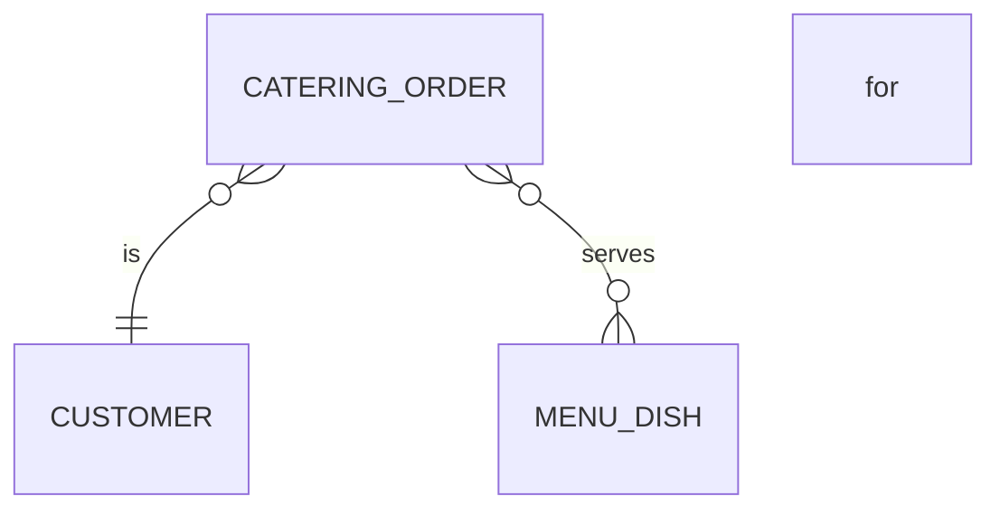
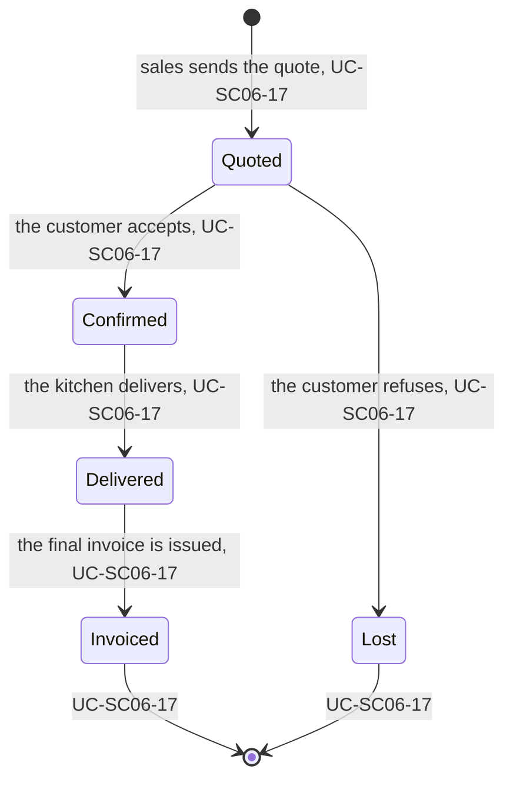

🏠 [Specs](../../../README.md) › 🏷️ [Sectors](../../README.md) › 🍽️ [SC06 Restaurant and hospitality](../README.md) ›
🗃️ [Data](README.md) › 🗃️ E-SC06-14 Catering order

# 🗃️ E-SC06-14 Catering order

**Status:** ✅ specified

## Purpose

An order for a meal prepared by the venue and served at another place: menu, headcount, allergens, price and delivery
([D550](../../../06-decisions/sectors/d550-benchmark-gaps-sc06-hospitality.md)). It is neither a restaurant bill nor a
customer quote ([E-F6-03 Quote](../../../02-functional/f06-customers-and-sales/data/e-f06-03-quote.md)): it holds what
the kitchen needs and links to the quote.

## Fields

| Name | Type | Required | Validation | Default | Example | Personal data | Custom fields |
|---|---|---|---|---|---|---|---|
| customer | customer (E-F6-01) | yes | a customer of the company | - | Atelier Roche | no | no |
| event date | date | yes | not in the past | - | 2026-12-14 | no | no |
| place | text | yes | an address | - | Rue des Lilas, Lyon | no | no |
| headcount | number | yes | above 0 | - | 80 | no | no |
| menu | list of dishes | yes | dishes of the company | - | salmon, tart | no | no |
| allergens | list | yes | from the dishes' recipes | computed | fish, milk, gluten | no | no |
| total | amount in EUR | yes | 0 or more | computed | 2,950.00 | no | no |
| deposit | amount in EUR | no | 0 to total | 30 % | 885.00 | no | no |
| delivery slot | date and time | no | on the event date | - | 2026-12-14 11:30 | no | no |
| state | Quoted, Confirmed, Delivered, Invoiced, Lost | yes | the lifecycle below | Quoted | Confirmed | no | no |
| owner | user | yes | a user of the company | the creator | Claire P. | yes | no |

## Relations

- [E-F6-01](../../../02-functional/f06-customers-and-sales/data/e-f06-01-customer-record.md)
- [E-SC06-02 Menu dish](e-sc06-02-menu-dish.md)
- [E-F6-03 Quote](../../../02-functional/f06-customers-and-sales/data/e-f06-03-quote.md)

## Lifecycle

## Indexes and search

By customer, event date, state and delivery slot.

## Retention

Kept with the invoice for ten years, and the sent allergen list with it.

## Audit

Every quote version, change of menu or headcount, allergen list sent and delivery record, with who and when.

## Import and export

Export of the production list of a day as a PDF for the kitchen.

## Used by

- [UC-SC06-17](../use-cases/06-campsites-catering-groups-and-pricing/uc-sc06-17-quote-and-deliver-catering.md)
- [UC-SC06-02](../use-cases/01-menus-and-food-safety/uc-sc06-02-show-allergens-and-the-home-made-label.md)

## Open questions

None.

---

⬅️ [E-SC06-13 Pitch](e-sc06-13-pitch.md) · ⬆️ [Up](README.md) ·
➡️ [E-SC06-15 Group booking](e-sc06-15-group-booking.md)
