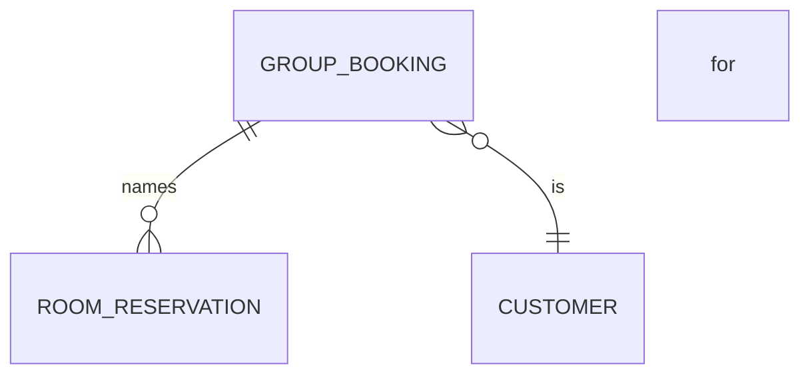
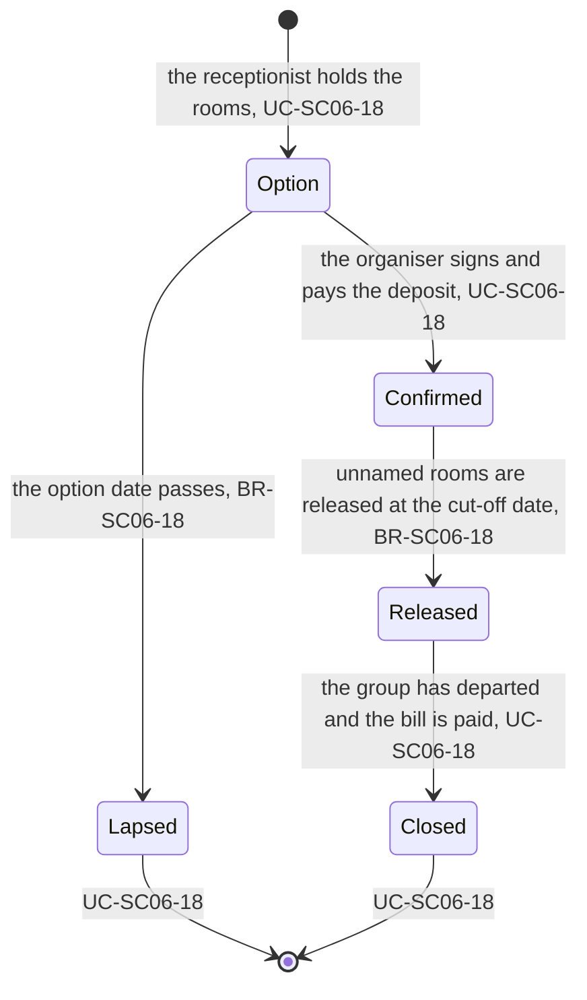

🏠 [Specs](../../../README.md) › 🏷️ [Sectors](../../README.md) › 🍽️ [SC06 Restaurant and hospitality](../README.md) ›
🗃️ [Data](README.md) › 🗃️ E-SC06-15 Group booking

# 🗃️ E-SC06-15 Group booking

**Status:** ✅ specified

## Purpose

A block of rooms held for a group or seminar, with its rate, option and cut-off dates and rooming list
([D550](../../../06-decisions/sectors/d550-benchmark-gaps-sc06-hospitality.md)). The individual stays are reservations
([E-SC06-08 Room reservation](e-sc06-08-room-reservation.md)) it creates for the named guests.

## Fields

| Name | Type | Required | Validation | Default | Example | Personal data | Custom fields |
|---|---|---|---|---|---|---|---|
| organiser | customer (E-F6-01) | yes | a customer of the company | - | Alpes Tech | no | no |
| from | date | yes | not in the past | - | 2026-06-04 | no | no |
| to | date | yes | after from | - | 2026-06-06 | no | no |
| rooms | number per room type | yes | within the hotel's rooms | - | 20 double, 10 single | no | no |
| rate | amount in EUR | yes | above 0 | from the rate plan | 118.00 | no | no |
| option date | date | yes | before the cut-off date | - | 2026-05-06 | no | no |
| cut-off date | date | yes | before the arrival | - | 2026-05-20 | no | no |
| rooms named | number | yes | 0 or more | 0 | 24 | no | no |
| attrition | percent | no | 0 to 100 | 0 | 10 | no | no |
| deposit | percent | no | 0 to 100 | 20 | 20 | no | no |
| state | Option, Confirmed, Lapsed, Released, Closed | yes | the lifecycle below | Option | Confirmed | no | no |
| owner | user | yes | a user of the company | the creator | Claire P. | yes | no |

## Relations

- [E-F6-01](../../../02-functional/f06-customers-and-sales/data/e-f06-01-customer-record.md)
- [E-SC06-08 Room reservation](e-sc06-08-room-reservation.md)
- [E-SC06-07 Rate plan](e-sc06-07-rate-plan.md)

## Lifecycle

## Indexes and search

By organiser, dates, state and cut-off date.

## Retention

Kept with the invoices for ten years.

## Audit

Every hold, change, confirmation, release and rooming list entry, with who, when and the rooms concerned.

## Import and export

CSV import of the rooming list, and export of the block's nights.

## Used by

- [UC-SC06-18](../use-cases/06-campsites-catering-groups-and-pricing/uc-sc06-18-book-groups-and-seminars.md)
- [UC-SC06-08](../use-cases/03-rooms-and-bookings/uc-sc06-08-take-bookings-directly-and-through-channel-managers.md)

## Open questions

None.

---

⬅️ [E-SC06-14 Catering order](e-sc06-14-catering-order.md) · ⬆️ [Up](README.md) ·
➡️ [E-SC06-16 Price rule](e-sc06-16-price-rule.md)
