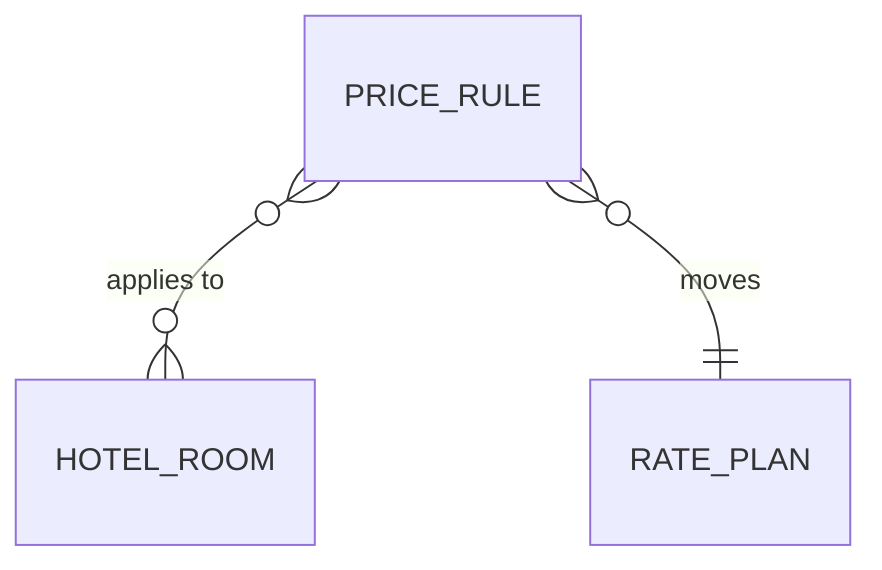
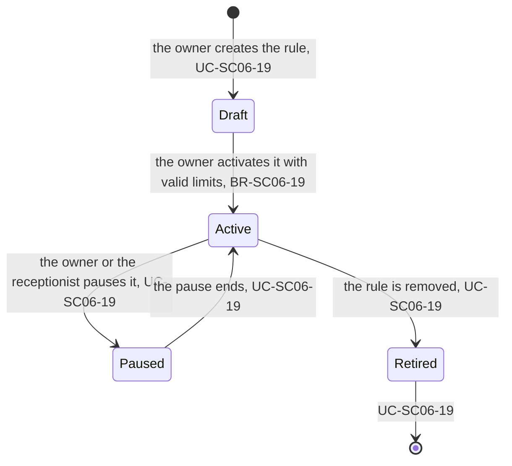

🏠 [Specs](../../../README.md) › 🏷️ [Sectors](../../README.md) › 🍽️ [SC06 Restaurant and hospitality](../README.md) ›
🗃️ [Data](README.md) › 🗃️ E-SC06-16 Price rule

# 🗃️ E-SC06-16 Price rule

**Status:** ✅ specified

## Purpose

A pricing rule that moves the rate of room types with a condition, with its limits and priority
([D550](../../../06-decisions/sectors/d550-benchmark-gaps-sc06-hospitality.md)). It acts on the base rate plan
([E-SC06-07 Rate plan](e-sc06-07-rate-plan.md)) without changing it.

## Fields

| Name | Type | Required | Validation | Default | Example | Personal data | Custom fields |
|---|---|---|---|---|---|---|---|
| name | text | yes | unique | - | High occupancy | no | no |
| condition | occupancy, lead time, day, event | yes | a known condition | - | occupancy above 80 % | no | no |
| action | percentage or amount | yes | not zero | - | +15 % | no | no |
| room types | list of room types | yes | at least one | - | Double | no | no |
| floor | amount in EUR | yes | above 0 | - | 90.00 | no | no |
| ceiling | amount in EUR | yes | at least the floor | - | 190.00 | no | no |
| priority | number | yes | 1 or more | 1 | 1 | no | no |
| applied nights | number | yes | 0 or more | 0 | 37 | no | no |
| cut nights | number | yes | 0 or more | 0 | 2 | no | no |
| state | Draft, Active, Paused, Retired | yes | the lifecycle below | Draft | Active | no | no |
| owner | user | yes | a user of the company | the creator | Claire P. | yes | no |

## Relations

- [E-SC06-07 Rate plan](e-sc06-07-rate-plan.md)
- [E-SC06-06 Hotel room](e-sc06-06-hotel-room.md)
- [E-SC06-08 Room reservation](e-sc06-08-room-reservation.md)

## Lifecycle

## Indexes and search

By name, room type, state and priority.

## Retention

Kept for three years with the prices it produced, to explain a rate.

## Audit

Every change of condition, action, limits and priority, with who, when and the old and new value.

## Import and export

Export of the rules and of the prices computed per night as CSV.

## Used by

- [UC-SC06-19](../use-cases/06-campsites-catering-groups-and-pricing/uc-sc06-19-set-prices-dynamically.md)
- [UC-SC06-07](../use-cases/03-rooms-and-bookings/uc-sc06-07-manage-rooms-room-types-and-rates.md)

## Open questions

None.

---

⬅️ [E-SC06-15 Group booking](e-sc06-15-group-booking.md) · ⬆️ [Up](README.md) ·
➡️ [E-SC06-17 Licence](e-sc06-17-licence.md)
