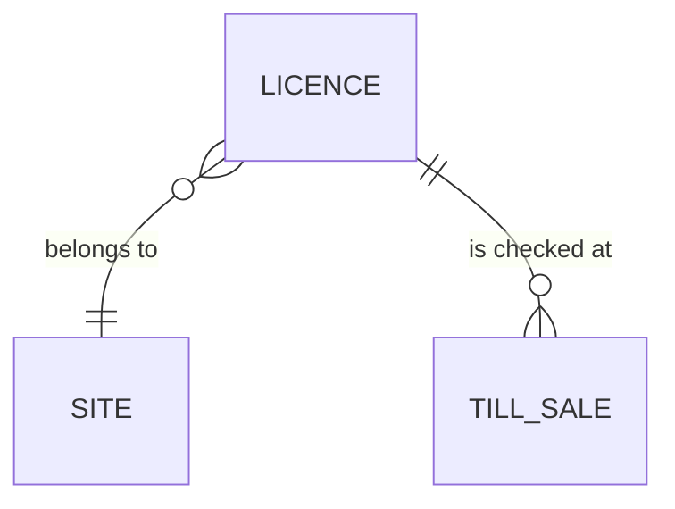
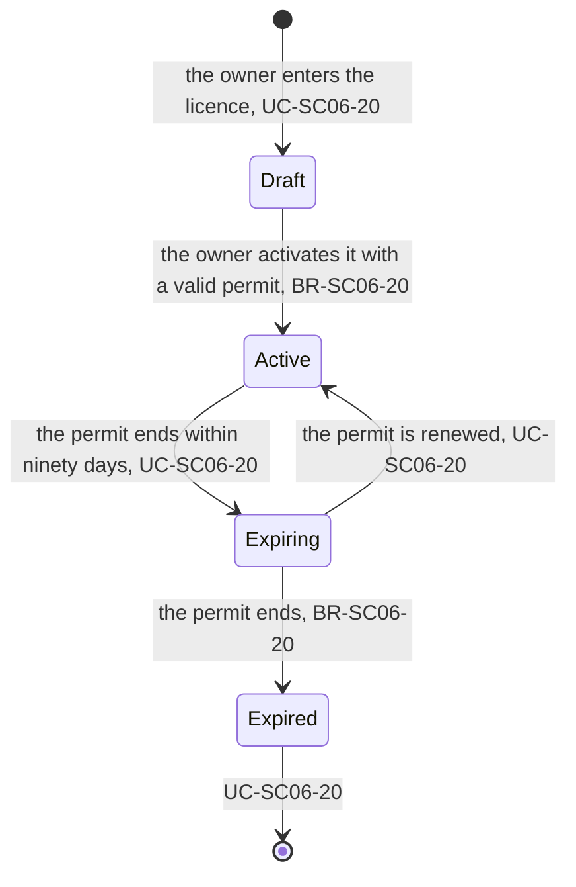

🏠 [Specs](../../../README.md) › 🏷️ [Sectors](../../README.md) › 🍽️ [SC06 Restaurant and hospitality](../README.md) ›
🗃️ [Data](README.md) › 🗃️ E-SC06-17 Licence

# 🗃️ E-SC06-17 Licence

**Status:** ✅ specified

## Purpose

The alcohol licence of one venue with its category, its operating permit and the hours of service
([D550](../../../06-decisions/sectors/d550-benchmark-gaps-sc06-hospitality.md)). It is the data the till checks for each
sale, not the age check ([E-F10-16 Age check](../../../02-functional/f10-point-of-sale/data/e-f10-16-age-check.md)) that
looks at the buyer.

## Fields

| Name | Type | Required | Validation | Default | Example | Personal data | Custom fields |
|---|---|---|---|---|---|---|---|
| venue | site (E-F1-02) | yes | a site of the company | - | Bar Le Quai | no | no |
| category | III, IV, small restaurant, full restaurant | yes | one of the four | - | III | no | no |
| declared on | date | yes | not in the future | - | 2019-03-12 | no | no |
| permit holder | text | yes | a person | - | M. Roux | yes | no |
| permit ends | date | yes | after the permit date | - | 2027-02-10 | no | no |
| hours | times per weekday | yes | start before end | - | 11:00-02:00 | no | no |
| meals only | yes or no | yes | set by the category | no | no | no | no |
| refused attempts | number | yes | 0 or more | 0 | 3 | no | no |
| state | Draft, Active, Expiring, Expired | yes | the lifecycle below | Draft | Active | no | no |
| owner | user | yes | a user of the company | the creator | Claire P. | yes | no |

## Relations

- [E-F1-02 Company site](../../../02-functional/f01-administration/data/e-f01-02-company-site.md)
- [E-F10-16 Age check](../../../02-functional/f10-point-of-sale/data/e-f10-16-age-check.md)
- [E-SC08-13 Temporary bar](../../sc08-non-profit/data/e-sc08-13-temporary-bar.md)

## Lifecycle

## Indexes and search

By venue, category, state and permit end date.

## Retention

Kept three years after the venue closes or changes hands.

## Audit

Every change of category, hours and permit and each refused sale, with who, when and the old and new value.

## Import and export

Export of the licences with their dates for an inspection.

## Used by

- [UC-SC06-20](../use-cases/06-campsites-catering-groups-and-pricing/uc-sc06-20-keep-alcohol-licences-current.md)
- [UC-F10-22](../../../02-functional/f10-point-of-sale/use-cases/08-vouchers-and-age-checks/uc-f10-22-check-age-for-restricted-sales.md)

## Open questions

None.

---

⬅️ [E-SC06-16 Price rule](e-sc06-16-price-rule.md) · ⬆️ [Up](README.md) ·
➡️ [E-SC06-18 Guest profile](e-sc06-18-guest-profile.md)
