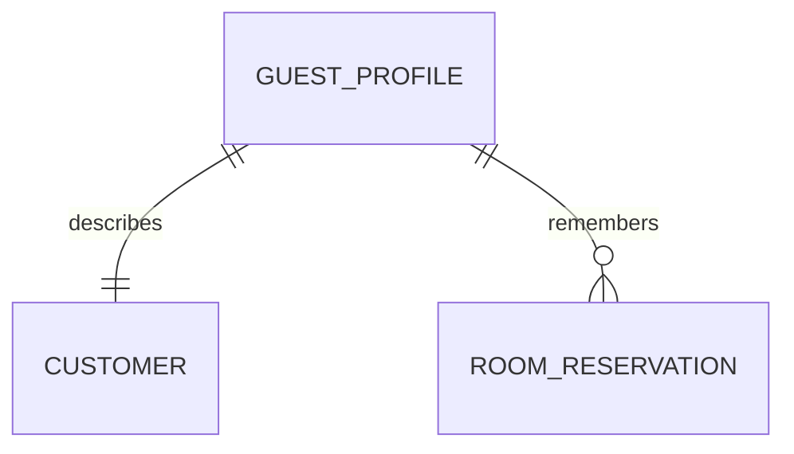
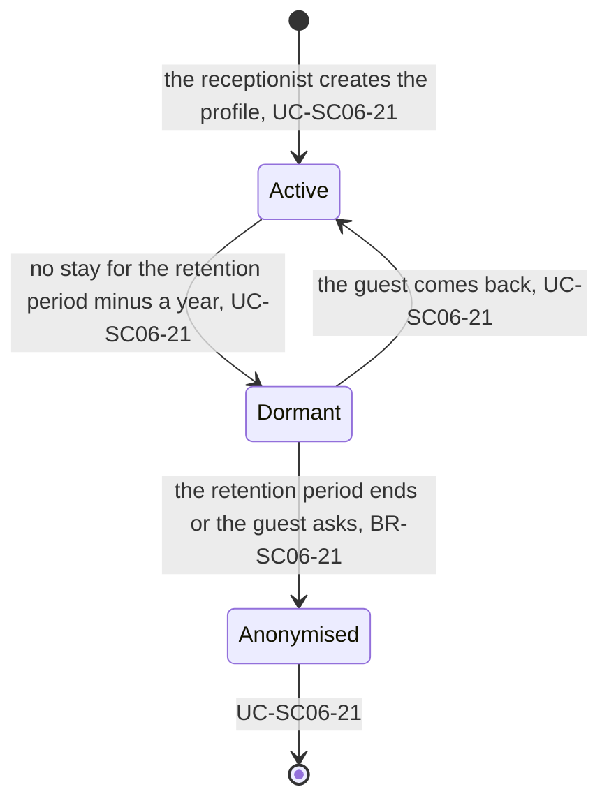

🏠 [Specs](../../../README.md) › 🏷️ [Sectors](../../README.md) › 🍽️ [SC06 Restaurant and hospitality](../README.md) ›
🗃️ [Data](README.md) › 🗃️ E-SC06-18 Guest profile

# 🗃️ E-SC06-18 Guest profile

**Status:** ✅ specified

## Purpose

What the venue knows of one guest: allergies, diet, preferences and the consent to keep them
([D550](../../../06-decisions/sectors/d550-benchmark-gaps-sc06-hospitality.md)). It is related to the clienteling
profile of retail ([E-F10-19](../../../02-functional/f10-point-of-sale/data/e-f10-19-clienteling-profile.md)) but
differs: it holds the allergies and stay preferences of a hotel or a restaurant and shows them on orders.

## Fields

| Name | Type | Required | Validation | Default | Example | Personal data | Custom fields |
|---|---|---|---|---|---|---|---|
| guest | customer (E-F6-01) | yes | a customer of the company | - | Ms Nakamura | yes | no |
| allergies | list of allergens | no | known allergens | none | peanuts, shellfish | yes | no |
| diet | list | no | vegetarian, pescatarian and others | none | pescatarian | yes | no |
| preferences | text | no | only with consent | - | quiet room | yes | no |
| special dates | dates | no | only with consent | - | 4 March | yes | no |
| consent | date and wording | no | required for preferences | - | 2025-06-03 | yes | no |
| stays | number | yes | 0 or more | 0 | 4 | no | no |
| last stay | date | no | not in the future | - | 2026-08-12 | no | no |
| state | Active, Dormant, Anonymised | yes | the lifecycle below | Active | Dormant | no | no |
| owner | user | yes | a user of the company | the creator | Claire P. | yes | no |

## Relations

- [E-F6-01](../../../02-functional/f06-customers-and-sales/data/e-f06-01-customer-record.md)
- [E-SC06-08 Room reservation](e-sc06-08-room-reservation.md)
- [E-F10-19](../../../02-functional/f10-point-of-sale/data/e-f10-19-clienteling-profile.md)

## Lifecycle

## Indexes and search

By guest, allergy, state and last stay date.

## Retention

Kept for the period set in the settings after the last stay, three years by default, then anonymised
([CR-FR-052](../../../10-country-packs/france/data-protection/cr-fr-052-storage-limitation.md)).

## Audit

Every reading of the allergies by a staff member, every change and every anonymisation, with who and when.

## Import and export

Export of one guest's profile on their request
([CR-FR-051](../../../10-country-packs/france/data-protection/cr-fr-051-access-and-erasure.md)).

## Used by

- [UC-SC06-21](../use-cases/06-campsites-catering-groups-and-pricing/uc-sc06-21-know-the-guest.md)
- [UC-SC06-15](../use-cases/03-rooms-and-bookings/uc-sc06-15-ask-the-assistant-about-the-hotel-or-restaurant.md)

## Open questions

None.

---

⬅️ [E-SC06-17 Licence](e-sc06-17-licence.md) · ⬆️ [Up](README.md)
