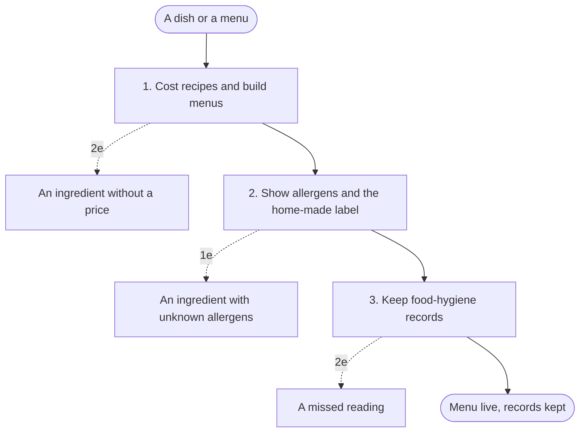

🏠 [Specs](../../../README.md) › 🏷️ [Sectors](../../README.md) › 🍽️ [SC06 Restaurant and hospitality](../README.md) ›
🔀 [Flows](README.md) › 🔀 FL-SC06-01 Menus and food safety

# 🔀 FL-SC06-01 Menus and food safety

**Status:** ✅ specified

## Summary

Menus from costed recipes, allergens shown, hygiene recorded. It covers
[UC-SC06-01 Cost recipes and build menus](../use-cases/01-menus-and-food-safety/uc-sc06-01-cost-recipes-and-build-menus.md),
[UC-SC06-02 Show allergens and the home-made label](../use-cases/01-menus-and-food-safety/uc-sc06-02-show-allergens-and-the-home-made-label.md),
[UC-SC06-03 Keep food-hygiene records](../use-cases/01-menus-and-food-safety/uc-sc06-03-keep-food-hygiene-records.md).

## Personas

- [U09 Customer](../../../01-users/personas/u09-customer.md)
- [U19 Kitchen staff](../../../01-users/personas/u19-kitchen-staff.md)
- [U23 Store manager](../../../01-users/personas/u23-store-manager.md)

## Flowchart

## Sequence diagram

See each use case.

## Steps

| Step | Persona | Screen | Use case | What happens |
|---|---|---|---|---|
| 1 | U23, U19 | [S-SC06-01](../screens/01-menus-and-food-safety/s-sc06-01-recipes-and-menus.md) | [UC-SC06-01](../use-cases/01-menus-and-food-safety/uc-sc06-01-cost-recipes-and-build-menus.md) | The store manager and the kitchen write each dish's recipe with the shared recipes capability, see its cost from the latest purchase prices, and put dishes on menus with their food-cost ratio |
| 2 | U23, U09 | [S-SC06-02](../screens/01-menus-and-food-safety/s-sc06-02-allergens.md) | [UC-SC06-02](../use-cases/01-menus-and-food-safety/uc-sc06-02-show-allergens-and-the-home-made-label.md) | The manager checks each dish's allergens, which come from its recipe's ingredients, and the home-made label where it qualifies, guests read them on menus, QR menus and kiosks |
| 3 | U19, U23 | [S-SC06-03](../screens/01-menus-and-food-safety/s-sc06-03-hygiene-records.md) | [UC-SC06-03](../use-cases/01-menus-and-food-safety/uc-sc06-03-keep-food-hygiene-records.md) | Kitchen staff take temperature, cleaning, delivery and oil readings on schedule on the tablet, an out-of-range or missed reading alerts the manager |

### Entities and screens

| Entity | States in this flow | Shown at step and screen | Aggregated view |
|---|---|---|---|
| [E-SC06-02 Menu dish](../data/e-sc06-02-menu-dish.md) | Active | 1 [S-SC06-01](../screens/01-menus-and-food-safety/s-sc06-01-recipes-and-menus.md); 2 [S-SC06-02](../screens/01-menus-and-food-safety/s-sc06-02-allergens.md) | Menu dishes |
| [E-F7-06 Item](../../../02-functional/f07-purchasing-and-stock/data/e-f07-06-item.md) | Active | Shown elsewhere: [S-F7-21 Stock levels](../../../02-functional/f07-purchasing-and-stock/screens/03-replenish/s-f07-21-stock-levels.md) | Items |
| [E-SC06-03 Hygiene record](../data/e-sc06-03-hygiene-record.md) | Recorded | 3 [S-SC06-03](../screens/01-menus-and-food-safety/s-sc06-03-hygiene-records.md) | Hygiene records |

## Errors

- [UC-SC06-01](../use-cases/01-menus-and-food-safety/uc-sc06-01-cost-recipes-and-build-menus.md) 2e. An ingredient
  without a price: the cost is marked partial and the ingredient named.
- [UC-SC06-01](../use-cases/01-menus-and-food-safety/uc-sc06-01-cost-recipes-and-build-menus.md) 3e. A food-cost ratio
  over the target: the manager is warned.
- [UC-SC06-02](../use-cases/01-menus-and-food-safety/uc-sc06-02-show-allergens-and-the-home-made-label.md) 1e. An
  ingredient with unknown allergens: the menu is blocked until set.
- [UC-SC06-02](../use-cases/01-menus-and-food-safety/uc-sc06-02-show-allergens-and-the-home-made-label.md) 2e. The label
  on a dish with bought-in parts: it is refused.
- [UC-SC06-03](../use-cases/01-menus-and-food-safety/uc-sc06-03-keep-food-hygiene-records.md) 2e. A missed reading: the
  manager is alerted.
- [UC-SC06-03](../use-cases/01-menus-and-food-safety/uc-sc06-03-keep-food-hygiene-records.md) 3e. A reading out of
  range: the manager is alerted and an action is asked.

## Images

Every step and error, for each persona taking part, in light and dark mode (D120). Steps are numbered as in the Steps
table; E rows are the error cases.

| Step | Persona | Device | Light | Dark |
|---|---|---|---|---|
| 1 | U23 | desktop | [light](../images/01-menus-and-food-safety/u23-store-manager/1-recipe-desktop-light.png) | [dark](../images/01-menus-and-food-safety/u23-store-manager/1-recipe-desktop-dark.png) |
| 1 | U23 | phone | [light](../images/01-menus-and-food-safety/u23-store-manager/1-recipe-phone-light.png) | [dark](../images/01-menus-and-food-safety/u23-store-manager/1-recipe-phone-dark.png) |
| 1 | U23 | tablet | [light](../images/01-menus-and-food-safety/u23-store-manager/1-recipe-tablet-light.png) | [dark](../images/01-menus-and-food-safety/u23-store-manager/1-recipe-tablet-dark.png) |
| 1 | U19 | desktop | [light](../images/01-menus-and-food-safety/u19-kitchen-staff/1-recipe-desktop-light.png) | [dark](../images/01-menus-and-food-safety/u19-kitchen-staff/1-recipe-desktop-dark.png) |
| 2 | U09 | phone | [light](../images/01-menus-and-food-safety/u09-customer/2-allergens-phone-light.png) | [dark](../images/01-menus-and-food-safety/u09-customer/2-allergens-phone-dark.png) |
| 2 | U23 | desktop | [light](../images/01-menus-and-food-safety/u23-store-manager/2-allergens-desktop-light.png) | [dark](../images/01-menus-and-food-safety/u23-store-manager/2-allergens-desktop-dark.png) |
| 2 | U23 | phone | [light](../images/01-menus-and-food-safety/u23-store-manager/2-allergens-phone-light.png) | [dark](../images/01-menus-and-food-safety/u23-store-manager/2-allergens-phone-dark.png) |
| 2 | U23 | tablet | [light](../images/01-menus-and-food-safety/u23-store-manager/2-allergens-tablet-light.png) | [dark](../images/01-menus-and-food-safety/u23-store-manager/2-allergens-tablet-dark.png) |
| 3 | U19 | desktop | [light](../images/01-menus-and-food-safety/u19-kitchen-staff/3-hygiene-desktop-light.png) | [dark](../images/01-menus-and-food-safety/u19-kitchen-staff/3-hygiene-desktop-dark.png) |
| 3 | U23 | desktop | [light](../images/01-menus-and-food-safety/u23-store-manager/3-hygiene-desktop-light.png) | [dark](../images/01-menus-and-food-safety/u23-store-manager/3-hygiene-desktop-dark.png) |
| 3 | U23 | phone | [light](../images/01-menus-and-food-safety/u23-store-manager/3-hygiene-phone-light.png) | [dark](../images/01-menus-and-food-safety/u23-store-manager/3-hygiene-phone-dark.png) |
| 3 | U23 | tablet | [light](../images/01-menus-and-food-safety/u23-store-manager/3-hygiene-tablet-light.png) | [dark](../images/01-menus-and-food-safety/u23-store-manager/3-hygiene-tablet-dark.png) |
| E1 | U23 | desktop | [light](../images/01-menus-and-food-safety/u23-store-manager/e1-unknown-allergen-desktop-light.png) | [dark](../images/01-menus-and-food-safety/u23-store-manager/e1-unknown-allergen-desktop-dark.png) |
| E1 | U23 | phone | [light](../images/01-menus-and-food-safety/u23-store-manager/e1-unknown-allergen-phone-light.png) | [dark](../images/01-menus-and-food-safety/u23-store-manager/e1-unknown-allergen-phone-dark.png) |
| E1 | U23 | tablet | [light](../images/01-menus-and-food-safety/u23-store-manager/e1-unknown-allergen-tablet-light.png) | [dark](../images/01-menus-and-food-safety/u23-store-manager/e1-unknown-allergen-tablet-dark.png) |

## Open questions

None.

---

⬆️ [Up](README.md) · ➡️ [FL-SC06-02 Kitchen stock and staff](fl-sc06-02-kitchen-stock-and-staff.md)
