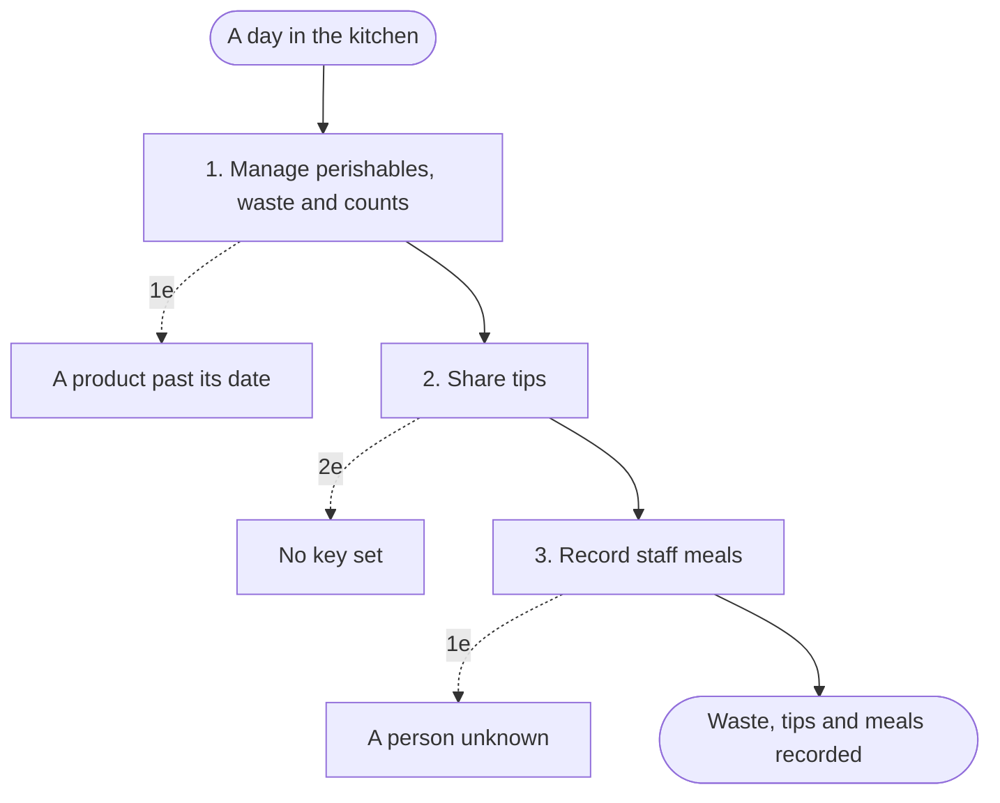

🏠 [Specs](../../../README.md) › 🏷️ [Sectors](../../README.md) › 🍽️ [SC06 Restaurant and hospitality](../README.md) ›
🔀 [Flows](README.md) › 🔀 FL-SC06-02 Kitchen stock and staff

# 🔀 FL-SC06-02 Kitchen stock and staff

**Status:** ✅ specified

## Summary

The kitchen's stock and waste, and the staff's tips and meals. It covers
[UC-SC06-04 Manage perishables, waste and counts](../use-cases/02-kitchen-stock-and-staff/uc-sc06-04-manage-perishables-waste-and-counts.md),
[UC-SC06-05 Share tips](../use-cases/02-kitchen-stock-and-staff/uc-sc06-05-share-tips.md),
[UC-SC06-06 Record staff meals](../use-cases/02-kitchen-stock-and-staff/uc-sc06-06-record-staff-meals.md).

## Personas

- [U18 Waiter](../../../01-users/personas/u18-waiter.md)
- [U19 Kitchen staff](../../../01-users/personas/u19-kitchen-staff.md)
- [U23 Store manager](../../../01-users/personas/u23-store-manager.md)

## Flowchart

## Sequence diagram

See each use case.

## Steps

| Step | Persona | Screen | Use case | What happens |
|---|---|---|---|---|
| 1 | U19, U23 | [S-SC06-04](../screens/02-kitchen-stock-and-staff/s-sc06-04-perishables.md) | [UC-SC06-04](../use-cases/02-kitchen-stock-and-staff/uc-sc06-04-manage-perishables-waste-and-counts.md) | Kitchen staff check use-by dates, record waste with its reason, count stock and donate unsold food |
| 2 | U23, U18 | [S-SC06-05](../screens/02-kitchen-stock-and-staff/s-sc06-05-tips.md) | [UC-SC06-05](../use-cases/02-kitchen-stock-and-staff/uc-sc06-05-share-tips.md) | The manager collects card and cash tips, applies the agreed sharing key, and sends each person's share to payroll or pays it out |
| 3 | U23 | [S-SC06-06](../screens/02-kitchen-stock-and-staff/s-sc06-06-staff-meals.md) | [UC-SC06-06](../use-cases/02-kitchen-stock-and-staff/uc-sc06-06-record-staff-meals.md) | The manager records staff meals per person, checks them and sends them to payroll as a benefit in kind under the hotels-and-restaurants agreement |

### Entities and screens

| Entity | States in this flow | Shown at step and screen | Aggregated view |
|---|---|---|---|
| [E-F7-06 Item](../../../02-functional/f07-purchasing-and-stock/data/e-f07-06-item.md) | Active | Shown elsewhere: [S-F7-21 Stock levels](../../../02-functional/f07-purchasing-and-stock/screens/03-replenish/s-f07-21-stock-levels.md) | Items |
| [E-SC06-05 Staff benefit](../data/e-sc06-05-staff-benefit.md) | Active | 2 [S-SC06-05](../screens/02-kitchen-stock-and-staff/s-sc06-05-tips.md); 3 [S-SC06-06](../screens/02-kitchen-stock-and-staff/s-sc06-06-staff-meals.md) | Staff benefits |

## Errors

- [UC-SC06-04](../use-cases/02-kitchen-stock-and-staff/uc-sc06-04-manage-perishables-waste-and-counts.md) 1e. A product
  past its date: it is blocked from use.
- [UC-SC06-04](../use-cases/02-kitchen-stock-and-staff/uc-sc06-04-manage-perishables-waste-and-counts.md) 4e. A big
  difference: a recount is asked.
- [UC-SC06-05](../use-cases/02-kitchen-stock-and-staff/uc-sc06-05-share-tips.md) 2e. No key set: tips are held until one
  is set.
- [UC-SC06-05](../use-cases/02-kitchen-stock-and-staff/uc-sc06-05-share-tips.md) 1e. Card tips not in the till's
  settlement: the gap is shown.
- [UC-SC06-06](../use-cases/02-kitchen-stock-and-staff/uc-sc06-06-record-staff-meals.md) 1e. A person unknown: the meal
  is refused.
- [UC-SC06-06](../use-cases/02-kitchen-stock-and-staff/uc-sc06-06-record-staff-meals.md) 2e. A meal on a day off: it is
  flagged.

## Images

Every step and error, for each persona taking part, in light and dark mode (D120). Steps are numbered as in the Steps
table; E rows are the error cases.

| Step | Persona | Device | Light | Dark |
|---|---|---|---|---|
| 1 | U19 | desktop | [light](../images/02-kitchen-stock-and-staff/u19-kitchen-staff/1-perishables-desktop-light.png) | [dark](../images/02-kitchen-stock-and-staff/u19-kitchen-staff/1-perishables-desktop-dark.png) |
| 1 | U23 | desktop | [light](../images/02-kitchen-stock-and-staff/u23-store-manager/1-perishables-desktop-light.png) | [dark](../images/02-kitchen-stock-and-staff/u23-store-manager/1-perishables-desktop-dark.png) |
| 1 | U23 | phone | [light](../images/02-kitchen-stock-and-staff/u23-store-manager/1-perishables-phone-light.png) | [dark](../images/02-kitchen-stock-and-staff/u23-store-manager/1-perishables-phone-dark.png) |
| 1 | U23 | tablet | [light](../images/02-kitchen-stock-and-staff/u23-store-manager/1-perishables-tablet-light.png) | [dark](../images/02-kitchen-stock-and-staff/u23-store-manager/1-perishables-tablet-dark.png) |
| 2 | U23 | desktop | [light](../images/02-kitchen-stock-and-staff/u23-store-manager/2-tips-desktop-light.png) | [dark](../images/02-kitchen-stock-and-staff/u23-store-manager/2-tips-desktop-dark.png) |
| 2 | U23 | phone | [light](../images/02-kitchen-stock-and-staff/u23-store-manager/2-tips-phone-light.png) | [dark](../images/02-kitchen-stock-and-staff/u23-store-manager/2-tips-phone-dark.png) |
| 2 | U23 | tablet | [light](../images/02-kitchen-stock-and-staff/u23-store-manager/2-tips-tablet-light.png) | [dark](../images/02-kitchen-stock-and-staff/u23-store-manager/2-tips-tablet-dark.png) |
| 2 | U18 | phone | [light](../images/02-kitchen-stock-and-staff/u18-waiter/2-tips-phone-light.png) | [dark](../images/02-kitchen-stock-and-staff/u18-waiter/2-tips-phone-dark.png) |
| 2 | U18 | tablet | [light](../images/02-kitchen-stock-and-staff/u18-waiter/2-tips-tablet-light.png) | [dark](../images/02-kitchen-stock-and-staff/u18-waiter/2-tips-tablet-dark.png) |
| 3 | U23 | desktop | [light](../images/02-kitchen-stock-and-staff/u23-store-manager/3-staff-meals-desktop-light.png) | [dark](../images/02-kitchen-stock-and-staff/u23-store-manager/3-staff-meals-desktop-dark.png) |
| 3 | U23 | phone | [light](../images/02-kitchen-stock-and-staff/u23-store-manager/3-staff-meals-phone-light.png) | [dark](../images/02-kitchen-stock-and-staff/u23-store-manager/3-staff-meals-phone-dark.png) |
| 3 | U23 | tablet | [light](../images/02-kitchen-stock-and-staff/u23-store-manager/3-staff-meals-tablet-light.png) | [dark](../images/02-kitchen-stock-and-staff/u23-store-manager/3-staff-meals-tablet-dark.png) |
| E1 | U19 | desktop | [light](../images/02-kitchen-stock-and-staff/u19-kitchen-staff/e1-expired-desktop-light.png) | [dark](../images/02-kitchen-stock-and-staff/u19-kitchen-staff/e1-expired-desktop-dark.png) |

## Open questions

None.

---

⬅️ [FL-SC06-01 Menus and food safety](fl-sc06-01-menus-and-food-safety.md) · ⬆️ [Up](README.md) ·
➡️ [FL-SC06-03 Rooms and bookings](fl-sc06-03-rooms-and-bookings.md)
