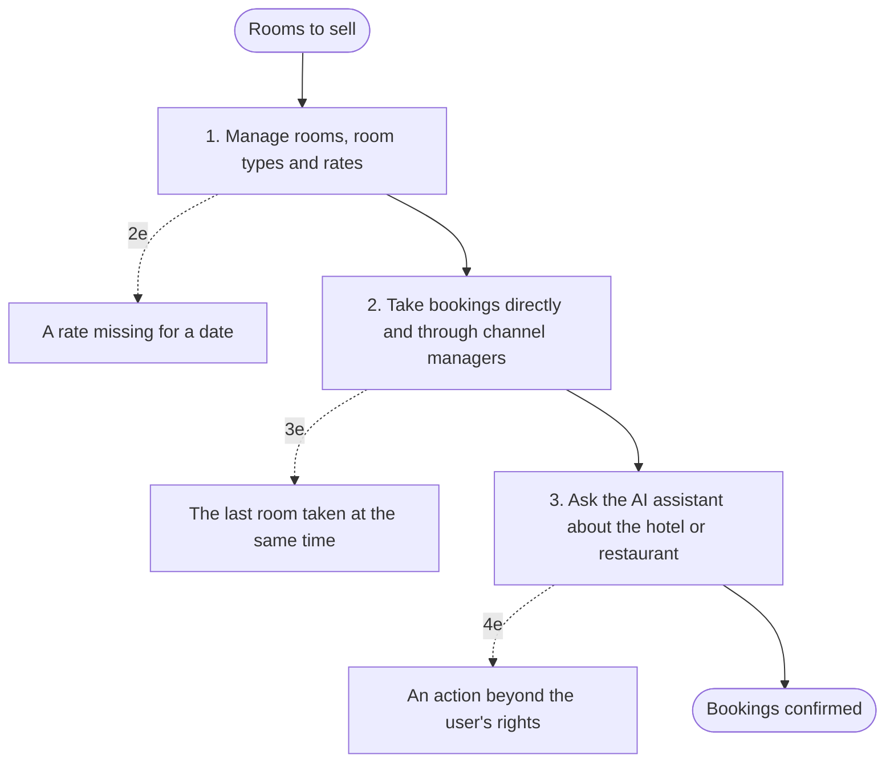

🏠 [Specs](../../../README.md) › 🏷️ [Sectors](../../README.md) › 🍽️ [SC06 Restaurant and hospitality](../README.md) ›
🔀 [Flows](README.md) › 🔀 FL-SC06-03 Rooms and bookings

# 🔀 FL-SC06-03 Rooms and bookings

**Status:** ✅ specified

## Summary

Rooms on the shared booking engine, bookings from every channel, the AI assistant. It covers
[UC-SC06-07 Manage rooms, room types and rates](../use-cases/03-rooms-and-bookings/uc-sc06-07-manage-rooms-room-types-and-rates.md),
[UC-SC06-08 Take bookings directly and through channel managers](../use-cases/03-rooms-and-bookings/uc-sc06-08-take-bookings-directly-and-through-channel-managers.md),
[UC-SC06-15 Ask the AI assistant about the hotel or restaurant](../use-cases/03-rooms-and-bookings/uc-sc06-15-ask-the-assistant-about-the-hotel-or-restaurant.md).

## Personas

- [U09 Customer](../../../01-users/personas/u09-customer.md)
- [U23 Store manager](../../../01-users/personas/u23-store-manager.md)
- [U28 Hotel receptionist](../../../01-users/personas/u28-hotel-receptionist.md)

## Flowchart

## Sequence diagram

See each use case.

## Steps

| Step | Persona | Screen | Use case | What happens |
|---|---|---|---|---|
| 1 | U23, U28 | [S-SC06-07](../screens/03-rooms-and-bookings/s-sc06-07-rooms-and-rates.md) | [UC-SC06-07](../use-cases/03-rooms-and-bookings/uc-sc06-07-manage-rooms-room-types-and-rates.md) | The manager sets rooms and room types as bookable resources of the shared booking engine, sets rate plans per date and publishes them to the direct channel and channel managers |
| 2 | U28, U09 | [S-SC06-08](../screens/03-rooms-and-bookings/s-sc06-08-bookings.md) | [UC-SC06-08](../use-cases/03-rooms-and-bookings/uc-sc06-08-take-bookings-directly-and-through-channel-managers.md) | The receptionist receives bookings from the direct page and channel managers through the shared booking engine, each booking closes the room everywhere at once and is confirmed to the guest |
| 3 | U28, U23 | [S-SC06-15](../screens/03-rooms-and-bookings/s-sc06-15-hospitality-assistant.md) | [UC-SC06-15](../use-cases/03-rooms-and-bookings/uc-sc06-15-ask-the-assistant-about-the-hotel-or-restaurant.md) | The receptionist or manager asks the AI assistant about arrivals, free rooms or a dish's allergens, within their role's rights |

### Entities and screens

| Entity | States in this flow | Shown at step and screen | Aggregated view |
|---|---|---|---|
| [E-SC06-07 Rate plan](../data/e-sc06-07-rate-plan.md) | Active | 1 [S-SC06-07](../screens/03-rooms-and-bookings/s-sc06-07-rooms-and-rates.md) | Rate plans |
| [E-SC06-08 Room reservation](../data/e-sc06-08-room-reservation.md) | Booked, Arrived, Cancelled, Departed | 2 [S-SC06-08](../screens/03-rooms-and-bookings/s-sc06-08-bookings.md); 3 [S-SC06-15](../screens/03-rooms-and-bookings/s-sc06-15-hospitality-assistant.md) | Room reservations |
| [E-F3-04 Assistant change batch](../../../02-functional/f03-assistant/data/e-f03-04-assistant-change-batch.md) | Proposed, Cancelled, Done, Partly done, Undone | Shown elsewhere: [S-F3-01 Assistant panel](../../../02-functional/f03-assistant/screens/01-ask-the-assistant/s-f03-01-assistant-panel.md) | Assistant change batches |
| [E-F1-03 User](../../../02-functional/f01-administration/data/e-f01-03-user.md) | Invited, Active, Deactivated | Shown elsewhere: [S-F1-03 Users](../../../02-functional/f01-administration/screens/03-user-lifecycle/s-f01-03-users.md) | Users |
| [E-F1-06 Role](../../../02-functional/f01-administration/data/e-f01-06-role.md) | Active | Shown elsewhere: [S-F1-06 Role editor](../../../02-functional/f01-administration/screens/04-edit-a-role/s-f01-06-role-editor.md) | Roles |

## Errors

- [UC-SC06-07](../use-cases/03-rooms-and-bookings/uc-sc06-07-manage-rooms-room-types-and-rates.md) 2e. A rate missing
  for a date: the room type is not sold that date.
- [UC-SC06-07](../use-cases/03-rooms-and-bookings/uc-sc06-07-manage-rooms-room-types-and-rates.md) 4e. A channel refuses
  the update: the channel is flagged and retried.
- [UC-SC06-08](../use-cases/03-rooms-and-bookings/uc-sc06-08-take-bookings-directly-and-through-channel-managers.md) 3e.
  The last room taken at the same time: the second booking is refused and the channel closed.
- [UC-SC06-08](../use-cases/03-rooms-and-bookings/uc-sc06-08-take-bookings-directly-and-through-channel-managers.md) 2e.
  A channel booking with an unknown rate: it is held for the receptionist.
- [UC-SC06-15](../use-cases/03-rooms-and-bookings/uc-sc06-15-ask-the-assistant-about-the-hotel-or-restaurant.md) 4e. An
  action beyond the user's rights: the AI assistant refuses and says which role can do it.
- [UC-SC06-15](../use-cases/03-rooms-and-bookings/uc-sc06-15-ask-the-assistant-about-the-hotel-or-restaurant.md) 2e. No
  data to answer: the AI assistant says so and does not guess.

## Images

Every step and error, for each persona taking part, in light and dark mode (D120). Steps are numbered as in the Steps
table; E rows are the error cases.

| Step | Persona | Device | Light | Dark |
|---|---|---|---|---|
| 1 | U23 | desktop | [light](../images/03-rooms-and-bookings/u23-store-manager/1-rates-desktop-light.png) | [dark](../images/03-rooms-and-bookings/u23-store-manager/1-rates-desktop-dark.png) |
| 1 | U23 | phone | [light](../images/03-rooms-and-bookings/u23-store-manager/1-rates-phone-light.png) | [dark](../images/03-rooms-and-bookings/u23-store-manager/1-rates-phone-dark.png) |
| 1 | U23 | tablet | [light](../images/03-rooms-and-bookings/u23-store-manager/1-rates-tablet-light.png) | [dark](../images/03-rooms-and-bookings/u23-store-manager/1-rates-tablet-dark.png) |
| 1 | U28 | desktop | [light](../images/03-rooms-and-bookings/u28-hotel-receptionist/1-rates-desktop-light.png) | [dark](../images/03-rooms-and-bookings/u28-hotel-receptionist/1-rates-desktop-dark.png) |
| 1 | U28 | tablet | [light](../images/03-rooms-and-bookings/u28-hotel-receptionist/1-rates-tablet-light.png) | [dark](../images/03-rooms-and-bookings/u28-hotel-receptionist/1-rates-tablet-dark.png) |
| 2 | U28 | desktop | [light](../images/03-rooms-and-bookings/u28-hotel-receptionist/2-bookings-desktop-light.png) | [dark](../images/03-rooms-and-bookings/u28-hotel-receptionist/2-bookings-desktop-dark.png) |
| 2 | U28 | tablet | [light](../images/03-rooms-and-bookings/u28-hotel-receptionist/2-bookings-tablet-light.png) | [dark](../images/03-rooms-and-bookings/u28-hotel-receptionist/2-bookings-tablet-dark.png) |
| 2 | U09 | phone | [light](../images/03-rooms-and-bookings/u09-customer/2-bookings-phone-light.png) | [dark](../images/03-rooms-and-bookings/u09-customer/2-bookings-phone-dark.png) |
| 3 | U28 | desktop | [light](../images/03-rooms-and-bookings/u28-hotel-receptionist/3-assistant-desktop-light.png) | [dark](../images/03-rooms-and-bookings/u28-hotel-receptionist/3-assistant-desktop-dark.png) |
| 3 | U28 | tablet | [light](../images/03-rooms-and-bookings/u28-hotel-receptionist/3-assistant-tablet-light.png) | [dark](../images/03-rooms-and-bookings/u28-hotel-receptionist/3-assistant-tablet-dark.png) |
| 3 | U23 | desktop | [light](../images/03-rooms-and-bookings/u23-store-manager/3-assistant-desktop-light.png) | [dark](../images/03-rooms-and-bookings/u23-store-manager/3-assistant-desktop-dark.png) |
| 3 | U23 | phone | [light](../images/03-rooms-and-bookings/u23-store-manager/3-assistant-phone-light.png) | [dark](../images/03-rooms-and-bookings/u23-store-manager/3-assistant-phone-dark.png) |
| 3 | U23 | tablet | [light](../images/03-rooms-and-bookings/u23-store-manager/3-assistant-tablet-light.png) | [dark](../images/03-rooms-and-bookings/u23-store-manager/3-assistant-tablet-dark.png) |
| E1 | U28 | desktop | [light](../images/03-rooms-and-bookings/u28-hotel-receptionist/e1-sold-out-desktop-light.png) | [dark](../images/03-rooms-and-bookings/u28-hotel-receptionist/e1-sold-out-desktop-dark.png) |
| E1 | U28 | tablet | [light](../images/03-rooms-and-bookings/u28-hotel-receptionist/e1-sold-out-tablet-light.png) | [dark](../images/03-rooms-and-bookings/u28-hotel-receptionist/e1-sold-out-tablet-dark.png) |

## Open questions

None.

---

⬅️ [FL-SC06-02 Kitchen stock and staff](fl-sc06-02-kitchen-stock-and-staff.md) · ⬆️ [Up](README.md) ·
➡️ [FL-SC06-04 Stay and folio](fl-sc06-04-stay-and-folio.md)
