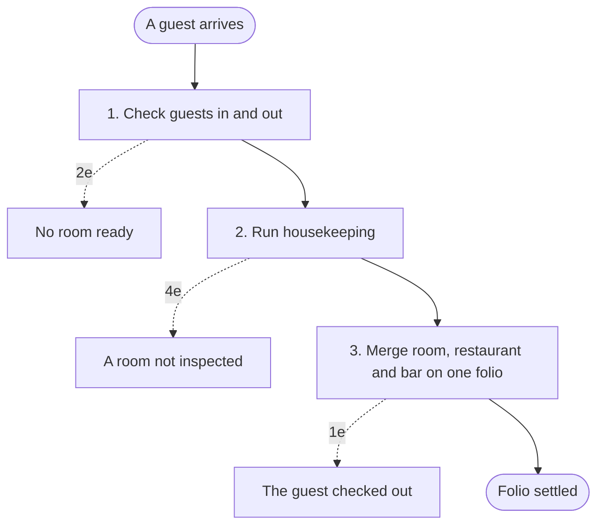

🏠 [Specs](../../../README.md) › 🏷️ [Sectors](../../README.md) › 🍽️ [SC06 Restaurant and hospitality](../README.md) ›
🔀 [Flows](README.md) › 🔀 FL-SC06-04 Stay and folio

# 🔀 FL-SC06-04 Stay and folio

**Status:** ✅ specified

## Summary

The stay: check-in, housekeeping and one folio. It covers
[UC-SC06-09 Check guests in and out](../use-cases/04-stay-and-folio/uc-sc06-09-check-guests-in-and-out.md),
[UC-SC06-10 Run housekeeping](../use-cases/04-stay-and-folio/uc-sc06-10-run-housekeeping.md),
[UC-SC06-11 Merge room, restaurant and bar on one folio](../use-cases/04-stay-and-folio/uc-sc06-11-merge-room-restaurant-and-bar-on-one-folio.md).

## Personas

- [U09 Customer](../../../01-users/personas/u09-customer.md)
- [U18 Waiter](../../../01-users/personas/u18-waiter.md)
- [U28 Hotel receptionist](../../../01-users/personas/u28-hotel-receptionist.md)

## Flowchart

## Sequence diagram

See each use case.

## Steps

| Step | Persona | Screen | Use case | What happens |
|---|---|---|---|---|
| 1 | U28, U09 | [S-SC06-09](../screens/04-stay-and-folio/s-sc06-09-check-in.md), [S-SC06-11](../screens/04-stay-and-folio/s-sc06-11-folio.md) | [UC-SC06-09](../use-cases/04-stay-and-folio/uc-sc06-09-check-guests-in-and-out.md) | The receptionist checks the guest in with identity and a ready room, and at departure settles the folio with the tourist tax |
| 2 | U28 | [S-SC06-10](../screens/04-stay-and-folio/s-sc06-10-housekeeping.md) | [UC-SC06-10](../use-cases/04-stay-and-folio/uc-sc06-10-run-housekeeping.md) | The receptionist lists rooms to clean, housekeepers clean and report issues on the phone, and rooms are inspected before they can be assigned |
| 3 | U28, U18 | [S-SC06-11](../screens/04-stay-and-folio/s-sc06-11-folio.md) | [UC-SC06-11](../use-cases/04-stay-and-folio/uc-sc06-11-merge-room-restaurant-and-bar-on-one-folio.md) | Waiters charge restaurant and bar bills to a guest's room, the receptionist sees one folio per stay and settles it at departure |

### Entities and screens

| Entity | States in this flow | Shown at step and screen | Aggregated view |
|---|---|---|---|
| [E-SC06-10 Housekeeping task](../data/e-sc06-10-housekeeping-task.md) | Clean | 2 [S-SC06-10](../screens/04-stay-and-folio/s-sc06-10-housekeeping.md) | Housekeeping tasks |
| [E-SC06-09 Folio](../data/e-sc06-09-folio.md) | Open, Settled | 1 [S-SC06-09](../screens/04-stay-and-folio/s-sc06-09-check-in.md); 1, 3 [S-SC06-11](../screens/04-stay-and-folio/s-sc06-11-folio.md) | Folios |

## Errors

- [UC-SC06-09](../use-cases/04-stay-and-folio/uc-sc06-09-check-guests-in-and-out.md) 2e. No room ready: the guest goes
  on a wait list and is told when ready.
- [UC-SC06-09](../use-cases/04-stay-and-folio/uc-sc06-09-check-guests-in-and-out.md) 4e. Payment refused: another means
  is asked; the folio stays open.
- [UC-SC06-10](../use-cases/04-stay-and-folio/uc-sc06-10-run-housekeeping.md) 4e. A room not inspected: it cannot be
  assigned.
- [UC-SC06-10](../use-cases/04-stay-and-folio/uc-sc06-10-run-housekeeping.md) 3e. No network on a floor: the status
  syncs later.
- [UC-SC06-11](../use-cases/04-stay-and-folio/uc-sc06-11-merge-room-restaurant-and-bar-on-one-folio.md) 1e. The guest
  checked out: the charge is refused.
- [UC-SC06-11](../use-cases/04-stay-and-folio/uc-sc06-11-merge-room-restaurant-and-bar-on-one-folio.md) 1f. Alcohol
  outside the licence: the till refuses it
  ([BR-SC06-06](../business-rules/br-sc06-06-alcohol-sold-within-the-licence.md)).

## Images

Every step and error, for each persona taking part, in light and dark mode (D120). Steps are numbered as in the Steps
table; E rows are the error cases.

| Step | Persona | Device | Light | Dark |
|---|---|---|---|---|
| 1 | U28 | desktop | [light](../images/04-stay-and-folio/u28-hotel-receptionist/1-check-in-desktop-light.png) | [dark](../images/04-stay-and-folio/u28-hotel-receptionist/1-check-in-desktop-dark.png) |
| 1 | U28 | tablet | [light](../images/04-stay-and-folio/u28-hotel-receptionist/1-check-in-tablet-light.png) | [dark](../images/04-stay-and-folio/u28-hotel-receptionist/1-check-in-tablet-dark.png) |
| 1 | U09 | phone | [light](../images/04-stay-and-folio/u09-customer/1-check-in-phone-light.png) | [dark](../images/04-stay-and-folio/u09-customer/1-check-in-phone-dark.png) |
| 2 | U28 | desktop | [light](../images/04-stay-and-folio/u28-hotel-receptionist/2-housekeeping-desktop-light.png) | [dark](../images/04-stay-and-folio/u28-hotel-receptionist/2-housekeeping-desktop-dark.png) |
| 2 | U28 | tablet | [light](../images/04-stay-and-folio/u28-hotel-receptionist/2-housekeeping-tablet-light.png) | [dark](../images/04-stay-and-folio/u28-hotel-receptionist/2-housekeeping-tablet-dark.png) |
| 3 | U28 | desktop | [light](../images/04-stay-and-folio/u28-hotel-receptionist/3-folio-desktop-light.png) | [dark](../images/04-stay-and-folio/u28-hotel-receptionist/3-folio-desktop-dark.png) |
| 3 | U28 | tablet | [light](../images/04-stay-and-folio/u28-hotel-receptionist/3-folio-tablet-light.png) | [dark](../images/04-stay-and-folio/u28-hotel-receptionist/3-folio-tablet-dark.png) |
| 3 | U18 | phone | [light](../images/04-stay-and-folio/u18-waiter/3-folio-phone-light.png) | [dark](../images/04-stay-and-folio/u18-waiter/3-folio-phone-dark.png) |
| 3 | U18 | tablet | [light](../images/04-stay-and-folio/u18-waiter/3-folio-tablet-light.png) | [dark](../images/04-stay-and-folio/u18-waiter/3-folio-tablet-dark.png) |
| E1 | U28 | desktop | [light](../images/04-stay-and-folio/u28-hotel-receptionist/e1-room-not-ready-desktop-light.png) | [dark](../images/04-stay-and-folio/u28-hotel-receptionist/e1-room-not-ready-desktop-dark.png) |
| E1 | U28 | tablet | [light](../images/04-stay-and-folio/u28-hotel-receptionist/e1-room-not-ready-tablet-light.png) | [dark](../images/04-stay-and-folio/u28-hotel-receptionist/e1-room-not-ready-tablet-dark.png) |

## Open questions

None.

---

⬅️ [FL-SC06-03 Rooms and bookings](fl-sc06-03-rooms-and-bookings.md) · ⬆️ [Up](README.md) ·
➡️ [FL-SC06-05 Taxes and performance](fl-sc06-05-taxes-and-performance.md)
