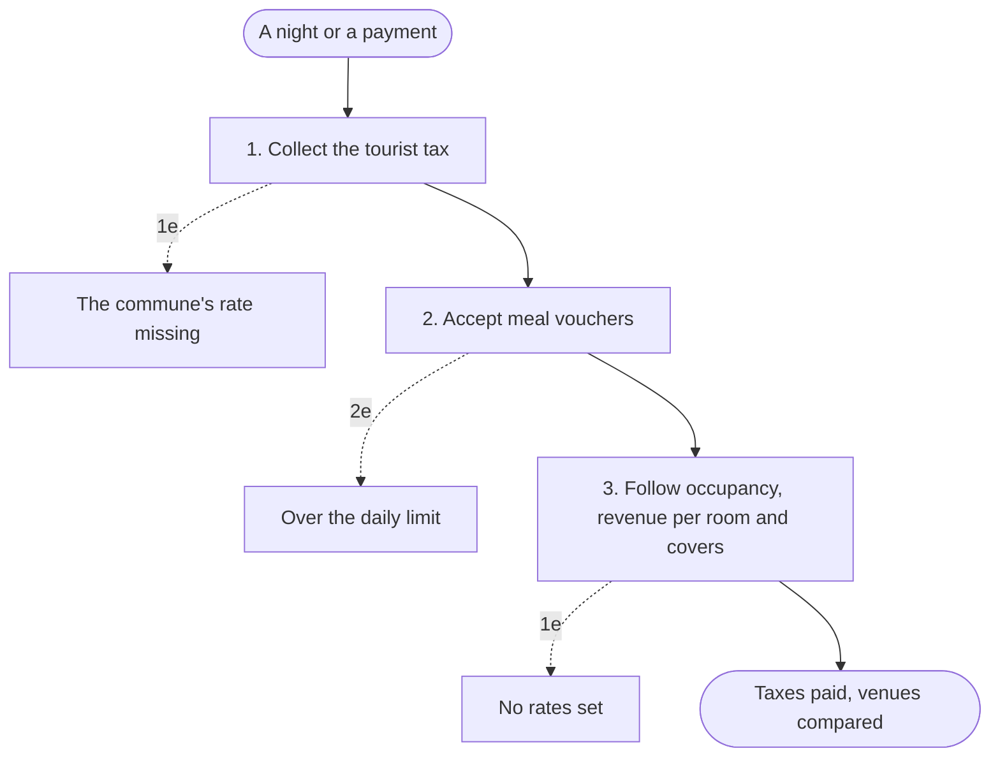

🏠 [Specs](../../../README.md) › 🏷️ [Sectors](../../README.md) › 🍽️ [SC06 Restaurant and hospitality](../README.md) ›
🔀 [Flows](README.md) › 🔀 FL-SC06-05 Taxes and performance

# 🔀 FL-SC06-05 Taxes and performance

**Status:** ✅ specified

## Summary

Taxes, meal vouchers and the venues' performance. It covers
[UC-SC06-12 Collect the tourist tax](../use-cases/05-taxes-and-performance/uc-sc06-12-collect-the-tourist-tax.md),
[UC-SC06-13 Accept meal vouchers](../use-cases/05-taxes-and-performance/uc-sc06-13-accept-meal-vouchers.md),
[UC-SC06-14 Follow occupancy, revenue per room and covers](../use-cases/05-taxes-and-performance/uc-sc06-14-follow-occupancy-revenue-per-room-and-covers.md).

## Personas

- [U05 Accounting](../../../01-users/personas/u05-accounting.md)
- [U13 Owner](../../../01-users/personas/u13-owner.md)
- [U17 Cashier](../../../01-users/personas/u17-cashier.md)
- [U18 Waiter](../../../01-users/personas/u18-waiter.md)
- [U23 Store manager](../../../01-users/personas/u23-store-manager.md)
- [U28 Hotel receptionist](../../../01-users/personas/u28-hotel-receptionist.md)

## Flowchart

## Sequence diagram

See each use case.

## Steps

| Step | Persona | Screen | Use case | What happens |
|---|---|---|---|---|
| 1 | U28, U05 | [S-SC06-12](../screens/05-taxes-and-performance/s-sc06-12-tourist-tax.md) | [UC-SC06-12](../use-cases/05-taxes-and-performance/uc-sc06-12-collect-the-tourist-tax.md) | Each taxable night carries the commune's tourist tax, shown apart on the folio, accounting declares and pays it |
| 2 | U17, U18, U05 | [S-SC06-13](../screens/05-taxes-and-performance/s-sc06-13-meal-vouchers.md) | [UC-SC06-13](../use-cases/05-taxes-and-performance/uc-sc06-13-accept-meal-vouchers.md) | The cashier or waiter accepts meal vouchers at the till within the daily limit and for eligible food, and the guest pays the rest |
| 3 | U13, U23 | [S-SC06-14](../screens/05-taxes-and-performance/s-sc06-14-performance.md) | [UC-SC06-14](../use-cases/05-taxes-and-performance/uc-sc06-14-follow-occupancy-revenue-per-room-and-covers.md) | The owner and managers follow occupancy, average rate, revenue per available room and covers, and compare venues |

### Entities and screens

| Entity | States in this flow | Shown at step and screen | Aggregated view |
|---|---|---|---|
| [E-F6-06 Customer payment](../../../02-functional/f06-customers-and-sales/data/e-f06-06-customer-payment.md) | Matched, Refused | Shown elsewhere: [S-F6-07 Payments and reconciliation](../../../02-functional/f06-customers-and-sales/screens/03-invoice-and-get-paid/s-f06-07-payments-and-reconciliation.md) | Customer payments |
| [E-SC06-11 Tourist tax line](../data/e-sc06-11-tourist-tax-line.md) | Recorded | 1 [S-SC06-12](../screens/05-taxes-and-performance/s-sc06-12-tourist-tax.md) | Tourist tax lines |
| [E-SC06-12 Meal voucher payment](../data/e-sc06-12-meal-voucher-payment.md) | Active | 2 [S-SC06-13](../screens/05-taxes-and-performance/s-sc06-13-meal-vouchers.md) | Meal voucher payments |
| [E-SC06-07 Rate plan](../data/e-sc06-07-rate-plan.md) | Active | 3 [S-SC06-14](../screens/05-taxes-and-performance/s-sc06-14-performance.md) | Rate plans |

## Errors

- [UC-SC06-12](../use-cases/05-taxes-and-performance/uc-sc06-12-collect-the-tourist-tax.md) 1e. The commune's rate
  missing: the night is blocked.
- [UC-SC06-12](../use-cases/05-taxes-and-performance/uc-sc06-12-collect-the-tourist-tax.md) 3e. The declaration deadline
  near: accounting is reminded.
- [UC-SC06-13](../use-cases/05-taxes-and-performance/uc-sc06-13-accept-meal-vouchers.md) 2e. Over the daily limit: the
  rest is asked.
- [UC-SC06-13](../use-cases/05-taxes-and-performance/uc-sc06-13-accept-meal-vouchers.md) 2f. A non-eligible item: it is
  paid apart.
- [UC-SC06-14](../use-cases/05-taxes-and-performance/uc-sc06-14-follow-occupancy-revenue-per-room-and-covers.md) 1e. No
  rates set: revenue per room is not shown.
- [UC-SC06-14](../use-cases/05-taxes-and-performance/uc-sc06-14-follow-occupancy-revenue-per-room-and-covers.md) 3e. A
  till not synced: the covers say they are partial.

## Images

Every step and error, for each persona taking part, in light and dark mode (D120). Steps are numbered as in the Steps
table; E rows are the error cases.

| Step | Persona | Device | Light | Dark |
|---|---|---|---|---|
| 1 | U28 | desktop | [light](../images/05-taxes-and-performance/u28-hotel-receptionist/1-tourist-tax-desktop-light.png) | [dark](../images/05-taxes-and-performance/u28-hotel-receptionist/1-tourist-tax-desktop-dark.png) |
| 1 | U28 | tablet | [light](../images/05-taxes-and-performance/u28-hotel-receptionist/1-tourist-tax-tablet-light.png) | [dark](../images/05-taxes-and-performance/u28-hotel-receptionist/1-tourist-tax-tablet-dark.png) |
| 1 | U05 | desktop | [light](../images/05-taxes-and-performance/u05-accounting/1-tourist-tax-desktop-light.png) | [dark](../images/05-taxes-and-performance/u05-accounting/1-tourist-tax-desktop-dark.png) |
| 2 | U17 | desktop | [light](../images/05-taxes-and-performance/u17-cashier/2-meal-voucher-desktop-light.png) | [dark](../images/05-taxes-and-performance/u17-cashier/2-meal-voucher-desktop-dark.png) |
| 2 | U17 | phone | [light](../images/05-taxes-and-performance/u17-cashier/2-meal-voucher-phone-light.png) | [dark](../images/05-taxes-and-performance/u17-cashier/2-meal-voucher-phone-dark.png) |
| 2 | U17 | tablet | [light](../images/05-taxes-and-performance/u17-cashier/2-meal-voucher-tablet-light.png) | [dark](../images/05-taxes-and-performance/u17-cashier/2-meal-voucher-tablet-dark.png) |
| 2 | U05 | desktop | [light](../images/05-taxes-and-performance/u05-accounting/2-meal-voucher-desktop-light.png) | [dark](../images/05-taxes-and-performance/u05-accounting/2-meal-voucher-desktop-dark.png) |
| 2 | U18 | phone | [light](../images/05-taxes-and-performance/u18-waiter/2-meal-voucher-phone-light.png) | [dark](../images/05-taxes-and-performance/u18-waiter/2-meal-voucher-phone-dark.png) |
| 2 | U18 | tablet | [light](../images/05-taxes-and-performance/u18-waiter/2-meal-voucher-tablet-light.png) | [dark](../images/05-taxes-and-performance/u18-waiter/2-meal-voucher-tablet-dark.png) |
| 3 | U13 | desktop | [light](../images/05-taxes-and-performance/u13-owner/3-performance-desktop-light.png) | [dark](../images/05-taxes-and-performance/u13-owner/3-performance-desktop-dark.png) |
| 3 | U13 | phone | [light](../images/05-taxes-and-performance/u13-owner/3-performance-phone-light.png) | [dark](../images/05-taxes-and-performance/u13-owner/3-performance-phone-dark.png) |
| 3 | U23 | desktop | [light](../images/05-taxes-and-performance/u23-store-manager/3-performance-desktop-light.png) | [dark](../images/05-taxes-and-performance/u23-store-manager/3-performance-desktop-dark.png) |
| 3 | U23 | phone | [light](../images/05-taxes-and-performance/u23-store-manager/3-performance-phone-light.png) | [dark](../images/05-taxes-and-performance/u23-store-manager/3-performance-phone-dark.png) |
| 3 | U23 | tablet | [light](../images/05-taxes-and-performance/u23-store-manager/3-performance-tablet-light.png) | [dark](../images/05-taxes-and-performance/u23-store-manager/3-performance-tablet-dark.png) |
| E1 | U17 | desktop | [light](../images/05-taxes-and-performance/u17-cashier/e1-voucher-limit-desktop-light.png) | [dark](../images/05-taxes-and-performance/u17-cashier/e1-voucher-limit-desktop-dark.png) |
| E1 | U17 | phone | [light](../images/05-taxes-and-performance/u17-cashier/e1-voucher-limit-phone-light.png) | [dark](../images/05-taxes-and-performance/u17-cashier/e1-voucher-limit-phone-dark.png) |
| E1 | U17 | tablet | [light](../images/05-taxes-and-performance/u17-cashier/e1-voucher-limit-tablet-light.png) | [dark](../images/05-taxes-and-performance/u17-cashier/e1-voucher-limit-tablet-dark.png) |

## Open questions

None.

---

⬅️ [FL-SC06-04 Stay and folio](fl-sc06-04-stay-and-folio.md) · ⬆️ [Up](README.md) ·
➡️ [FL-SC06-06 Campsites, catering, groups, pricing and licences](fl-sc06-06-campsites-catering-groups-and-pricing.md)
