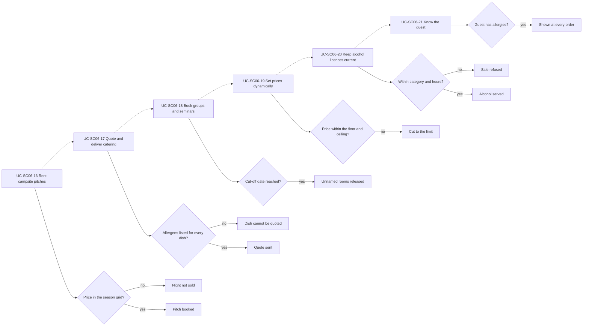
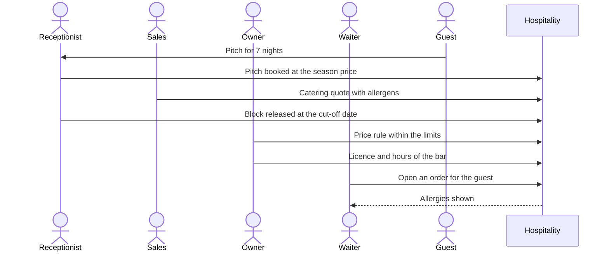

🏠 [Specs](../../../README.md) › 🏷️ [Sectors](../../README.md) › 🍽️ [SC06 Restaurant and hospitality](../README.md) ›
🔀 [Flows](README.md) › 🔀 FL-SC06-06 Campsites, catering, groups, pricing and licences

# 🔀 FL-SC06-06 Campsites, catering, groups, pricing and licences

**Status:** 🔄 waiting for the owner

## Summary

Six situations of hotels, restaurants and campsites: pitches priced by season, catering quotes with their allergens,
blocks of rooms for groups, rates that follow demand within limits, alcohol licences checked by the till, and guest
profiles with their allergies ([D550](../../../06-decisions/sectors/d550-benchmark-gaps-sc06-hospitality.md)).

## Personas

- [U28 Hotel receptionist](../../../01-users/personas/u28-hotel-receptionist.md), who books pitches and groups and keeps
  the profiles
- [U09 Customer](../../../01-users/personas/u09-customer.md), who books a pitch or a block
- [U03 Sales](../../../01-users/personas/u03-sales.md), who quotes catering
- [U19 Kitchen staff](../../../01-users/personas/u19-kitchen-staff.md), who prepares and delivers it
- [U13 Owner](../../../01-users/personas/u13-owner.md), who sets prices and keeps the licences
- [U18 Waiter](../../../01-users/personas/u18-waiter.md), who sees the allergies on the order

## Flowchart

## Sequence diagram

## Steps

| Step | Persona | Screen | Use case | What happens |
|---|---|---|---|---|
| 1 | [U28](../../../01-users/personas/u28-hotel-receptionist.md) | [S-SC06-16](../screens/06-campsites-catering-groups-and-pricing/s-sc06-16-campsite.md) | [UC-SC06-16](../use-cases/06-campsites-catering-groups-and-pricing/uc-sc06-16-rent-campsite-pitches.md) | The receptionist books a pitch for the dates at the price of each night's season, with the options |
| 2 | [U03](../../../01-users/personas/u03-sales.md) | [S-SC06-17](../screens/06-campsites-catering-groups-and-pricing/s-sc06-17-catering.md) | [UC-SC06-17](../use-cases/06-campsites-catering-groups-and-pricing/uc-sc06-17-quote-and-deliver-catering.md) | Sales quotes an event meal per head with the allergens and the kitchen delivers it |
| 3 | [U28](../../../01-users/personas/u28-hotel-receptionist.md) | [S-SC06-18](../screens/06-campsites-catering-groups-and-pricing/s-sc06-18-groups-and-seminars.md) | [UC-SC06-18](../use-cases/06-campsites-catering-groups-and-pricing/uc-sc06-18-book-groups-and-seminars.md) | The receptionist holds a block of rooms for a group and releases the unnamed rooms at the cut-off date |
| 4 | [U13](../../../01-users/personas/u13-owner.md) | [S-SC06-19](../screens/06-campsites-catering-groups-and-pricing/s-sc06-19-dynamic-pricing.md) | [UC-SC06-19](../use-cases/06-campsites-catering-groups-and-pricing/uc-sc06-19-set-prices-dynamically.md) | The owner sets rules that move the room rate within a floor and a ceiling |
| 5 | [U13](../../../01-users/personas/u13-owner.md) | [S-SC06-20](../screens/06-campsites-catering-groups-and-pricing/s-sc06-20-alcohol-licences.md) | [UC-SC06-20](../use-cases/06-campsites-catering-groups-and-pricing/uc-sc06-20-keep-alcohol-licences-current.md) | The owner keeps the licence, the permit and the hours of each venue and the till applies them |
| 6 | [U28](../../../01-users/personas/u28-hotel-receptionist.md) | [S-SC06-21](../screens/06-campsites-catering-groups-and-pricing/s-sc06-21-guest-profiles.md) | [UC-SC06-21](../use-cases/06-campsites-catering-groups-and-pricing/uc-sc06-21-know-the-guest.md) | The receptionist keeps the guest's profile and the waiter sees the allergies at every order |

### Entities and screens

| Entity | States in this flow | Shown at step and screen | Aggregated view |
|---|---|---|---|
| [E-SC06-13 Pitch](../data/e-sc06-13-pitch.md) | Draft, Open, Blocked, Retired | 1 [S-SC06-16](../screens/06-campsites-catering-groups-and-pricing/s-sc06-16-campsite.md) | Pitches |
| [E-SC06-14 Catering order](../data/e-sc06-14-catering-order.md) | Quoted, Confirmed, Delivered, Invoiced, Lost | 2 [S-SC06-17](../screens/06-campsites-catering-groups-and-pricing/s-sc06-17-catering.md) | Catering orders |
| [E-SC06-15 Group booking](../data/e-sc06-15-group-booking.md) | Option, Confirmed, Lapsed, Released, Closed | 3 [S-SC06-18](../screens/06-campsites-catering-groups-and-pricing/s-sc06-18-groups-and-seminars.md) | Group bookings |
| [E-SC06-16 Price rule](../data/e-sc06-16-price-rule.md) | Draft, Active, Paused, Retired | 4 [S-SC06-19](../screens/06-campsites-catering-groups-and-pricing/s-sc06-19-dynamic-pricing.md) | Price rules |
| [E-SC06-17 Licence](../data/e-sc06-17-licence.md) | Draft, Active, Expiring, Expired | 5 [S-SC06-20](../screens/06-campsites-catering-groups-and-pricing/s-sc06-20-alcohol-licences.md) | Licences |
| [E-SC06-18 Guest profile](../data/e-sc06-18-guest-profile.md) | Active, Dormant, Anonymised | 6 [S-SC06-21](../screens/06-campsites-catering-groups-and-pricing/s-sc06-21-guest-profiles.md) | Guest profiles |
| [E-SC06-08 Room reservation](../data/e-sc06-08-room-reservation.md) | Booked | Shown elsewhere: [S-SC06-08 Bookings](../screens/03-rooms-and-bookings/s-sc06-08-bookings.md) | Room reservations |
| [E-SC06-07 Rate plan](../data/e-sc06-07-rate-plan.md) | Active | Shown elsewhere: [S-SC06-07 Rooms and rates](../screens/03-rooms-and-bookings/s-sc06-07-rooms-and-rates.md) | Rate plans |

## Errors

- **E1 The sale is outside the licence hours.** The till refuses a sale of alcohol outside the category or the hours of
  the venue's licence and records the attempt
  ([BR-SC06-20](../business-rules/br-sc06-20-alcohol-is-served-within-the-licences-category-and-hours.md), step 5).

## Images

Every step and error, for each persona taking part, in light and dark mode (D120). Steps are numbered as in the Steps
table; E rows are the error cases.

| Step | Persona | Device | Light | Dark |
|---|---|---|---|---|
| 1 | U28 | desktop | [light](../images/06-campsites-catering-groups-and-pricing/u28-hotel-receptionist/1-campsite-desktop-light.png) | [dark](../images/06-campsites-catering-groups-and-pricing/u28-hotel-receptionist/1-campsite-desktop-dark.png) |
| 1 | U09 | phone | [light](../images/06-campsites-catering-groups-and-pricing/u09-customer/1-campsite-phone-light.png) | [dark](../images/06-campsites-catering-groups-and-pricing/u09-customer/1-campsite-phone-dark.png) |
| 1 | U28 | tablet | [light](../images/06-campsites-catering-groups-and-pricing/u28-hotel-receptionist/1-campsite-tablet-light.png) | [dark](../images/06-campsites-catering-groups-and-pricing/u28-hotel-receptionist/1-campsite-tablet-dark.png) |
| 2 | U03 | desktop | [light](../images/06-campsites-catering-groups-and-pricing/u03-sales/2-catering-desktop-light.png) | [dark](../images/06-campsites-catering-groups-and-pricing/u03-sales/2-catering-desktop-dark.png) |
| 2 | U19 | desktop | [light](../images/06-campsites-catering-groups-and-pricing/u19-kitchen-staff/2-catering-desktop-light.png) | [dark](../images/06-campsites-catering-groups-and-pricing/u19-kitchen-staff/2-catering-desktop-dark.png) |
| 2 | U03 | phone | [light](../images/06-campsites-catering-groups-and-pricing/u03-sales/2-catering-phone-light.png) | [dark](../images/06-campsites-catering-groups-and-pricing/u03-sales/2-catering-phone-dark.png) |
| 2 | U03 | tablet | [light](../images/06-campsites-catering-groups-and-pricing/u03-sales/2-catering-tablet-light.png) | [dark](../images/06-campsites-catering-groups-and-pricing/u03-sales/2-catering-tablet-dark.png) |
| 3 | U28 | desktop | [light](../images/06-campsites-catering-groups-and-pricing/u28-hotel-receptionist/3-groups-and-seminars-desktop-light.png) | [dark](../images/06-campsites-catering-groups-and-pricing/u28-hotel-receptionist/3-groups-and-seminars-desktop-dark.png) |
| 3 | U09 | phone | [light](../images/06-campsites-catering-groups-and-pricing/u09-customer/3-groups-and-seminars-phone-light.png) | [dark](../images/06-campsites-catering-groups-and-pricing/u09-customer/3-groups-and-seminars-phone-dark.png) |
| 3 | U28 | tablet | [light](../images/06-campsites-catering-groups-and-pricing/u28-hotel-receptionist/3-groups-and-seminars-tablet-light.png) | [dark](../images/06-campsites-catering-groups-and-pricing/u28-hotel-receptionist/3-groups-and-seminars-tablet-dark.png) |
| 4 | U13 | desktop | [light](../images/06-campsites-catering-groups-and-pricing/u13-owner/4-dynamic-pricing-desktop-light.png) | [dark](../images/06-campsites-catering-groups-and-pricing/u13-owner/4-dynamic-pricing-desktop-dark.png) |
| 4 | U28 | desktop | [light](../images/06-campsites-catering-groups-and-pricing/u28-hotel-receptionist/4-dynamic-pricing-desktop-light.png) | [dark](../images/06-campsites-catering-groups-and-pricing/u28-hotel-receptionist/4-dynamic-pricing-desktop-dark.png) |
| 4 | U13 | phone | [light](../images/06-campsites-catering-groups-and-pricing/u13-owner/4-dynamic-pricing-phone-light.png) | [dark](../images/06-campsites-catering-groups-and-pricing/u13-owner/4-dynamic-pricing-phone-dark.png) |
| 5 | U13 | desktop | [light](../images/06-campsites-catering-groups-and-pricing/u13-owner/5-alcohol-licences-desktop-light.png) | [dark](../images/06-campsites-catering-groups-and-pricing/u13-owner/5-alcohol-licences-desktop-dark.png) |
| 5 | U13 | phone | [light](../images/06-campsites-catering-groups-and-pricing/u13-owner/5-alcohol-licences-phone-light.png) | [dark](../images/06-campsites-catering-groups-and-pricing/u13-owner/5-alcohol-licences-phone-dark.png) |
| 6 | U28 | desktop | [light](../images/06-campsites-catering-groups-and-pricing/u28-hotel-receptionist/6-guest-profiles-desktop-light.png) | [dark](../images/06-campsites-catering-groups-and-pricing/u28-hotel-receptionist/6-guest-profiles-desktop-dark.png) |
| 6 | U18 | phone | [light](../images/06-campsites-catering-groups-and-pricing/u18-waiter/6-guest-profiles-phone-light.png) | [dark](../images/06-campsites-catering-groups-and-pricing/u18-waiter/6-guest-profiles-phone-dark.png) |
| 6 | U28 | tablet | [light](../images/06-campsites-catering-groups-and-pricing/u28-hotel-receptionist/6-guest-profiles-tablet-light.png) | [dark](../images/06-campsites-catering-groups-and-pricing/u28-hotel-receptionist/6-guest-profiles-tablet-dark.png) |
| E1 | U28 | desktop | [light](../images/06-campsites-catering-groups-and-pricing/u28-hotel-receptionist/e1-the-sale-is-outside-the-licence-hours-desktop-light.png) | [dark](../images/06-campsites-catering-groups-and-pricing/u28-hotel-receptionist/e1-the-sale-is-outside-the-licence-hours-desktop-dark.png) |
| E1 | U28 | tablet | [light](../images/06-campsites-catering-groups-and-pricing/u28-hotel-receptionist/e1-the-sale-is-outside-the-licence-hours-tablet-light.png) | [dark](../images/06-campsites-catering-groups-and-pricing/u28-hotel-receptionist/e1-the-sale-is-outside-the-licence-hours-tablet-dark.png) |

## Open questions

None.

---

⬅️ [FL-SC06-05 Taxes and performance](fl-sc06-05-taxes-and-performance.md) · ⬆️ [Up](README.md)
