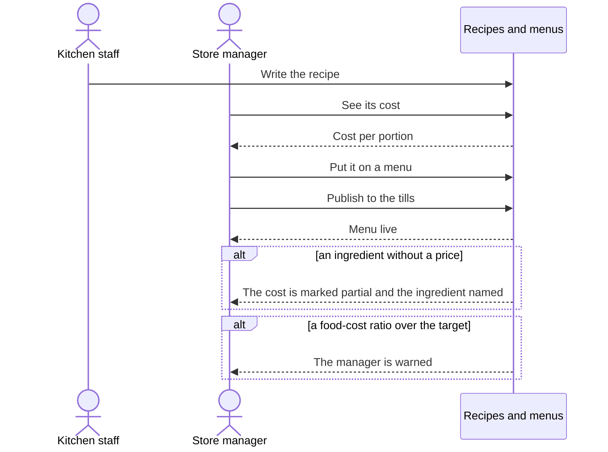

🏠 [Specs](../../../../README.md) › 🏷️ [Sectors](../../../README.md) ›
🍽️ [SC06 Restaurant and hospitality](../../README.md) › 📝 [Use cases](../README.md) ›
📝 [Use cases: FL-SC06-01 Menus and food safety](README.md) › 📝 UC-SC06-01 Cost recipes and build menus

# 📝 UC-SC06-01 Cost recipes and build menus

**Status:** ✅ specified

## Summary

The store manager and the kitchen write each dish's recipe with the shared recipes capability, see its cost from the
latest purchase prices, and put dishes on menus with their food-cost ratio.

## Personas

- [U23 Store manager](../../../../01-users/personas/u23-store-manager.md)
- [U19 Kitchen staff](../../../../01-users/personas/u19-kitchen-staff.md)

## Goal

Menus priced from what dishes really cost.

## Trigger

A new dish, a new menu or a price change of an ingredient.

## Frequency

Menus seasonally; costs follow every purchase.

## Preconditions

- The SC06 sector pack is installed for the company,
  [UC-F14-02](../../../../02-functional/f14-plugin-store/use-cases/01-find-and-install/uc-f14-02-install-a-plugin-or-sector-pack.md),
  and its users have their roles,
  [UC-F1-06](../../../../02-functional/f01-administration/use-cases/04-edit-a-role/uc-f01-06-edit-a-role-and-its-record-rules.md).

## Postconditions

- **Success:** the dish is on the menu with its price, cost and food-cost ratio.
- **Failed:** the dish stays off the menu.

## Main flow

1. The kitchen staff writes the recipe on
   [S-SC06-01 Recipes and menus](../../screens/01-menus-and-food-safety/s-sc06-01-recipes-and-menus.md): ingredients,
   quantities, yield and steps,
   [UC-F12-31](../../../../02-functional/f12-manufacturing/use-cases/09-recipes-and-batches/uc-f12-31-define-a-recipe-and-produce-in-batches.md).
2. SimpleERP costs it from the latest purchase prices and yields
   ([BR-SC06-04](../../business-rules/br-sc06-04-recipes-costed-from-purchases.md)).
3. The manager puts the dish on a menu with its price and sees the food-cost ratio.
4. The menu goes to the tills, QR menus and kiosks,
   [UC-F10-06](../../../../02-functional/f10-point-of-sale/use-cases/02-sell-at-the-counter/uc-f10-06-apply-prices-promotions-and-combos.md).

## Alternative flows

- 3a. A seasonal menu: it applies between its dates and the previous one comes back after.

## Error flows

- 2e. An ingredient without a price: the cost is marked partial and the ingredient named.
- 3e. A food-cost ratio over the target: the manager is warned (over 30 %).
- Any step: a call to a service or an outside system fails: it is retried first
  ([BR-F3-32](../../../../02-functional/f03-assistant/business-rules/br-f03-32-retry-before-an-error.md)), then the
  error message pattern ([D122](../../../../06-decisions/ux/d122-error-message-standard.md)) says what failed; what was
  typed is kept.

## Business rules

- [BR-SC06-04 Recipes costed from purchases](../../business-rules/br-sc06-04-recipes-costed-from-purchases.md)
- [BR-F12-26 Recipes scale to the batch and keep their tolerances](../../../../02-functional/f12-manufacturing/business-rules/br-f12-26-recipes-scale-to-the-batch-and-keep-their-tolerances.md)

## Entities

- [E-F12-25 Recipe](../../../../02-functional/f12-manufacturing/data/e-f12-25-recipe.md)
- [E-SC06-02 Menu dish](../../data/e-sc06-02-menu-dish.md)
- [E-F12-25 Recipe](../../../../02-functional/f12-manufacturing/data/e-f12-25-recipe.md)

## Permissions

The store manager and kitchen staff roles; the record rules of their role and site apply,
[UC-F1-06](../../../../02-functional/f01-administration/use-cases/04-edit-a-role/uc-f01-06-edit-a-role-and-its-record-rules.md).

## Notifications

None beyond the in-app updates of the records concerned.

## Audit events

Every creation, change and state change of recipe, menu dish, recipe records, with who, when and the values before and
after (T3).

## AI involvement

The AI assistant answers questions on the recipe, menu dish, recipe records of this use case, with links, and prepares
them as drafts the user confirms. It works within the user's rights,
[BR-F3-34](../../../../02-functional/f03-assistant/business-rules/br-f03-34-every-capability-is-reachable-from-the-assistant.md),
and never deletes or does anything irreversible without the user's confirmation,
[BR-F3-07](../../../../02-functional/f03-assistant/business-rules/br-f03-07-no-deletes-no-irreversible-acts.md).

## API, MCP and A2A exposure

Through the API and webhooks (T5) and the MCP and A2A gateway (T6), with the caller's rights,
[BR-F3-34](../../../../02-functional/f03-assistant/business-rules/br-f03-34-every-capability-is-reachable-from-the-assistant.md),
reading, creating and changing the records of this use case; nothing irreversible without a person's confirmation.

## Screens

- [S-SC06-01 Recipes and menus](../../screens/01-menus-and-food-safety/s-sc06-01-recipes-and-menus.md)

## Flowchart

See [FL-SC06-01 Menus and food safety](../../flows/fl-sc06-01-menus-and-food-safety.md#flowchart).

## Sequence diagram

## Acceptance criteria

1. **Given** the example restaurant group's Pesto pasta v2 costing 3.40 EUR sold at 14.50 EUR **when** it is put on the
   lunch menu **then** its food-cost ratio shows 23 %.
2. **Given** Pesto pasta v2 with pine nuts never bought **when** its cost is computed **then** the cost is marked
   partial and the ingredient named.

## Non-functional notes

[D408](../../../../06-decisions/technical/d408-performance-and-profiles.md)'s targets
([performance](../../../../05-non-functional/performance.md)): 95 % of screens within 1 second; lists paged on the
server, the first page within 1 second; reports within 5 seconds or in the background. WCAG 2.2 AA and RGAA
([D46](../../../../06-decisions/ux/d46-accessibility-standard.md)).

## Regulatory references

None specific to this use case; the sector's legal rules are listed in [SC06 regulatory](../../regulatory.md).

## Related use cases

- [UC-SC06-02 Show allergens and the home-made label](uc-sc06-02-show-allergens-and-the-home-made-label.md)

## Open questions

None open.

---

⬆️ [Up](README.md) ·
➡️ [UC-SC06-02 Show allergens and the home-made label](uc-sc06-02-show-allergens-and-the-home-made-label.md)
